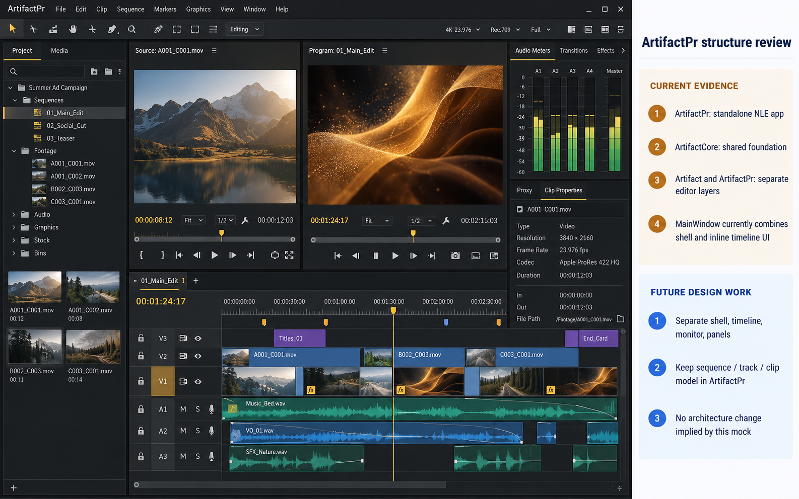

# ArtifactPr premium workbench and structure review

**最終更新:** 2026-10-19

**状態:** 検討用モック。未採用・未実装。

## 目的

ArtifactPr の制作中ワークスペースを、既存の NLE 編集責務を保って密度・階層・落ち着いた質感の観点から見直す。右側の注釈はアプリ UI ではなく、画面モックと現状のコード構成を混同しないためのレビュー欄。

## 現状確認

- `ArtifactPr/README.md` は ArtifactPr を独立した NLE アプリとし、sequence / track / clip 編集モデルを Artifact 側の Composition / Layer 編集面から分離すると説明している。共通基盤は ArtifactCore と共有する。
- `ArtifactPr/src/ArtifactPrMainWindow.cppm` は dock shell を組み立てる一方、TimelineClipWidget、TimelineRulerWidget、TimelinePanel など Timeline UI の複数クラスも同じ実装ファイル内に定義している。
- `ArtifactPr/src/ArtifactPrEditorEngine.cppm` にはシーケンス編集状態、永続化、再生・書き出し連携などが集約されている。`ArtifactPr/CMakeLists.txt` は個々の `.ixx` / `.cppm` を登録しているが、Timeline 専用モジュールは現時点で見当たらない。
- 既存の詳細な構成比較は `docs/analysis/REPORT_ARTIFACTPR_VP_RENDERING_VS_ARTIFACT_2026-08-31.md` と `docs/analysis/REPORT_ARTIFACT_PR_IMPLEMENTABILITY_2026-06-16.md` にある。いずれも現状把握資料であり、分割済みであることを示すものではない。

## モックの範囲

画面側には現行コードで確認できる Project / Media、Source / Program Monitor、Timeline、Audio Meters、Transitions、Effects、Proxy、Clip Properties の責務を配置した。内容・名称・データはデザイン用の例示であり、実装済み機能や採用済みレイアウトの証拠ではない。

構成レビュー欄では、現状として確認した分割の粗さと、将来検討する分割方向を分けた。Timeline UI を別モジュールへ切り出す、MainWindow を orchestration に限定する、EditorEngine の状態管理と処理責務を整理することは候補だが、このモックで決定・実装したものではない。NLE の正本である sequence / track / clip モデルは ArtifactPr に残す。

## 制約

画像生成による文字・アイコン・細部の差異、架空データ、配置は実装仕様にしない。コード構成の診断は静的なファイル確認に基づく。ビルド、テスト、ランタイム UI 比較は未実施。

## 実装フォローアップ（2026-10-19）

`TimelineClipWidget`、`TimelineRulerWidget`、`TransitionWidget`、`TimelinePanel` を `ArtifactPr.TimelinePanel` へ移し、MainWindow 側は dock 登録と他パネルとの接続を行う構成にした。NLE の sequence / track / clip モデルは ArtifactPr に残している。

`tests/ArtifactPr/TimelinePanelStandaloneTest.cpp` は MainWindow を生成せず、独立 executable から Timeline module を起動し、ruler、track、clip、zoom control が widget tree に存在する契約を確認する。`ARTIFACT_BUILD_PR_STANDALONE_TESTS` は任意の CMake option。ビルド・テスト・実画面の検証は未実施。

この変更は UI の最初の切り出しであり、EditorEngine の責務分割や残る Monitor / Inspector panel のモジュール化は未完了。
