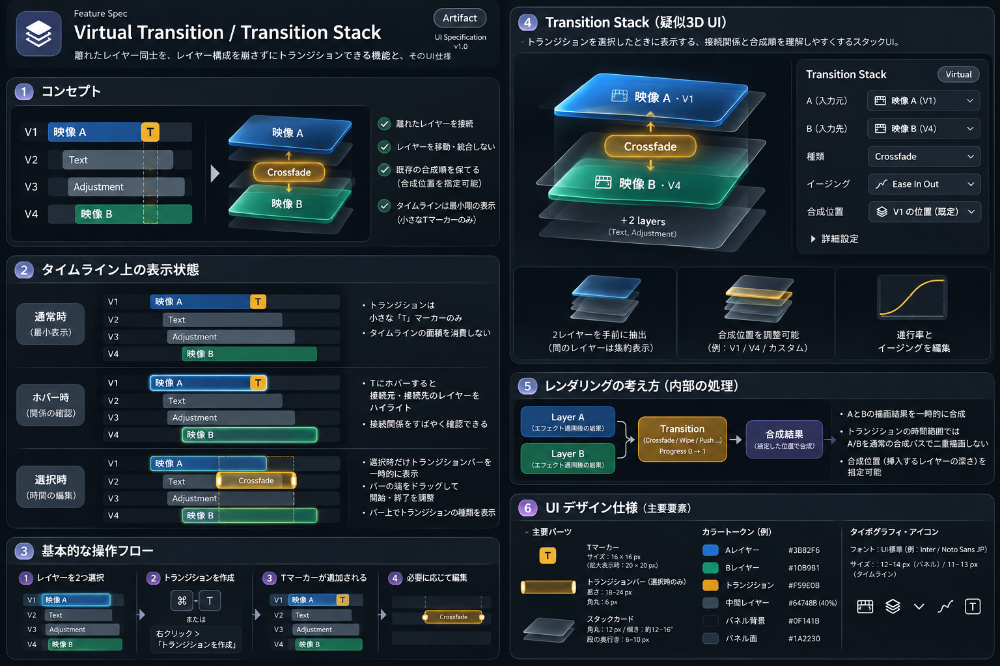

# Virtual Transition / Transition Stack — Project

**最終更新:** 2026-11-23
**ステータス:** In Progress

This folder preserves the original user-provided reference image. Its SHA-256 is `7D6D0902494C7B8E1C3EEDBDC576A7B0E6FFD089AD9CDFCC2C203613EAEAFF5E`.

## Project files

- Product requirements, implementation decisions, phases, and acceptance checks: [MILESTONE_VIRTUAL_TRANSITION_STACK_2026-11-20.md](../../planned/MILESTONE_VIRTUAL_TRANSITION_STACK_2026-11-20.md)
- Contract test target: `ArtifactVirtualTransitionStackContractTest` in `tests/Artifact/CMakeLists.txt`
- Model, timeline, and GPU kernel contract sources: `tests/Artifact/ArtifactVirtualTransitionStackContractTest.cpp` and `tests/Artifact/ArtifactVirtualTransitionGpuCrossfadeTest.cpp`
- Render integration design and remaining proposal (2026-11-20): [RENDER_INTEGRATION_DESIGN_2026-11-20.md](RENDER_INTEGRATION_DESIGN_2026-11-20.md) — A/B temporary composite, draw suppression, insertion ordering, Undo, and parity. Production draw-plan and UI status is recorded separately in the milestone; P3 pixel compositing and P4 parity remain incomplete.

The contract sources cover transition serialization and source identity, frame evaluation and cached source indices, simultaneous evaluation of disjoint transitions into a caller-reused workspace, compact timeline marker rendering, marker hover hit testing, draw-plan ordering, and the GPU crossfade kernel's pixel output at progress 0, 0.5, and 1. The Preview and Render Queue opacity paths now consume all active opacity-only transitions. Tests still do not prove GPU group composition, source draw suppression, or preview/final-render parity; those remain implementation and acceptance work in the milestone.

The UI scope includes the compact timeline marker, hover/selection source highlighting, selected range bar, and a dedicated Transition Stack editor. The first three have offscreen contract coverage. A modal editor exposes name, source A/B, kind, easing, frame range, stack position, and enabled state; its owner-drawn preview shows the A/B stack, transition, insertion position, and duration. Transition create/edit/duplicate/delete operations use an in-memory snapshot Undo command. The context-menu creation/type choices expose only Crossfade and Dissolve while Wipe/Slide render passes are unavailable. On 2026-11-23, the editor was opened and visually inspected in a hidden Windows Qt session, edited, applied, and reopened; the renamed entry appeared in the stack menu. Transition creation Undo/Redo was also exercised. Editing the dialog values with Undo/Redo remains unverified. Undo history persistence and collaboration dispatch remain outstanding.

The hidden UI runner uses the Windows Qt platform plugin with the app and transient top-level widgets hidden from the screen. It sends virtual Qt input through the localhost UI MCP endpoint and captures widgets through Qt; it does not inject OS input or capture the desktop. This validates the real widget event handlers without showing a Windows application window.

The 2026-11-23 run in the existing `out/build/x64-Debug-Agent` tree passed `ArtifactCoreTransitionRenderContractTest` (20/20 internal cases) and `ArtifactVirtualTransitionStackContractTest` (10/10), 2/2 CTest targets. These tests cover the existing model, timeline, draw-plan, and GPU-kernel contracts; they do not prove production GPU group composition or Preview/final parity. Runtime captures and the isolated app log are in the ignored `out/ui-offline-transition-verify/` directory.
