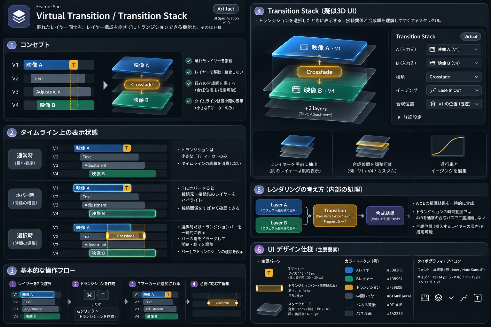

# Virtual Transition / Transition Stack

**最終更新:** 2026-11-21
**ステータス:** In Progress

**進捗:** 2026-11-20 — modelのinclusive overlap/progressとstackPosition JSON/API、TimelineのT marker/selected range、source highlight、管理メニュー、offscreen contract targetを追加済み。さらに `CompositionTimelineTransition` へ左右LayerIDを追加しJSON保存、既存name-onlyデータは一意名のみfallback解決、重複名は曖昧として解決しない。既存action data dispatcherからsource A/BをLayerIDで選び直せる。新規作成時に選択source IDを保存し、Timeline表示とpreview opacity評価はLayerID優先でsourceを特定する。legacy name-only sourceはcomposition読込後に一度だけ一意性確認してLayerIDへ移行し、frame evaluatorはfixed-size UUID byte arrayでsourceを判定し、全layer scanやPImpl LayerID copyをしない。実allocation計測は未実施。opacity-only transitionの共通frame evaluatorをcompositionに追加し、viewport preview・render queueのCPU/GPU pathから同じsource別opacity係数を使う。同じopacity係数はCut/Crossfade/Dissolveに限って各render pathへ適用する。composition側でlayer追加・挿入・移動・削除時にtransition sourceのstack index cacheを更新し、frame evaluation値へA/B indexとresolve済みinsertion indexを渡すようにした。index検索は変更時だけで、frame loopはcached indexを読む。テストsourceにはmove/insert/remove後、legacy JSON読込後、explicit stack位置のindex assertionを追加した。さらに、straight-alpha BGRA sourceをpremultiplied color/alphaで線形補間してstraight-alpha BGRAへ戻す専用GPU crossfade kernel/APIと、開始・中点・終点のGPU contract testを追加した。このkernelはまだcomposition render loopから呼ばれていない。現行render loopはまだinsertion indexを消費せず、A/Bの一時group合成・二重描画防止・stack insertionによる画素順変更は未実装。Wipe/Slide等のGPU transition pass、専用詳細editorも未実装。tests target/sourceは追加したが、ビルド・実行は禁止指示のため未確認。

**追加監査・進捗:** `evaluateTimelineTransitionAtFrame()` は範囲内の最初の1件だけを返すが、modelはsourceを共有しないtransition同士の時間重複を許可している。別source pairのtransitionが同時にactiveなら後続が各render pathから抜けていた。この不一致に対し、呼び出し側が容量を保持する `ArtifactArray` workspaceへactive結果を詰める `evaluateTimelineTransitionsAtFrame()` と、source判定／layerごとの係数集約APIを追加した。Preview controllerは既存CompositionChangedEventでworkspaceをcold reserveし、Render QueueのCPU/GPU経路はthread-local workspaceをtransition数に応じて再利用する。同時activeのcomposition contract testも登録済み。実行は未確認。これはsourceごとのopacity評価までであり、A/B group合成・通常描画抑止・stack insertionによる画素順変更は未実装。workspace成長がframe中に起きないruntime計測も未実施。

## 目的

離れたレイヤー同士を、レイヤー構成を統合せず遷移させる「Virtual Transition」を設計・実装する。遷移はレイヤーとは別の独立したタイムラインオブジェクトとして扱い、通常時は小さな `T` マーカーだけを表示する。選択・ホバー時には関係する2レイヤーを強調し、遷移区間の編集時だけ小さなバーを表示する。

この文書は添付された「Virtual Transition / Transition Stack」UI仕様画像を製品の要求資料として保存し、既存実装との対応、実装段階、契約テスト計画を固定する。画像の見た目をそのまま複製することではなく、下記の機能要件を実装対象とする。

## 既存実装の確認

- `Artifact/include/Composition/ArtifactAbstractComposition.ixx` に `CompositionTimelineTransition` があり、安定ID、名前、kind、easing、左右レイヤー名、frame range、enable状態を値型で保持する。
- `Artifact/src/Composition/ArtifactAbstractComposition.cpp` がJSON変換と追加・検索・更新・複製・削除APIを実装している。
- `Artifact/src/Widgets/Timeline/ArtifactLayerPanelWidget.cpp` に2レイヤー選択からCrossfade/Wipe/Slideを追加する既存入口と管理操作がある。
- `Artifact/src/Widgets/Timeline/ArtifactTimelineTrackPainterView.cpp` にTransition clipの描画・編集経路がある。
- `ArtifactAbstractComposition::evaluateTimelineTransitionAtFrame` がsource別opacity係数を返し、viewport previewとrender queue CPU/GPU pathがそれを利用する。これは従来のlayer描画へ係数を適用する実装であり、A/Bの一時group合成やstack insertionを行わない。その他のkindは専用GPU pass待ちで、離れたsourceの時間対応も実装されていない。
- `docs/planned/MILESTONE_TRANSITION_EFFECTS_RD_2026-11-12.md` は `ArtifactCore` の画像transition群を対象にしたR&Dであり、このcomposition-level機能とは別経路。画像transitionの品質やGPU経路がComposition側で利用可能だとは仮定しない。

以上から、最初に既存モデル/API/UIとundo・保存・評価経路の接続を監査し、既存オブジェクトを再利用できる範囲を確定する。別のtransitionモデルを先に重複追加しない。

## 製品要件

### データと意味

1. Transitionはレイヤーを作成・移動・統合・再親子化しない独立オブジェクトである。
2. source A、source B、transition kind、easing、duration/range、compositing insertion positionを保持する。
3. 合成位置は明示されたレイヤー深度または既定のA位置で解決し、遷移中の一時結果をその位置へ合成する。周辺レイヤーは既存順序で合成される。
4. 遷移は指定範囲内でA/Bを一時合成し、その区間外の通常レイヤー描画を維持する。transition区間中にA/Bを通常合成パスで二重描画しない。
5. 保存・再読込・複製・削除・enable切替・kind/easing/range/stack位置変更でID参照と結果が一貫する。不正または欠落したsourceを安全に扱う。
6. 複数transitionが同一レイヤーを参照する場合、重複時間範囲と合成順の規則を明文化する。初期実装で曖昧な組み合わせは拒否または警告し、暗黙順序に依存させない。

### Timeline表示と操作

- 通常時: 最小表示として `T` マーカー。レーン面積を常時占有しない。
- hover/選択時: 接続元と接続先のレイヤーを識別可能にハイライトし、関係を確認できる。
- 選択時: duration barと両端ハンドルを表示し、開始・終了を編集できる。
- バーには現在のtransition名/kindを識別可能に示す。表示密度が足りない場合は詳細をtooltipまたは既存の編集面に委譲する。
- marker位置、bar範囲、snap、選択、undo/redoは既存timeline操作・command規約へ接続する。
- 新規signal/slot、ReactiveEvents、中央イベントバスを追加しない。既存の公開API/command/描画経路を使用する。接続変更が避けられない場合は実装前に設計レビューする。

### Transition Stack（疑似3D UI）

選択transitionの詳細編集面は、A/Bの合成関係と積層位置を理解しやすく表す。疑似3Dスタック表示は編集対象の説明に限り、viewport内に新しい3D gizmo/HUD/overlayを持ち込まない。

- A（入力元）、B（入力先）、kind、easing、合成位置を編集可能にする。
- 合成位置候補はA位置、B位置、明示的なstack位置を含む。実装時に既存のcomposition order規則との対応を確定する。
- 詳細設定はduration/frame range、方向・originなどkind固有パラメータ、境界条件を含む。未対応parameterをUIだけに表示しない。
- Stack図は選択したA/Bと、その間にあるレイヤー数・代表名を示す。レイヤー順の変更や統合を図から実行しない。
- UIは既存のtheme/palette/owner-draw方式を使い、Qt stylesheetを追加しない。

## 実装計画と完了条件

### Phase 0 — 実装前の契約監査

- `CompositionTimelineTransition` のシリアライズ、snapshot、undo、duplicate、range edit、timeline painterからrender evaluationまでの経路を追跡する。
- 現行render evaluatorでtransitionが実際に適用されるkind、source順、alpha/color契約、挿入位置の定義を記録する。
- 「合成位置」と「離れたsourceの時間対応」の曖昧点を設計決定として記録する。画像仕様の例だけで推測しない。
- 結果を同ファイルの「実装時の決定」へ追記してからproduction codeに着手する。

### Phase 1 — Model contract

- 必要なら既存transition値型へ最小限のstack position／stable source identityを追加する。layer nameだけで安定参照できるかを先に確認し、既存ID体系と整合させる。
- JSON round-trip、旧データ既定値、ID衝突、欠落source、invalid range、unknown kindの扱いを固定する。
- composition snapshot、duplicate/copy、undo/redo、enable/disable、range変更に新しい値が保存されることを確認する。

### Phase 2 — Evaluation contract

- 指定時間のA/B評価、easing/progress、transition固有処理、一時合成、stack挿入を副作用なく評価できる境界を設計する。
- 区間外の通常合成との同値性、区間内の二重描画防止、3層以上での挿入順、alpha/color契約を保証する。
- frameごとの大容量確保・GPU resource再生成を持ち込まず、既存のホットパスworkspace/cacheを再利用する。コールドパスで必要な容量確保は境界を明確にする。
- `QImage`、`QPainter`/Qt CompositionMode、新規signal/slot、ReactiveEventsを描画・合成経路へ導入しない。

### Phase 3 — Timeline interaction

- T marker、hover/selectionによるsource highlight、selected-only duration bar、range trim、snap、既存undo経路を実装する。
- normal/hover/selected状態の描画と hit-test を既存owner-drawの責務に沿わせる。
- 選択数バッジや常時表示の追加laneを導入しない。通常時のタイムライン占有量が最小であることを確認する。

### Phase 4 — Transition Stack editor

- 既存の専用panel/editor責務を確認し、適切な既存surfaceへstack viewとproperty editorを配置する。
- A/B/kind/easing/range/stack positionの各変更をmodel・undo・render evaluationへ一貫して反映する。
- テストでstack positionを変更したときevaluationの出力順序が変化すること、A/Bソースが通常passで二重合成されないことを確認する。前者は現段階で未実装を検出する契約テストを追加し、完成条件はまだ満たさない。
- ja/enを必須とし、設定可能ロケールja/en/zh/zh-TWを確認する。追加ロケールが増えた場合はその全てを含める。

### Phase 5 — parity and acceptance

- 保存／再読込後も同一フレーム出力、stack位置、選択・表示状態が仕様どおりである。
- Previewと最終renderで同じtransition evaluatorと結果を用いる。
- 静止画だけでなく連続フレーム、複数layer、alpha境界、odd dimensions、端点、disabled、欠落sourceを確認する。
- ユーザー向けテスト実行前に関連テストとcapture条件を確定する。ビルド／テスト／CMakeは明示指示があるまで実行しない。

## テストプロジェクト

テストは既存 `tests/Artifact` の構成に追加した `ArtifactVirtualTransitionStackContractTest` target/sourceから開始する。別の実行可能プロジェクトは既存targetが不適切と分かった段階で検討する。登録は `ARTIFACT_BUILD_TESTS` または `ARTIFACT_ENABLE_IMAGE_EFFECT_TESTS` 条件下。ソースは追加済みだが、リポジトリ指示により未build・未実行。

### Test group A — Model/persistence

- TransitionのJSON round-tripで全フィールドとstable IDが保持される。
- 旧JSONに新規任意フィールドがない場合、定義済み既定値を採用する。
- add/update/duplicate/remove/enable/clear後にsource・ID・順序が正しい。
- invalid range、同一source、missing source、unknown kind、重複IDの契約を確認する。
- composition save/reload、snapshot、undo/redoでtransition情報が一致する。

### Test group B — Timeline interaction contract

- 通常状態はmarkerのみを表示し、selected状態だけduration bar/hit regionが有効。
- hover/selectionは指定したsource A/Bだけを強調し、他layerを誤強調しない。
- trim/move/snap後のrangeとplayhead位置がframe単位で正しい。
- paint-state fixtureまたは既存のoffscreen公開経路で通常/hover/selectedを検査する。評価のためだけの新しい内部イベント配線を作らない。
- UI captureは `ja`, `en`, `zh`, `zh-TW` と対象surfaceで選択可能な追加ロケールを個別指定する。

### Test group C — Evaluation/render contract

- progress 0/1でsource A/Bの期待結果に一致し、中間progressは設定kind/easingの契約を満たす。
- 同一区間のA/Bが通常passで重複合成されない。
- sourceが異なる2組以上のtransitionが同時activeなとき、全組が同じframe progressで評価され、Preview/Render Queueのopacity係数に反映される。評価API・呼び出し側workspace・contract testは追加済みだが、GPU画素合成とstack insertionは未実装。
- insertion positionをA/B/明示stack indexへ変えたとき、周辺layerとの前後関係が期待どおり。
- 遷移区間外のpixel出力が既存通常合成と一致する。
- 中間layerを含む3+ layer、逆向きsource、disabled、重複・隣接transitionを検査する。
- alpha 0/77/128/255、transparent hidden RGB、異なるsource寸法、odd dimensions、境界pixelを含む決定的人工fixtureを使う。
- GPU crossfade kernel単体のcontract testでprogress 0/0.5/1、直alphaの補間、premultiplied RGB境界、alpha端点を検査する。kernel単体の成功は通常render loop統合やPreview/final parityの証明としない。
- previewと最終renderの同一frame hashまたは定義済みpixel toleranceを比較する。CPU/GPU経路は個別に識別し、未確認のparityを主張しない。

### Test group D — 時間連続性・負荷観測

- 固定fps/durationで全frameを保存し、progress mapping、連番、欠落、端点、隣接frame差分を解析する。
- 人工色ブロック、番号付き象限、細線格子、alpha境界を使い、source由来画素、seam、flicker、急なprogress変化を人が確認できるレビュー出力を用意する。
- timingはraw sampleとbuild/backend/host条件を記録し、閾値を基準capture取得前に決めない。
- hot path allocationとGPU resourceの再生成を観測し、フレームごとの大容量allocationがないことを確認する。

### Fixtureと証跡

- 決定的入力fixture、評価計画、capture script、manifest schemaは `experiments/VirtualTransitionStack/` に配置する。
- fixtureは小容量の人工素材を優先する。生成captureは `experiments/VirtualTransitionStack/captures/` に置き、通常はGit追跡しない。
- 採用する最終証跡だけ、manifestに対象・条件・取得日・出所・SHA-256を記録し、個別ファイルとして明示的に追加する。
- blind reviewを使う場合、割当鍵を独立レビュー完了まで追跡対象にしない。

## 実装時の決定

| 項目 | 状態 | 決定／根拠 |
|---|---|---|
| Transition sourceの安定参照 | 暫定決定 | 新規transitionは左右LayerIDを保存。旧JSONは一意なlayer nameに限りfallbackし、同名layerが複数ある場合は曖昧としてsource未解決にする。layer削除後の修復UIは未実装。 |
| Stack位置の保存形式 | 暫定 | `stackPosition=-1` はsource A位置、0以上はlayer stack indexとしてJSON保存。実rendererへの適用とlayer reorder後の安定性は未決。 |
| 異なる時間範囲のsource評価 | 未決 | source time remap、延長、hold、欠落時fallbackの既存契約を調査する。 |
| overlapするtransition | 決定 | inclusive frameでsourceを共有して重なるtransitionはmodel APIで拒否する。将来、同一sourceへの並列transitionが必要なら仕様変更する。 |
| render insertion point | 設計提案（要承認） | layer loop の `insertionIndex` 到達時に transition 合成を先に描画し、A/B は通常 pass をスキップ。同一 index は transition ID 辞書順。詳細は [描画統合設計](../design/virtual-transition-stack/RENDER_INTEGRATION_DESIGN_2026-11-20.md) D1/D4。 |
| Undo/Redo接続 | 未実装（調査完了） | transition 用 UndoCommand は皆無で UI が setter を直接呼ぶ。snapshot command + `setTimelineTransitions()` 経由を提案。Project の Composition 複製も transition を落とす。詳細は同設計 D6。 |
| Preview/final parity | 未達（設計提案） | 複数 API は preview GPU と CPU final のみが利用。GPU final は未接続、preview direct fallback は係数未適用。3 経路を同じ draw plan へ統合する方針を同設計 D7 に記載。 |
| 未実装 kind の露出 | 決定（2026-11-21） | Wipe/Slide は pass 完成まで UI から隠す。model は未知 kind を安全な no-op として扱い保存互換を維持（同設計 D5）。 |

### 2026-11-20 実装更新

- `CompositionTimelineTransition::stackPosition` は -1 を旧動作（outgoing layer位置）として保存する。JSONにキーがない旧データも -1 を使う。
- `setTimelineTransitionStackPosition` は -1以上だけを受け付け、ID指定で値を更新する。
- Composition APIは同じlayer sourceを1つでも共有するtransitionについて、inclusiveなframe rangeが重なる場合は拒否する。既存rangeの終端フレームの次からは追加できる。追加・range更新・一括設定に同じ制約を適用する。
- ここでのstackPositionは保存可能なmodel値であり、context menuから編集できるが、rendererの挿入位置には未適用。
- `ArtifactVirtualTransitionStackContractTest` target/sourceはJSON既定値／round-trip、source LayerIDとrename/ambiguous legacy resolution、shared opacity evaluator (Crossfade/Dissolve/Cut)、source競合、easing progress、stack position編集、duplicate位置、composition save/reload、offscreen marker/range描画差を対象にする。実行未確認。
- `FrameEvaluationCarriesEditedStackPosition` とsource reorder/insert/remove assertionは、layer order変更時のcache更新とruntime insertion index計算だけを検査する。実際のrender insertion orderやA/B通常描画の置換は検査せず、別の未実装契約として残る。
- 現行Timeline表示では常設laneを追加せず、source A行へTマーカーを置く。marker選択は既存 `TimelineLayerSelectionRequestedEvent` を再利用し、layer selectionとは分離したtransition IDを保持する。Diligent snapshotにもhover/selection時のsource highlightを渡す。
- Context menuのstack-position editorは保存値の入力まで対応するが、評価・compositing処理は未接続。このため位置変更が最終画素順を変えるとはまだ保証しない。
- 2026-11-20: 残ギャップ（G1〜G9）のコード監査と実装設計を [描画統合設計](../design/virtual-transition-stack/RENDER_INTEGRATION_DESIGN_2026-11-20.md) に記録した。
- 2026-11-21: D5（Wipe/Slide を UI から隠す）と D3（一時合成は source A の blend を継承し opacity 1.0）が承認された。P1 として draw plan（`CompositionTimelineTransitionDrawStep` / `buildTimelineTransitionDrawPlan()`）を model に追加し、preview GPU と render queue の CPU/GPU 経路を step 消費へ接続した。
- 2026-11-21: P2 として source A/B を insertionIndex 直前へ移動する Layer step を生成し、自然位置での二重描画を抑制した。stackPosition 変更が画素順へ反映される構造になった（kernel 接続は P3、parity は P4）。契約テストの期待値を更新。
- 2026-11-21: ユーザ許可で既存 `out/build/x64-Debug-Agent` を使用してビルド・テスト実行。`ArtifactVirtualTransitionStackContractTest` はビルド成功。offscreen QWidget の2件を除外した model / draw-plan / GPU kernel は 8/8 Pass。`StableSourceIdsSurviveRenameAndLegacyNamesMustBeUnique` の insertion index 期待値は実測に合わせ修正。フル CTest は一度30秒 timeout、最新実行は marker test 開始時に3.76秒で失敗終了し診断なし。marker と hover UI の単独テストも応答停止し、UI 描画は未検証。最初に Ninja 1.12.1 の stale C++ module dyndep assertion が発生したが、既存 build tree の生成物を clean した後にビルド成功。Artifact 子リポジトリのソース変更なし。

## 画像参照の意味

画像から採用する要求は、離れたlayer間のtransition、minimal marker、関係layer highlight、selected-only range bar、source A/B・kind・easing・合成位置の編集、積層関係の理解しやすさである。図中の具体色、疑似3D見た目、ショートカット表示は既存theme・shortcut規約の確認前に固定しない。Composition Viewport内の既存ギズモ・overlay・描画入力仕様をこの画像から変更しない。

