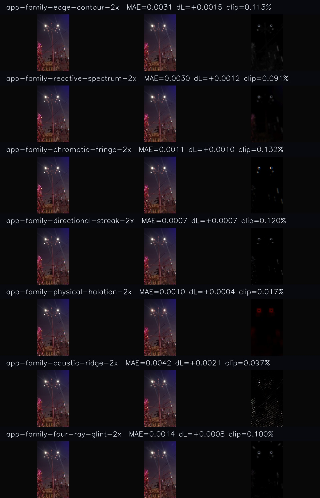

# CC0 Street-light Glow-family transfer — RD1

**最終更新:** 2026-11-11

## Purpose

Check whether distinct installed Glow specialists retain recognizable roles when a restrained lineup calibrated on a CC0 neon-city photo is transferred to a different photographic practical. This is a same-source comparison of standalone effects; no common Glow foundation is applied. The purpose is role separation and material-response research, not preset acceptance.

## Capture conditions

- Input: `assets/cc0-street-light-night.jpg`, 576×1280, CC0 1.0; provenance and SHA-256 `b01e663da4cada43f95b936d88ed377244680b56c41929d2d621d087d7224eb8` are recorded in `assets/SOURCES.md`.
- Path: `ArtifactUiTest` installed CPU effect output, Japanese locale, 8-bit PNG. The executable SHA-256 is recorded in each product manifest. This is not final Composition Viewer output, GPU output, or HDR evaluation.
- Families: Edge Bloom, Reactive Glow, Chromatic Glow, Directional Glow, Physical Halation, Luminescence Caustics, and 4-ray Glint. Each starts from the same source pixels.
- Two rounds: the restrained city-lineup profile; then a 2× amplitude visibility probe with shape, threshold, and color controls fixed. The profiles and exact property values are in `glow_suite_family_streetlight_singletons_rd1.json` and `glow_suite_family_streetlight_rolepop_rd1.json`.
- Manual bulb ROIs use normalized bounds left `[.195,.325,.315,.395]` and right `[.585,.325,.705,.395]`. The reviewer records encoded 8-bit RGB MAE, newly clipped channel fraction, source/output hashes, and alpha MAE. Local difference crops display signed RGB deltas at 5× around neutral gray.

## Results

All 14 outputs preserve alpha exactly. Across the restrained round, whole-frame newly clipped channels are below 0.10%, but localized clipping around the two bulbs ranges from 0.41–4.37% on the left and 0.47–3.88% on the right. In the 2× probe, whole-frame new clipping remains below 0.14%, while the lamp ROIs reveal much higher family-specific costs:

| Family | Left bulb new clip | Right bulb new clip | Local signature in amplified crop |
|---|---:|---:|---|
| Edge Bloom | 4.77% | 4.17% | Softened bright contour; broad response |
| Reactive Glow | 4.21% | 3.66% | Broad response close to Edge Bloom at this setting |
| Chromatic Glow | 6.19% | 5.39% | Distinct blue/cyan fringe around the bulb |
| Directional Glow | 4.88% | 4.28% | Added streak response remains subtle beside baked-in lamp beams |
| Physical Halation | 0.72% | 0.71% | Red-dominant spread, distinct from the neutral bloom families |
| Luminescence Caustics | 4.02% | 1.30% | Local structure; response differs strongly between bulbs |
| 4-ray Glint | 4.61% | 3.99% | Compact star response is hard to distinguish at full-image scale |

The 2× contact sheet preserves the input's portrait aspect ratio. Enlarged bulb ROIs make the Chromatic, Halation, and Caustics signatures easier to compare. Edge/Reactive and Directional/Glint remain weakly separated at normal full-image scale. Doubling amplitude improves visibility for some roles but spends too much local headroom for several candidates; none is selected as a product default. ROI percentages describe these specific already-bright bulbs and are not universal pass thresholds.

Left and right 1:1 ROI evidence: [left practical](captures/glow-suite-family-streetlight-rolepop-rd1/review/roi/left-practical-contact.png), [right practical](captures/glow-suite-family-streetlight-rolepop-rd1/review/roi/right-practical-contact.png). Full-frame measurements: [restrained round](captures/glow-suite-family-streetlight-singletons-rd1/review/family-streetlight-singletons-contact.json), [2× round](captures/glow-suite-family-streetlight-rolepop-rd1/review/family-streetlight-rolepop-contact.json). Detailed ROI measurements are stored under each capture's `review/roi/streetlight-roi-metrics.json`.

## Interpretation and next work

City-tuned strength does not transfer directly to a differently exposed practical. Whole-frame averages hide local clipping on small lamps. Next, tune threshold/exposure response by family and compare native-scale role visibility against practical-local headroom. Edge versus Reactive and Directional versus Glint need stronger role separation before any paired recipe is promoted. Still-open gates include final Viewer/GPU parity, HDR/linear response, temporal stability, processing time, and allocation behavior.

A separate portrait-plate trial was excluded from this CC0 report because the asset has no provenance record in `assets/SOURCES.md`.
