# Lens Flare Optics Evaluation

**最終更新:** 2026-10-28

## Prescription surface-scatter pupil-cone study

`evaluate_prescription_surface_scatter.py` traces a regular pupil bundle
through all 14 prescription surfaces at 550 nm and reports the accepted full
path ray count and per-surface r50/r90/r99/RMS bundle radius. With a 64x64
sample, the accepted rays were 4096/4096 at 0, 5, and 10 degrees, and 2362/4096
(57.7%) at 12 degrees. The surface-0 r90 stayed near 5.06 mm, while surface-13
r90 decreased from 2.841 mm on axis to 2.413 mm at 12 degrees. This confirms
that a single invariant pupil-radius parameter cannot represent all surfaces
and fields in this prescription. Increasing the grid from 32² to 64² moved the
reported surface-13 r90 by less than 0.6% at both 0 and 12 degrees.

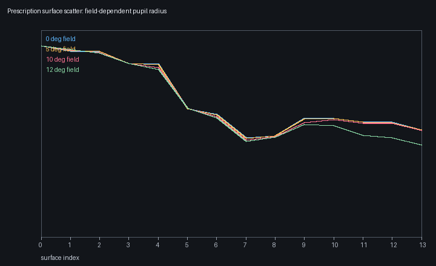

The companion image uses Peterson's per-surface focal-plane irradiance equation
(Eq. 8), with `a_j` approximated by the traced r90 beam radius and field
throughput approximated by the full-path acceptance fraction. The reference
uses f/22, 80% post-scatter system transmission, and generic Harvey parameters
from Ritt et al.'s generic Double-Gauss example; none are measured properties
of the bundled Angenieux prescription. The equation predicts how each surface's
cone radius changes the scatter amplitude and radial falloff, so the surfaces
are no longer assigned equal weights. See [Ritt et al. (2020)](https://www.mdpi.com/1424-8220/20/21/6308).

This remains an exploratory image, not a calibrated exposure prediction. It
does not include per-surface measured BSDF/TIS, actual coating scatter,
contamination, full post-scatter ray clipping, aberration, sensor response, or
measured stray-light references. The scalar throughput proxy and r90 beam
radius require validation against a non-sequential optical model or measured
PSF before the image can support production settings.

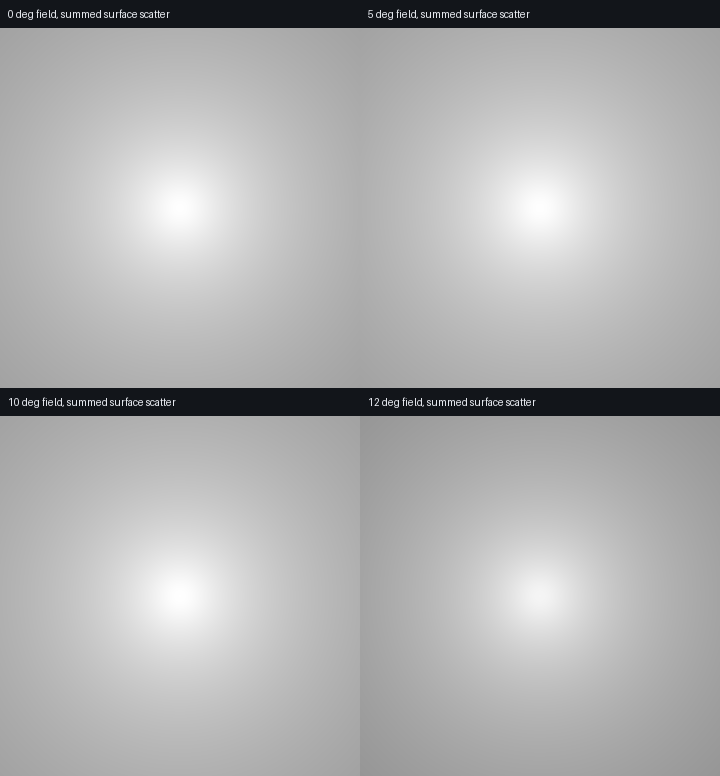

Reproduce the study with `python tools/LensFlareLab/evaluate_prescription_surface_scatter.py
--grid 64`. The image uses the generic Harvey parameters `S=-1.86`, `B=0.36`
and `L=2.04 mrad`; `--transmission` and `--na` control the stated system
assumptions. Increase `--grid` to check pupil sampling convergence before
using these radii as inputs to a future per-surface render model.

### Elliptical pupil-footprint sensitivity

`evaluate_elliptical_pupil_scatter.py` retains the traced hit points on each
surface and compares the circular r90 approximation with a 90%-coverage
covariance ellipse. The ellipse's equivalent radius preserves its area; a
directional radius then replaces the circular radius in the radial falloff.
This is an exploratory extension of the circular per-surface model in
[Ritt et al. (2020)](https://www.mdpi.com/1424-8220/20/21/6308), not a published
anisotropic BSDF formulation. In particular, mapping each surface's ellipse
orientation directly to image-plane directions is an unvalidated assumption.

The image plate compares both models on the same 5.5 µm-pitch central crop and
shared display range. Red in the difference panel means the elliptical model
is brighter; blue means the circular model is brighter. Crop totals were:

| Field | 32² delta vs circular | 64² delta | 128² delta | Median ellipse axis ratio at 64² |
|---:|---:|---:|---:|---:|
| 0° | 0.000% | 0.000% | 0.000% | 1.000 |
| 5° | −0.001% | +0.007% | +0.001% | 1.002 |
| 10° | +0.017% | +0.015% | +0.022% | 1.011 |
| 12° | +0.815% | +0.835% | +0.828% | 1.057 |

At 12°, five of fourteen surface bundles exceed a 1.1 major/minor axis ratio;
the maximum is 1.73. The total crop prediction still moves by less than 0.84%,
and the result is stable from 32² through 128². For this lens, generic BSDF,
and small central crop, the circular r90 approximation remains adequate for
total captured energy. The visible red/blue difference pattern shows where the
directional shape would alter the image, but its pixel-level value remains
unverified until compared with a measured or non-sequential scatter reference.

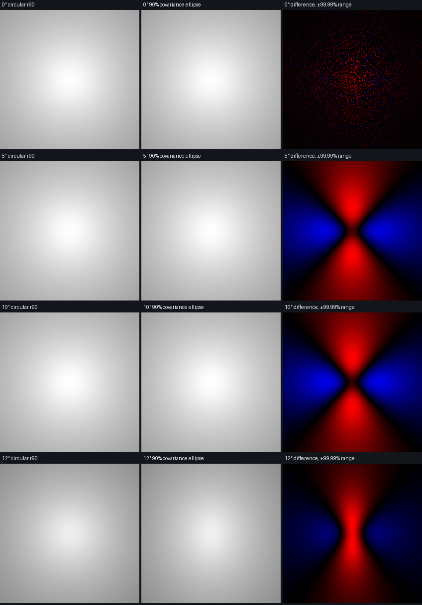

The field summary and per-surface ellipse axes are in
[`elliptical-pupil-scatter.csv`](examples/elliptical-pupil-scatter.csv) and
[`elliptical-pupil-scatter-surfaces.csv`](examples/elliptical-pupil-scatter-surfaces.csv).
Reproduce with `python tools/LensFlareLab/evaluate_elliptical_pupil_scatter.py
--grid 64`; `--grid 32` and `--grid 128` reproduce the sampling comparison.

### Harvey roll-off and finite-sensor capture

The same prescription-derived on-axis cones were evaluated at four roll-off
angles. The raster is a 720² central crop at 5.5 µm pitch (3.96 mm square),
not the prescription's full 53.96 mm sensor. Per-pixel irradiance is integrated
to estimate scatter power captured by this crop. The full-plane reference is
14 times the generic Eq. 6 TIS, multiplied by the assumed 80% transmission.
Results are:

| L (mrad) | Surface TIS integral | Eq. 6 TIS | 3.96 mm crop / incident | Crop / full-plane Eq. 6 |
|---:|---:|---:|---:|---:|
| 0.5 | 0.2000% | 0.2016% | 0.7105% | 31.46% |
| 1.0 | 0.1995% | 0.1908% | 0.5898% | 27.60% |
| 2.04 | 0.1976% | 0.1785% | 0.4546% | 22.73% |
| 4.0 | 0.1920% | 0.1657% | 0.3197% | 17.22% |

The narrower BSDF roll-off concentrates more of the modeled scatter inside
this local crop. The crop fractions are lower than the full-plane estimate
because Harvey wings extend beyond this crop; they do not say how much light
falls on the complete sensor. They are numerical results for this assumed
model and are not measured lens efficiencies.

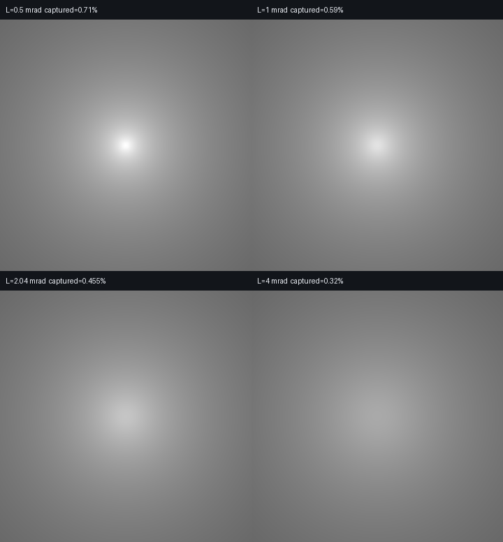

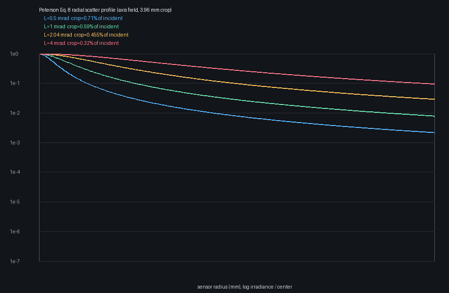

The per-radius values and repeated energy-integral diagnostics are saved in
[`prescription-surface-scatter-profile.csv`](examples/prescription-surface-scatter-profile.csv).

### Generic versus measured Harvey parameters

To quantify how much the predicted image depends on missing lens-specific
surface data, `compare_scatter_parameter_sets.py` applies two published
parameter sets to the exact same traced Angenieux pupil cones. The first is the
paper's generic Double-Gauss set (`S=-1.86, B=0.36 sr⁻¹, B0=6.92,
L=2.04 mrad`). The second is the median measured Fr3 achromatic-doublet #8 set
(`S=-2.22, B=1.09 sr⁻¹, B0=16.14, L=3.02 mrad`). Ritt et al. identify Fr3 as
measured values for a distinct achromatic doublet, so this is a roughness-data
sensitivity comparison only; those coefficients do not describe the bundled
Angenieux lens.

| Parameter set | Surface TIS integral | Eq. 6 TIS | 3.96 mm crop / incident | Crop / full-plane Eq. 6 |
|---|---:|---:|---:|---:|
| Generic Double-Gauss | 0.1975% | 0.1785% | 0.4543% | 22.72% |
| Measured achromat Fr3 #8 | 0.2954% | 0.2921% | 1.3678% | 41.81% |

The measured set produces about 3.0× more crop energy than the generic set in
this transferred model. The difference combines parameter changes and cannot
be interpreted as the expected flare ratio between those actual lenses; their
prescriptions, coatings, baffles, and sensor geometry differ.

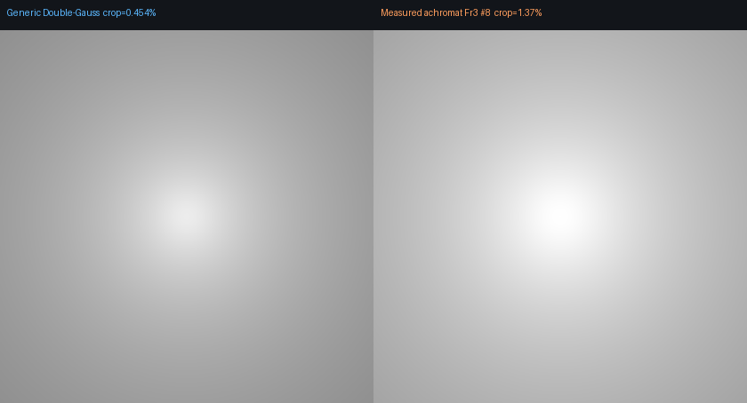

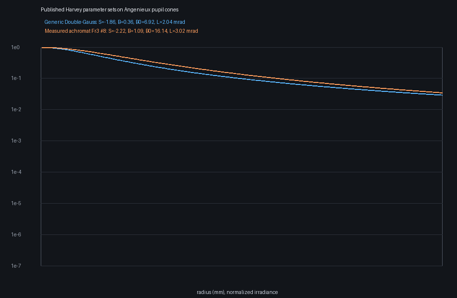

Per-radius values and energy integrals are saved in
[`scatter-parameter-comparison.csv`](examples/scatter-parameter-comparison.csv).
Reproduce the comparison after regenerating the 64x64 cone table with
`python tools/LensFlareLab/evaluate_prescription_surface_scatter.py --grid 64`,
then run `python tools/LensFlareLab/compare_scatter_parameter_sets.py`.

### Spectral scatter traced through the prescription

`evaluate_prescription_spectral_surface_scatter.py` applies the limited-band
Harvey wavelength scaling law to the Angenieux prescription's 14 surfaces.
Unlike the spectral reference image above, it re-traces the pupil bundle at
610/550/460 nm, so glass dispersion changes each surface's r90 cone radius and
the accepted full-path ray count before Peterson Eq. 8 is evaluated per
surface. The 64² trace accepted all rays at 0°, 5°, and 10°. At 12°, acceptance
was 2400/4096 red (58.59%), 2362/4096 green (57.67%), and 2258/4096 blue
(55.13%).

| Field | Red crop | Green crop | Blue crop | Blue / red |
|---:|---:|---:|---:|---:|
| 0° | 0.3475% | 0.4546% | 0.7187% | 2.068× |
| 5° | 0.3483% | 0.4555% | 0.7202% | 2.068× |
| 10° | 0.3502% | 0.4580% | 0.7239% | 2.068× |
| 12° | 0.2098% | 0.2699% | 0.4076% | 1.944× |

The 32²-to-64² crop fractions changed by less than 0.4% for every field and
band. Each crop is the central 3.96 mm of a hypothetical 5.5 µm-pitch sensor;
it is not the full 53.96 mm sensor in the prescription. The wavelength law
raises short-wave scatter in this assumed parameter set, and the bundle trace
adds a small field-dependent spectral change. These values are not measured
properties of the Angenieux lens. As a consistency check, the 550 nm green
channel's on-axis crop fraction exactly matches the existing monochromatic
L=2.04 mrad reference (`0.454551%`).

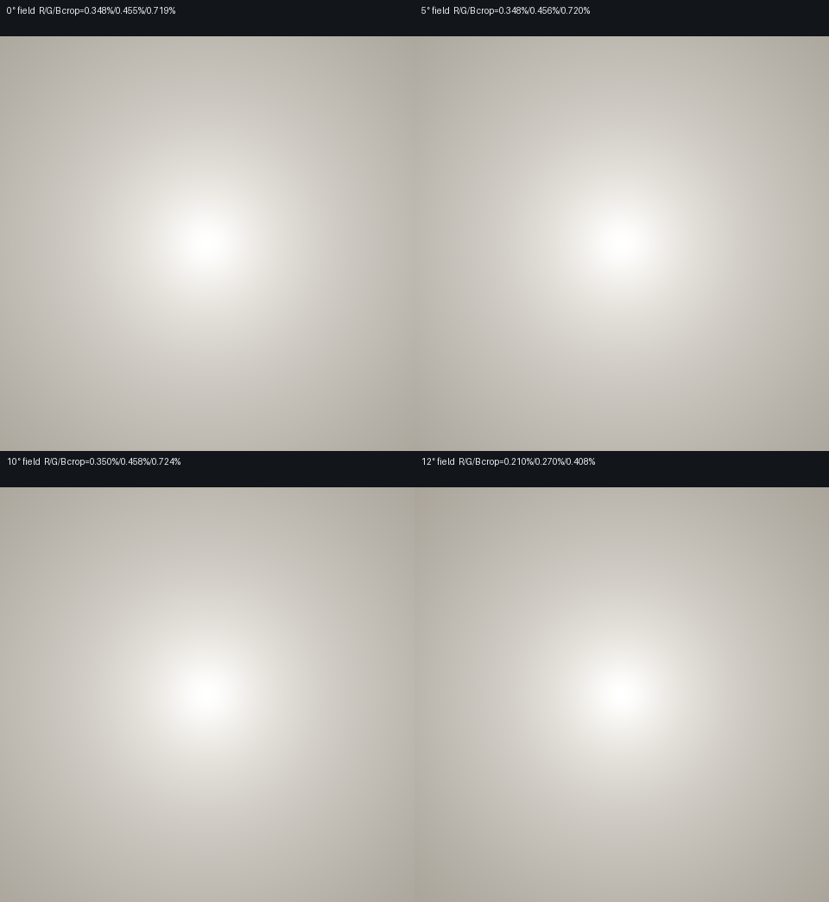

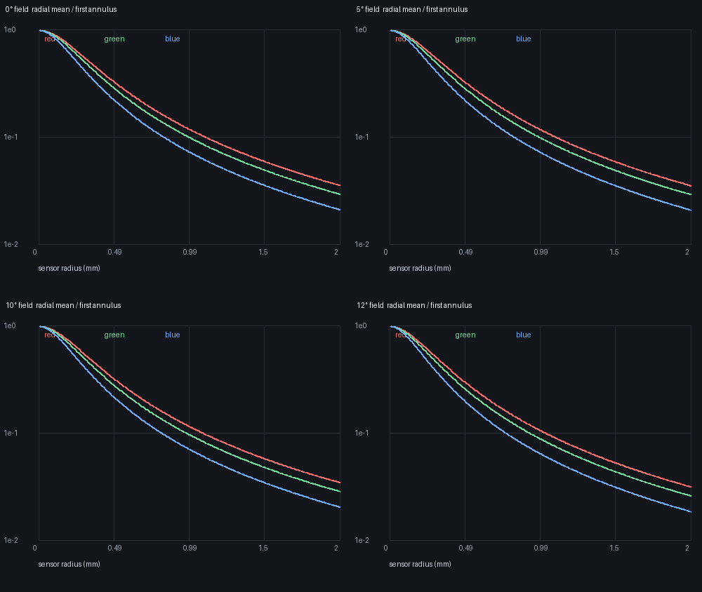

The color image is false-color: each band is peak-normalized to show shape,
while panel labels give the unnormalized crop fractions. The paired radial
profile chart makes the modest wavelength-dependent width differences easier
to inspect; profiles are normalized to the first non-zero annulus. Per-surface
radii and contributions are in
[`prescription-spectral-surface-scatter.csv`](examples/prescription-spectral-surface-scatter.csv).
They use f/22, 80% post-scatter transmission, generic Double-Gauss coefficients,
and the r90 beam-radius proxy. Measured per-surface BSDF/TIS, coatings, source
spectrum, sensor color response, post-scatter ray clipping, and housing scatter
remain outside this model. The wavelength-scaling rule itself is an approximate
limited-band law; see the references in the [Harvey wavelength-scaling study](#limited-band-harvey-wavelength-scaling).

The per-surface contribution plot shows how evenly this parameterization
distributes the crop scatter: no surface contributes more than 8.6% or less
than 5.5%, and the five largest surfaces account for about 40.0–40.5% from 0°
through 10° and 40.9–41.4% at 12°. This is close to an even 14-surface split;
the plot does not identify a reliable coating-priority surface. That outcome
is expected here because every surface shares one generic BSDF while cone size
is represented by traced r90. Per-surface measured BSDF/TIS is needed before
the contribution ranking can guide lens redesign.

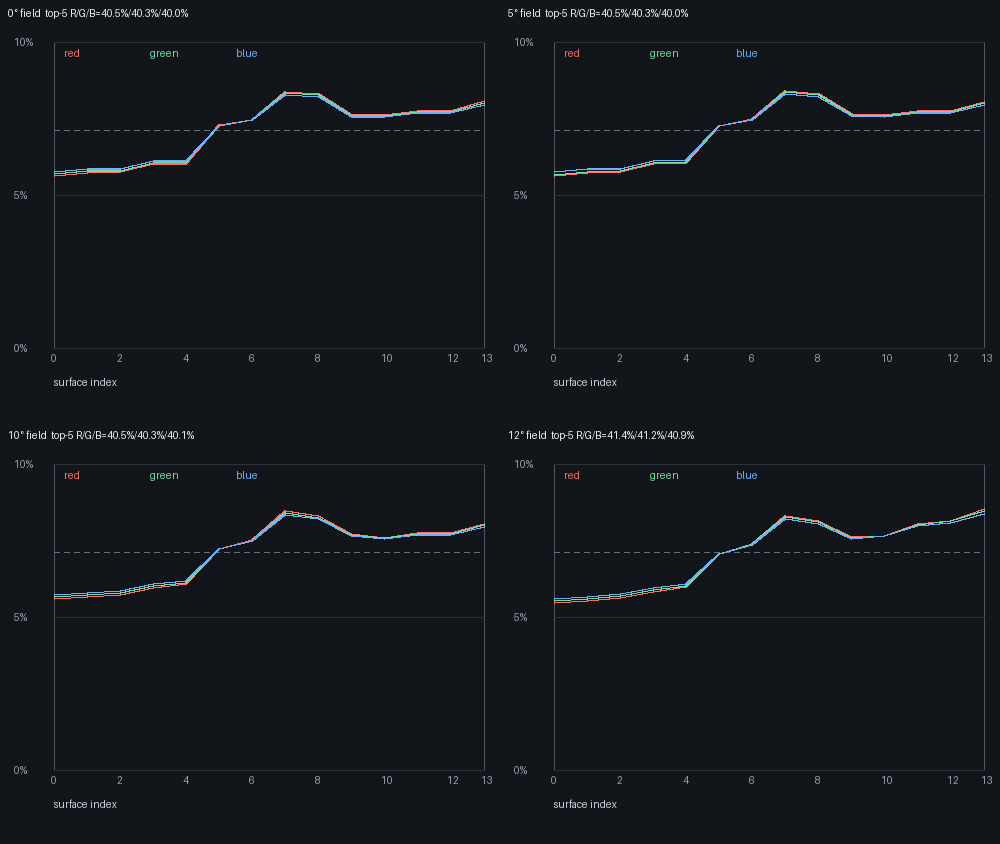

Reproduce the figures and CSV with
`python tools/LensFlareLab/evaluate_prescription_spectral_surface_scatter.py --grid 64`.
Pass `--pfm-dir <directory>` to also write one linear RGB PFM per field.

### Sensitivity to the pupil-cone radius proxy

The surface model uses r90 as a practical proxy for Peterson's beam-radius
term, but the prescription trace also records r50, r99, and RMS radii.
`evaluate_scatter_radius_proxy_sensitivity.py` reuses the same 64² trace and
recomputes the crop model with each statistic substituted consistently for
all 14 surfaces. This isolates the radius definition; it does not establish
that any one percentile is the physically correct beam radius.

Across all four fields and all three wavelength bands, relative to r90:

| Radius statistic | Change in modeled crop scatter |
|---|---:|
| r50 | +18.3% to +21.2% |
| r99 | −9.6% to −8.0% |
| RMS | +17.0% to +19.2% |

The top-ranked surface remains index 7 for 0–10° and index 13 at 12° for all
four original radius choices and all three bands. Its share remains below 8.9%, so this
ranking is weak and depends on the shared generic BSDF and the assumption that
one scalar radius can stand in for each surface's actual pupil distribution.
Changing only that radius statistic moves total crop estimates by up to about
21%, which is a larger uncertainty than the 32²-to-64² sampling change. A
measured or non-sequential surface-scatter model is needed before interpreting
the absolute scatter estimate or using it to prioritize an individual surface.

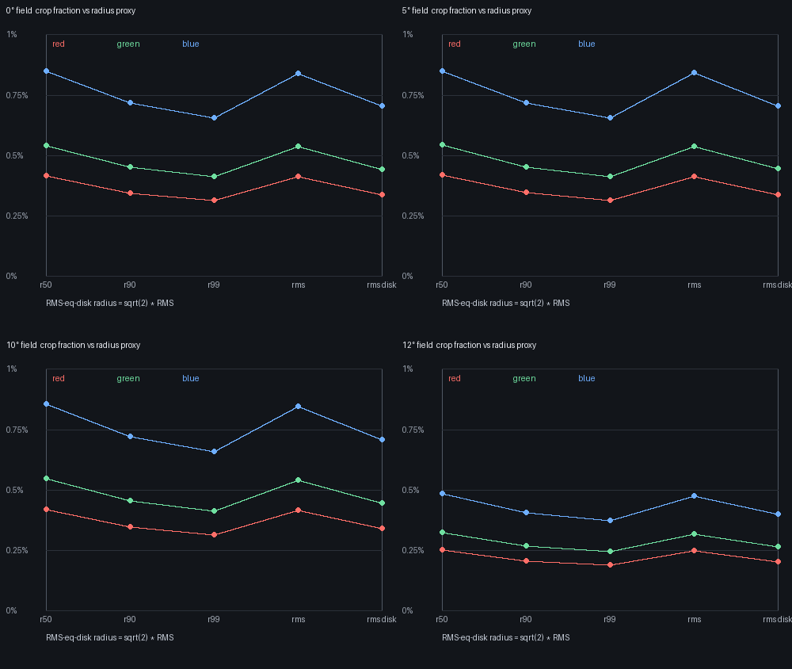

An additional equal-area disk radius, `sqrt(2) × RMS`, changes the modeled crop
by −2.13% to −1.29% relative to r90 across these cases. The conversion follows
the second moment of a uniform disk; its closeness to r90 here is an observed
property of this trace, not evidence that the true surface footprint is uniform.
This fifth curve is therefore a geometry-based comparison case, not a calibrated
replacement for measured pupil footprints or BSDF data.

Exact band/field results and top-surface indices are in
[`prescription-scatter-radius-proxy-sensitivity.csv`](examples/prescription-scatter-radius-proxy-sensitivity.csv).
Reproduce with `python tools/LensFlareLab/evaluate_scatter_radius_proxy_sensitivity.py`;
it reads [`prescription-spectral-surface-scatter.csv`](examples/prescription-spectral-surface-scatter.csv)
and does not repeat the ray trace.

### Fitting a measured linear point-source capture

`fit_harvey_measurement.py` accepts an RGB PFM capture and an optional matching
dark-frame PFM. This follows the measurement principle of Souksava et al., who
use RAW sensor captures to avoid nonlinear ISP processing and compare flare
light with the source. For a camera measurement, retain linear sensor values,
subtract black level/dark signal, and convert without tone mapping, sharpening,
denoising, or local contrast to PFM. Match focus, aperture, gain, exposure, and
temperature between illuminated and dark frames. Exclude the saturated source
core with `--core-radius-px`; the default annular median reduces sensitivity to
sparse ghosts and streaks, while `--statistic mean` preserves their energy in
the fit profile.

The fitter estimates Harvey slope `S`, roll-off `L`, an image-domain scale, and
a residual background. Its `--residual-image` output maps positive spatial
residuals in red and negative residuals in blue after removing the fitted radial
profile, with a default range of ±1.5 decades. The console also reports the 95th
percentile absolute log residual and the fraction of valid pixels differing
from the radial model by more than 2×. These expose asymmetric flare structure
that the annular profile hides. It cannot infer absolute BSDF `B` from ordinary
image counts: that requires calibrated source irradiance, sensor responsivity,
and system throughput. The radial model also cannot represent asymmetric ghosts,
streaks, dust, housing scatter, or field-dependent veiling glare; inspect the
residuals and use a field-by-field measurement set for such cases. Source center,
pixel pitch, and focal length must be supplied or known. This initial tool reads
linear RGB PFM; demosaicing/RAW decoding remains an input-preparation step.
Use `--channel red|green|blue` to fit one sensor channel, or `--channel all` to
fit all three independently. The all-channel mode writes three profile images
and three spatial-residual maps with `-red`, `-green`, and `-blue` suffixes;
the CSV contains a `channel` column. The default `luminance` mode retains the
single-image output. Channel fits help reveal wavelength-dependent scatter,
but sensor spectral response and Bayer/demosaic cross-talk still affect real
captures.

`evaluate_harvey_chromatic_fit.py` creates a 512² synthetic RGB PFM with
different S/L values per channel (red `S=-1.78, L=2.8 mrad`, green
`S=-1.86, L=2.04 mrad`, blue `S=-2.02, L=1.45 mrad`) and records the exact
inputs in `examples/harvey-chromatic-truth.csv`. This is a controlled fitter
check, not an empirical claim that real lenses follow this color ordering.
Run the generator, then fit its output with `--channel all`; compare each
channel's recovered S/L to the truth table. The model still fits a scalar
Harvey profile per channel and does not model spectral BSDF, sensor color
filters, or wavelength-resolved source calibration.

Using the documented 512² setup, the fit recovered:

| Channel | Input S | Fit S | S error | Input L (mrad) | Fit L (mrad) | L error | Log RMSE |
|---|---:|---:|---:|---:|---:|---:|---:|
| Red | -1.78 | -1.8416 | +3.46% | 2.80 | 2.8871 | +3.11% | 0.00261 |
| Green | -1.86 | -1.9136 | +2.88% | 2.04 | 2.1076 | +3.31% | 0.00367 |
| Blue | -2.02 | -2.0673 | +2.34% | 1.45 | 1.5016 | +3.56% | 0.00504 |

The input values, source generation, and fitting model share the same
pixel-integrated Harvey formulation, so these errors measure discretization
and fitting bias under controlled conditions rather than independent optical
accuracy.

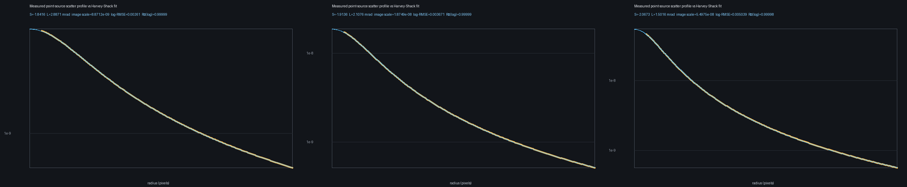

Individual spatial-residual maps are also written for each channel. The
synthetic radial-only input leaves them near the residual floor, as expected.

### Chromatic fit under synthetic noise and colored ghosts

`evaluate_harvey_chromatic_robustness.py` starts from those same three
pixel-integrated profiles, saturates a 20 px source core, injects four sparse
colored Gaussian spots, adds fixed-seed Poisson/read noise (with an explicitly
chosen 1e8 photon-count scale and 3-count read-noise sigma), and adds a small
residual dark offset. It then fits each channel with the annular median and
writes signed residual maps per channel plus a three-panel image. The right
panel shows residual magnitude by channel, while the individual maps encode
excess in red and deficit in blue.

| Channel | Clean fit S / L (mrad) | Stressed fit S / L (mrad) | Stressed shift vs clean, S / L |
|---|---:|---:|---:|
| Red | -1.8471 / 2.9024 | -1.8252 / 2.8690 | +1.19% / -1.15% |
| Green | -1.9201 / 2.1286 | -1.9019 / 2.1015 | +0.95% / -1.27% |
| Blue | -2.0754 / 1.5310 | -2.0607 / 1.5088 | +0.71% / -1.45% |

The RGB ordering remained consistent and the largest parameter movement was
1.45% in L relative to the clean fit. In this single deterministic case, the
stressed estimates also happen to be closer to the input values because the
clean model's fit bias and contamination partly cancel. Do not read that as
contamination improving the estimator. The noise scale is illustrative rather
than camera-calibrated; this is a method stress case, not a sensor-performance
claim.

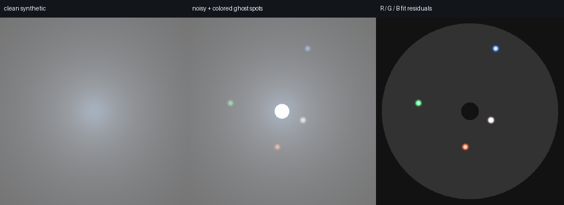

Per-channel signed residual maps and exact fit metrics are in
`examples/harvey-chromatic-robustness-residuals/` and
[`harvey-chromatic-robustness.csv`](examples/harvey-chromatic-robustness.csv).
Reproduce with `python tools/LensFlareLab/evaluate_harvey_chromatic_robustness.py`.

### Limited-band Harvey wavelength scaling

The earlier chromatic fit fixture deliberately assigned unrelated S/L values
to exercise the estimator. This separate study uses the published
smooth-surface wavelength scaling law instead: `S(λ)=S(λ₀)`,
`B(λ)=B(λ₀)(λ₀/λ)^(4+S)`, and `L(λ)=L(λ₀)(λ/λ₀)`. The source describes this
law as valid over a limited wavelength range, says camera-lens scatter
parameters generally require measurement for each lens, and limits the model
to clean, smooth surface scatter; it excludes housing scatter and multiple
scattering. See [Harvey's surface-scatter paper](https://lasp.colorado.edu/galaxy/download/attachments/232894171/Scattering_Harvey1975.pdf?api=v2)
and [the reviewed derivation and limits](https://pmc.ncbi.nlm.nih.gov/articles/PMC6749343/).

The evaluation starts from the published generic Double-Gauss reference set
at 550 nm (`S=-1.86`, `B=0.36 sr⁻¹`, `L=2.04 mrad`) and derives representative
red/green/blue bands at 610/550/460 nm. It assumes equal incident energy per
band and uses the same 512² crop, 5.5 µm pitch, 100 mm focal length, and 8x8
pixel-area integration for each band:

| Band | Wavelength | Derived B (sr⁻¹) | Derived L (mrad) | Eq. 6 TIS | 2.816 mm crop energy |
|---|---:|---:|---:|---:|---:|
| Red | 610 nm | 0.28845 | 2.2625 | 0.1415% | 0.02958% |
| Green | 550 nm | 0.36000 | 2.0400 | 0.1785% | 0.03887% |
| Blue | 460 nm | 0.52769 | 1.7062 | 0.2664% | 0.06199% |

Shorter wavelength produces a narrower angular roll-off but more integrated
scatter under this scaling law. The displayed panels normalize each band to
its own peak to compare shape; the plotted radial curves show that shape
normalized to the first non-zero annulus. They do not encode calibrated RGB
appearance. Equal spectral input, no sensor color-response matrix, and one
generic parameter set mean this is a law-consistency image, not a prediction
of a particular camera or lens. In particular, the formula does not replace
measured per-surface BSDF or coating data.

Passing the generated PFM through the per-channel measurement fitter recovered
`S=-1.9164/-1.9136/-1.9094` and `L=2.3358/2.1076/1.7655 mrad` for
red/green/blue. The common S and increasing L ordering were recovered within
about 3.6%; remaining bias is from finite pixel integration, annular profile
sampling, and the fit model. The exact radial data are in
[`harvey-spectral-scaling.csv`](examples/harvey-spectral-scaling.csv); the
per-channel fit is in [`harvey-spectral-scaling-fit.csv`](examples/harvey-spectral-scaling-fit.csv).

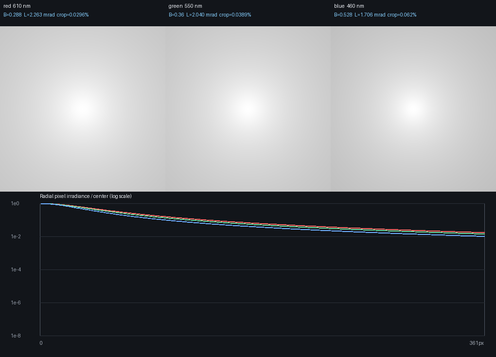

Reproduce both generation and fit with:

```powershell
python tools/LensFlareLab/evaluate_harvey_spectral_scaling.py
python tools/LensFlareLab/fit_harvey_measurement.py `
  tools/LensFlareLab/examples/harvey-spectral-scaling-synthetic.pfm `
  --pixel-pitch-um 5.5 --focal-length-mm 100 --core-radius-px 12 `
  --channel all --csv tools/LensFlareLab/examples/harvey-spectral-scaling-fit.csv `
  --image tools/LensFlareLab/examples/harvey-spectral-scaling-fit.png `
  --residual-image tools/LensFlareLab/examples/harvey-spectral-scaling-residual.png
```

A synthetic closed-loop check generated a 512² pixel-integrated Harvey image
with `S=-1.86`, `L=2.04 mrad`, 5.5 µm pixels and a 100 mm focal length. Fitting
annuli 12–240 px recovered `S=-1.9155`, `L=2.1073 mrad` (3.0% and 3.3% relative
errors), with log-profile RMSE 0.00349 and log-R² 0.999988. This checks the
shape fitter against its matching synthetic model; it is not independent
validation of real lens scatter.

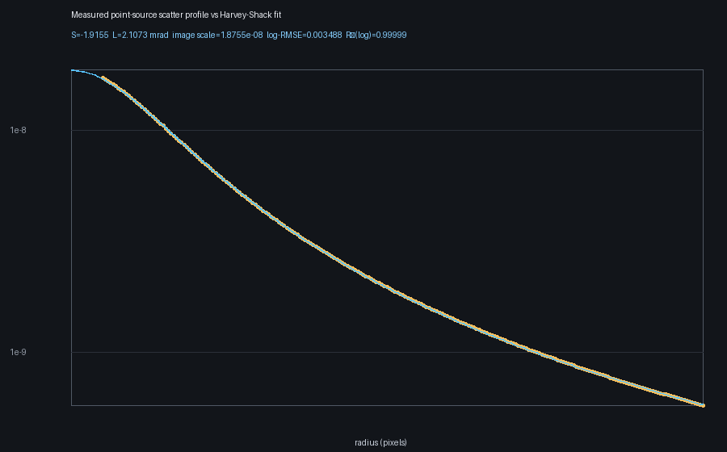

For a saturated-core/ghost-contaminated synthetic measurement, the residual
map highlights all four injected ghost spots after fitting the radial median
profile. It reports a 0.676% fraction of valid crop pixels with more than 2×
absolute deviation; the annular log-RMSE remains low because those spots occupy
small angular fractions of their rings. This illustrates why the spatial map
must accompany radial fit metrics.

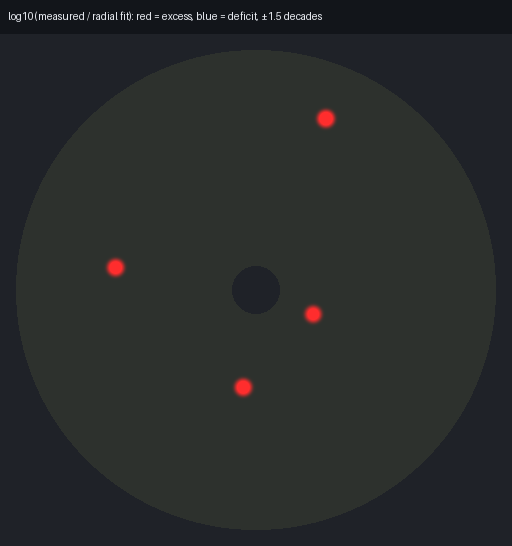

To reproduce, first run `evaluate_harvey_scatter_reference.py` or generate a
linear PFM measurement, then call:

```powershell
python tools/LensFlareLab/fit_harvey_measurement.py capture.pfm `
  --pixel-pitch-um 5.5 --focal-length-mm 100 --core-radius-px 12
```

For the synthetic chromatic check, run:

```powershell
python tools/LensFlareLab/evaluate_harvey_chromatic_fit.py
python tools/LensFlareLab/fit_harvey_measurement.py `
  tools/LensFlareLab/examples/harvey-chromatic-synthetic.pfm `
  --pixel-pitch-um 5.5 --focal-length-mm 100 --core-radius-px 12 `
  --channel all --csv tools/LensFlareLab/examples/harvey-chromatic-fit.csv `
  --image tools/LensFlareLab/examples/harvey-chromatic-fit.png `
  --residual-image tools/LensFlareLab/examples/harvey-chromatic-residual.png
```

Souksava et al., [Evaluation of the Lens Flare (2021)](https://library.imaging.org/ei/articles/33/9/art00008), describe RAW flare measurement across source positions. Their measured images and camera-specific calibration are not bundled here.

### Robustness to saturated cores and sparse ghosts

`evaluate_harvey_fit_robustness.py` starts from the same 512² synthetic Harvey
capture, saturates a 20 px central disk, adds four sparse Gaussian ghost spots
and a small residual black-level offset, then fits outside a 24 px core mask.
The same contaminated image is summarized with annular median and mean. Relative
to the clean median fit, contamination moved median-fit `S/L` by −2.91%/−3.98%,
while the mean moved them by +3.34%/+13.48%. Against the input parameters, the
contaminated median result was within 0.23% in `S` and 0.19% in `L`; contaminated
mean errors were 6.68% and 18.41%, with log-RMSE 0.405. This is one constructed
case and the near-exact median result partly cancels the clean synthetic fit's
own 3.23%/4.34% parameter bias. It does not establish general robustness on
real flare captures.

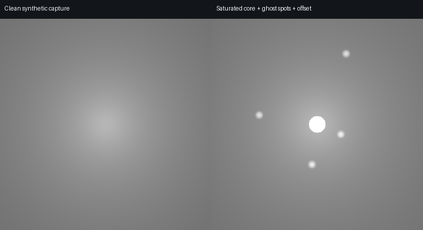

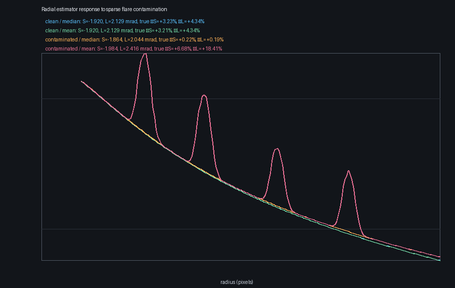

Reproduce the table and images with `python tools/LensFlareLab/evaluate_harvey_fit_robustness.py`;
the case metrics are in [`harvey-fit-robustness.csv`](examples/harvey-fit-robustness.csv).

## Prescription-based direct-transmission geometric image evaluation

`evaluate_direct_transmission_raytrace.py` independently traces a collimated
ray bundle through the 14 spherical surfaces in the bundled Angenieux
prescription, clips it at the physical six-blade stop (semidiameter EFL/22),
and plots sensor-plane ray intercepts at 610/550/460 nm and 0/5/10/12 degree
fields. The script matches the
LensFlareLab surface table, Cauchy dispersion approximation, and 15 mm rear
group spacing. This gives the standalone lab its first prescription-dependent
direct-transmission image evaluation rather than another synthetic Zernike
fixture.

The 512² launch grid transmits about 4,578–8,744 rays per field/wavelength
case. Median-centered 90% spot radii range from 0.23 to 23.17 µm over the
twelve cases. The 12 degree blue case is the broadest (r90=23.17 µm), while the
on-axis blue geometric bundle is much tighter (r90=0.23 µm); the large spectral
change is visible in the plate. Comparing 256² and 512² launch grids changes
r90 by at most 0.76% across the four fields and three wavelengths. The center
through 10 degree cases retain
97.6–100.2% of the on-axis ray-count area, while at 12 degrees the relative
transmitted pupil area is 52.9–56.3%. The 550 nm chief ray's image-space cos⁴
factor there is 0.990, giving a combined geometric relative-illumination proxy
of 0.546. Thus this assumed prescription's edge falloff at 12 degrees is driven
mainly by pupil clipping, not by natural cos⁴ roll-off. The approximation
follows the separated pupil and cos⁴ terms discussed by [Reiss (1948)](https://doi.org/10.1364/JOSA.38.000980).

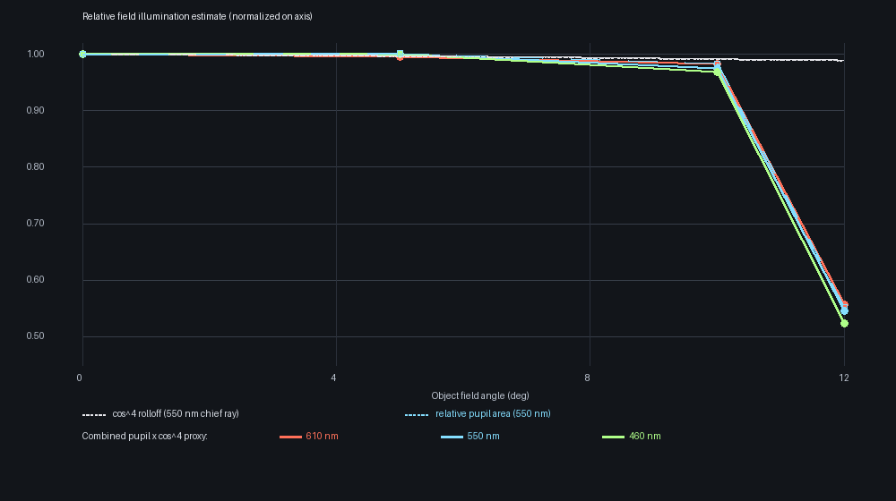

The illumination proxy is
`relative transmitted pupil area × cos⁴(image-space chief-ray angle)`. Rays
are sampled with equal area on planes perpendicular to each input bundle, so
the pupil-area comparison does not also count the bundle's projected area.
CSV includes the pupil ratio, chief-ray angle, cos⁴ factor, and product per
wavelength. This simplified estimate omits pupil-distortion Jacobian, Fresnel
transmission, coating losses, and sensor response; it is not calibrated relative
illumination for a physical lens.

The spot map is a location view. A second view bins equal-weight transmitted
rays by sensor area to estimate geometric irradiance density:

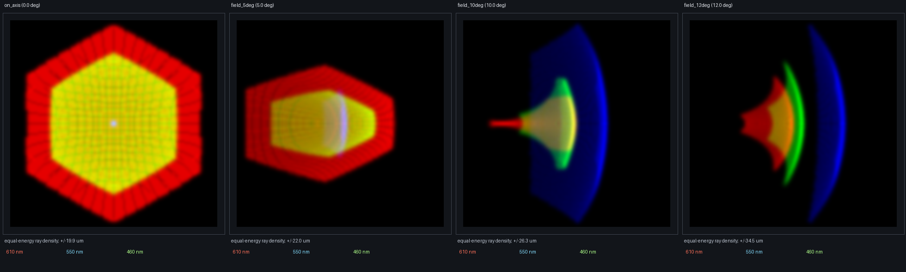

The density image uses 256² sensor bins, a two-bin Gaussian display blur, and
per-wavelength peak normalization before mapping 610/550/460 nm to red/green/blue.
These choices reveal the spatial shape and suppress the launch-grid lattice;
they do not preserve relative spectral power or model a physical sensor. The
CSV spot radii are computed from the unblurred ray coordinates.

The same equal-weight rays are also deposited without smoothing into 5 µm
square sensor pixels. `direct-transmission-pixel-psf.png` centers each field's
spot on its own median while keeping one shared ±35 µm display range; each
wavelength channel is peak-normalized and square-root encoded for visibility.
The CSV's `pixel_r50_um`, `pixel_r80_um`, and `pixel_r90_um` columns report the
radii enclosing those fractions of the binned ray counts, measured from the
median-centered pixel grid. At 12° the blue 460 nm bundle has the broadest
pixel-integrated 90% radius (25.5 µm); the on-axis 460 nm bundle falls within
one 5 µm pixel at this sampling pitch. These are sampling-dependent geometric
ray-density descriptors, not diffraction PSFs or calibrated pixel responses.

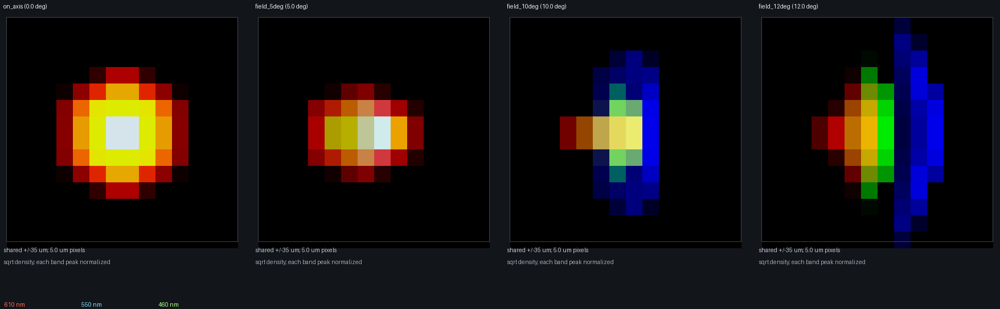

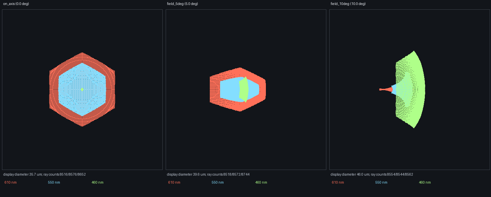

Reproduce the numerical table and plate with:

```powershell
python tools/LensFlareLab/evaluate_direct_transmission_raytrace.py --samples 512
```

This is geometric optics: it deposits rays at their sensor-plane intercepts.
It does not itself calculate a complex pupil, phase, diffraction, coating
phase, polarization, calibrated glass dispersion, or camera response. The
prescription and physical stop are the Lab's assumed model, not a measured
serial-number-specific Angenieux lens.

## Prescription-derived optical path and reference-sphere diagnostic

`evaluate_prescription_wavefront.py` reverse-traces the front group and
forwards the rear group from the stop to estimate both paraxial pupils using
81-ray, ±0.001-slope pencils. The virtual entrance pupil is at z = 82.95261 mm
with 1.72368× lateral magnification; the virtual exit pupil is at z =
−56.47356 mm with 4.12397× magnification. For the assumed 100 mm EFL, the
entrance pupil gives an object-space effective f-number of f/6.3817. The exit
pupil diameter and image distance give f/6.3719 on axis, a 0.154% difference;
the four-field image-side estimates span f/6.372–f/6.397. This paraxial
consistency check shows that the physical stop size EFL/22 does not make the
complete prescription an f/11 imaging system. Changing the probe cone from
±0.0005 to ±0.003 shifts the fitted exit pupil plane by only 0.0031 mm. These
remain estimates from the Lab's assumed prescription, not an independent
optical-design verification.

This pupil magnification matters for interpreting the older `f/11` diffraction
fixtures: they describe an isolated six-blade pupil with radius EFL/22, but do
not use the prescription-derived entrance/exit pupil magnification. Their
kernel scale should not be read as this full lens prescription's diffraction
scale until the pupil model is independently verified.

For each field, the evaluator accumulates optical path as `n × segment length`
from an equal-phase incident plane through all 14 surfaces to a shared plane
1 mm beyond the last vertex. It checks that plane's eikonal gradient against
the outgoing ray direction, then back-projects each ray in image-space air to
the virtual exit-pupil plane. The path is corrected by the distance from each
pupil sample to the chief-ray image point on the assumed sensor plane; the
chief path removes piston. This yields an image-centered reference-sphere OPD
map in exit-pupil coordinates. At 512², the 550 nm OPD RMS is 0.145–0.273 µm
(0.264–0.496 waves); doubling from 256² changes RMS by at most 0.20%. The 12°
field transmits 4,734 rays. The chief-ray pupil coordinate moves 0.258 mm at
5°, 2.213 mm at 10°, and 3.989 mm at 12° relative to the paraxial pupil center,
so field-dependent pupil mapping matters in the clipped edge field.

The equal-area incident grid also provides a finite-triangle estimate of the
ray-map Jacobian from the launch plane to the virtual exit pupil. At 512², no
folded triangles were found. The mapped areas are 899, 897, 865, and 478 mm²
for 0/5/10/12 degrees, or 98.5%, 98.2%, 94.8%, and 52.4% of the paraxial
on-axis hex-pupil area. The local Jacobian median declines from 5.75 on axis
to 5.60 at 12 degrees; a relative geometric amplitude proxy
`1/sqrt(J × cos(theta))` spans about 0.416–0.426 over the sampled fields.
This is a launch-grid area-density estimate, not a normalized complex pupil
amplitude: it excludes Fresnel transmission, coating phase, polarization,
vignetting-edge diffraction, and coherent multi-path effects.

The same ray/eikonal check gives 0.000042–0.000058% RMS-relative error for
adjacent launch-grid pairs. The prior arbitrary exit-side-plane reference and
the exit-pupil reference change OPD RMS by at most 0.36% in these four cases;
this RMS comparison does not imply their phase maps are identical. It checks
path accumulation and plane phase sampling, but does not independently
validate the assumed prescription.

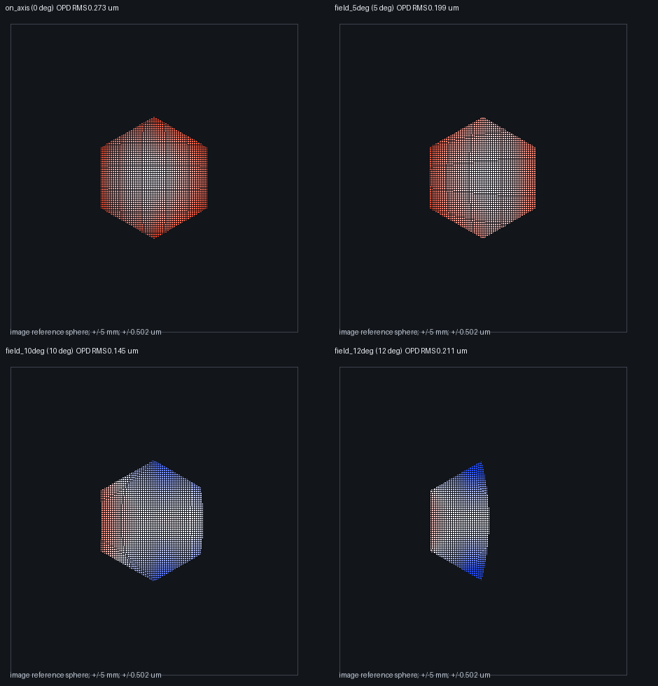

The CSV records the paraxial pupil plane and magnification, chief-ray pupil
decenter, image point, reference-sphere radius, OPD RMS, eikonal residual,
mapped pupil area, local Jacobian percentiles, and a relative geometric
amplitude proxy. A separate evaluator now applies that proxy to a scalar
complex pupil. Fresnel amplitude, coating phase, polarization, edge diffraction,
coherent multi-path effects, and calibrated sensor response are still missing
from a physical prescription-derived coherent PSF. This next step follows the exit-pupil OPD
definition in [OpticStudio's documentation](https://ansyshelp.ansys.com/public/Views/Secured/Zemax/v252/en/OpticStudio_User_Guide/OpticStudio_Help/topics/Exit_Pupil.html)
and the reference-sphere path-length treatment validated against Zemax by
[Lin (2024), DOI 10.1364/JOSAA.529814](https://doi.org/10.1364/JOSAA.529814).
Keep this work in LensFlareLab until the pupil map, amplitude normalization,
full-frame diffraction, and measured-camera comparisons are validated before
any Core/App integration.

Reproduce the OPD map and CSV with:

```powershell
python tools/LensFlareLab/evaluate_prescription_wavefront.py --samples 512
```

## Prescription-derived monochromatic coherent PSF prototype

`evaluate_prescription_coherent_psf.py` rasterizes the direct-transmission
reference-sphere OPD and geometric pupil-amplitude proxy onto a regular exit
pupil. It interpolates only through Delaunay triangles whose launch-grid
vertices are local neighbors, avoiding interpolation across disconnected or
clipped pupil regions. The pupil amplitude uses
`1/sqrt(J × cos(theta_exit))`, where `J` is the measured exit-pupil/incident
area Jacobian. A scalar Fraunhofer FFT produces the 550 nm PSF, following the
aperture-transform formulation in [Hullin et al. (2011)](https://matthias.hullin.net/publications/HullinEtAl-LensflareRendering-SIGGRAPH2011.pdf).
A matched ideal paraxial hex pupil provides a shape baseline. Both are
integrated over the assumed 84.3 µm sensor pixels, then compared in a shared
central crop.

At a 512² incident-ray grid and 2048² pupil grid, the ray-mapped pupil retains
98.5%, 98.2%, 94.8%, and 52.4% of the paraxial on-axis hex area at 0/5/10/12°.
Within the ±12 px crop, after normalizing each crop to unit energy, the
pixel-integrated PSF L1 difference from the ideal pupil is 0.31%, 0.30%,
0.34%, and 1.17%, respectively. The 12° pupil is nearly half the on-axis area,
but its 2048² pixel-integrated core remains similar to the ideal pupil at the
assumed sensor pitch; r99 is 1 px and the ±12 px crop retains 99.990% of the
sampled PSF energy.

Grid checks now agree after excluding pupil triangles with undefined or
nonpositive Jacobian vertices from amplitude interpolation. On the common
±6 px crop, doubling pupil sampling from 1024² to 2048² changes normalized PSF
L1 by 0.073–0.113% across all four fields. For 12°, increasing to 4096² changes
the common ±12 px image by 0.058%. Doubling the 12° incident-ray grid from
512² to 1024² changes that normalized crop by 0.151%. These checks support the
current pupil-grid result, though the 1024² ray check covers only the 12° case.
The 2048² final plate has finite sampled angular support of only ±13.7 sensor
pixels; it shows the central PSF and is not a full-frame flare reference. The
evaluator remains a monochromatic scalar prototype with the assumed
prescription, paraxial Fraunhofer propagation, and geometric amplitude proxy.
Its 550 nm phase does not include the wavelength-dependent pupil and OPD needed
for RGB PSFs.

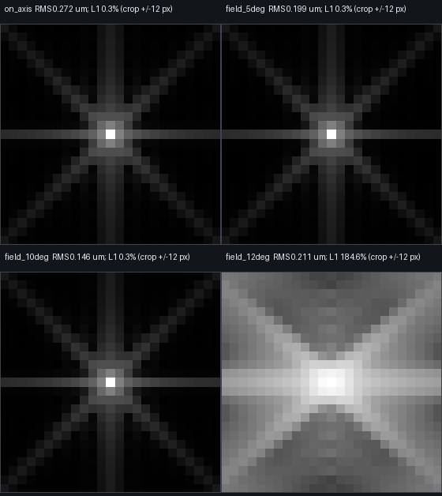

The field metrics are in
[`prescription-coherent-psf.csv`](examples/prescription-coherent-psf.csv), and
the per-pixel values are in
[`prescription-coherent-psf-pixels.csv`](examples/prescription-coherent-psf-pixels.csv).
Reproduce the higher quality plate with:

```powershell
python tools/LensFlareLab/evaluate_prescription_coherent_psf.py --ray-samples 512 --pupil-samples 2048
```

Use `--field field_12deg --ray-samples 512 --pupil-samples 4096` for the edge-
field convergence study. Validate the pupil and wavelength-dependent wavefront
against an optical design package or measured RAW point-source data before
considering RGB reconstruction or Core/App integration.

## Prescription-derived wavelength-dependent PSFs

`evaluate_prescription_polychromatic_psf.py` repeats the independent exit-pupil
fit, direct ray trace, reference-sphere OPD, and geometric Jacobian amplitude
for 460/550/610 nm. Dispersion therefore changes both the pupil conjugate and
the focused wavefront; each monochromatic PSF is computed independently and
integrated over the same assumed 84.3 µm sensor pixels. This follows the
complex-pupil Fourier formulation above and the wavelength-dependent optical
path and aperture behavior in [Hullin et al. (2011)](https://matthias.hullin.net/publications/HullinEtAl-LensflareRendering-SIGGRAPH2011.pdf).

At a 512² ray grid and 2048² pupil grid, chief-image lateral shifts relative to
550 nm are 0.03/0.01 px at 5°, 0.07/0.03 px at 10°, and 0.09/0.04 px at 12°
for 460/610 nm. The field-dependent 460 nm OPD RMS grows from 0.006 µm on axis
to 0.428 µm at 12°, while 610 nm ranges from 0.374 µm on axis to 0.179 µm at
12°. The relative aperture area at 12° spans 49.9–53.4% across these bands.
These are consequences of this assumed prescription, its approximate Cauchy
glass dispersion, and the fixed sensor plane; the table does not independently
validate a real lens.

At 12°, increasing pupil sampling from 1024² to 2048² changes the normalized
common-core PSF by 0.129% L1 at 460 nm (±5 px) and 0.119% at 610 nm (±7 px).
The 550 nm band changes by 0.113% over ±6 px. These are local core convergence
checks, not evidence that diffraction wings outside the sampled support are
resolved.

The plate maps 460/550/610 nm to blue/green/red and normalizes each band's
display independently so morphology is visible. This is a diagnostic RGB
basis: it does not model source spectrum, color-matching functions, sensor
response, or relative radiometric energy. Each PSF is recentered on its own
chief ray; the CSV carries chief-image coordinates and the wavelength shifts.
The crop is at most ±12 pixels (±10 px for 460 nm at this pupil grid), not a
full-frame flare kernel.

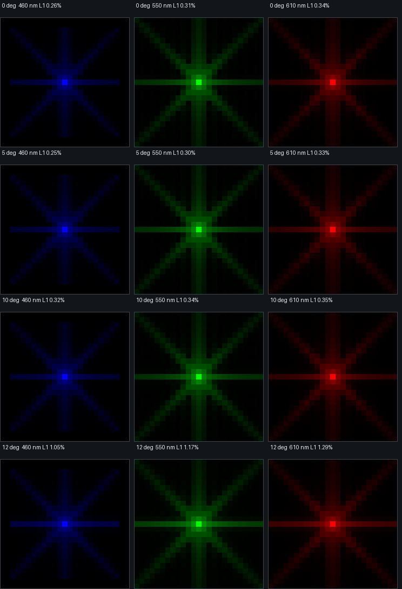

Metrics and pupil/chief-ray data are in
[`prescription-polychromatic-psf.csv`](examples/prescription-polychromatic-psf.csv);
per-pixel samples are in
[`prescription-polychromatic-psf-pixels.csv`](examples/prescription-polychromatic-psf-pixels.csv).
Reproduce with:

```powershell
python tools/LensFlareLab/evaluate_prescription_polychromatic_psf.py --ray-samples 512 --pupil-samples 2048
```

The 3-band RGB view remains provisional until glass data, RGB/sensor spectral
response, wide-angle diffraction, and RAW lens captures are available.

## Continuous ideal-pupil full-frame diffraction reference

The prescription-derived FFT above resolves a local core, because a uniform
pupil grid has finite unaliased image support. To inspect the wider diffraction
wings without pretending a coarse pupil FFT contains them, `evaluate_hex_pupil_full_frame.py`
evaluates the continuous Fourier transform of a regular hexagon using its
polygon boundary integral. The scalar Fraunhofer transform follows the aperture
Fourier model used by [Hullin et al. (2011)](https://matthias.hullin.net/publications/HullinEtAl-LensflareRendering-SIGGRAPH2011.pdf).
The ideal exit-pupil radius is derived from the assumed prescription's stop and
550 nm paraxial exit-pupil magnification. At 640×360 on a 53.96 mm sensor, a
2048² uniformly sampled pupil covers only ±13.7 sensor pixels before its
frequency support repeats, while the analytic polygon transform has no such
sample-grid cutoff.

The image and CSV report normalized pointwise irradiance over the full sensor.
They do **not** integrate detector pixel areas: the diffraction core is far
narrower than these pixels, so coarse point samples would alias the central
energy. The image uses a logarithmic display range of eight decades. This
reference isolates ideal-hex diffraction geometry; it does not include the
prescription's aberrated pupil, wavelength integration, coating losses,
obstructions, sensor response, or measured camera scatter, and is not suitable
as a production flare kernel.

The boundary-integral amplitudes were checked at 40 frequency/angle pairs
(`q × pupil-radius = 0.25…16`) against independent 96-point Gauss-Legendre
integration over six center-to-edge triangles. Maximum complex-amplitude error
was `2.15e-15` relative to pupil area. At much higher frequencies through
`q × pupil-radius = 12000`, the 60° rotational-symmetry check had a maximum
normalized complex error of `1.18e-16`; this range covers the full-frame image
corners. These are numerical checks of the ideal-polygon transform, not
validation of the optical prescription or sensor integration.

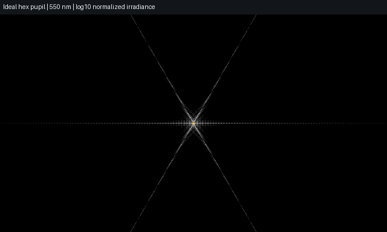

Recreate the image and point-sample table with:

```powershell
python tools/LensFlareLab/evaluate_hex_pupil_full_frame.py
```

The defaults are 640×360, 53.96 mm sensor width, 550 nm, and a 96-point
quadrature validation order. `--width`, `--height`, `--sensor-width-mm`,
`--wavelength-nm`, and `--validation-order` select other cases. The independent
complex-amplitude samples are in
[`hex-pupil-transform-validation.csv`](examples/hex-pupil-transform-validation.csv).
The script prints the ordinary 2048² pupil FFT's unaliased sensor support for
comparison. This analytic ideal-pupil view is a reference for future
wide-support and pixel-area integration work, not evidence to integrate into
Core/App.

## Harvey–Shack rough-surface scatter reference

The current geometric ghost and aperture-diffraction models do not produce the
wide, low-level veiling component caused by rough optical surfaces. To study
that missing contribution, `evaluate_harvey_scatter_reference.py` evaluates the
angular Harvey–Shack BSDF
`BSDF(θ)=b₀[1+(sin θ/L)²]^(S/2)` and maps it onto the focal plane with the
solid-angle Jacobian `cos³(θ)/f²`. It integrates 4×4 subpixel samples per
detector pixel and compares each rendered shape against an 8×8 reference.

The parameters use the generic commercial Double-Gauss set reported by
[Ritt et al. (2020)](https://www.mdpi.com/1424-8220/20/21/6308):
`S=-1.86`, `B=0.36 sr⁻¹`, and `L=2.04 mrad`. The derived `b₀` is `6.9245 sr⁻¹`.
The test image follows that article's example detector (1000×1000, 5.5 µm
pixels) and the 35 mm Double-Gauss simulation in its validation study. These
are generic lens-class measurements, not values measured from the bundled
Angenieux prescription or any specific production lens. The image shows one
rough surface's scatter-only component; the full lens surface count is not
assumed.

At `L=2.04 mrad`, the hemisphere integral of the stated BSDF is `0.1976%` while
the article's small-angle Eq. 6 gives `0.1785%`; the renderer scales the profile
to Eq. 6's per-surface TIS convention. The selected sensor captures `0.0810%`
of unit incident energy from that surface, about 45% of its Eq. 6 scatter. The
4×4 pixel integration differs from the 8×8 reference by `0.00023%` normalized
L1 in this case; the maximum across the four `L` cases is `0.00248%`. The
radial curve shifts outward as `L` grows, as expected from the BSDF corner
angle.

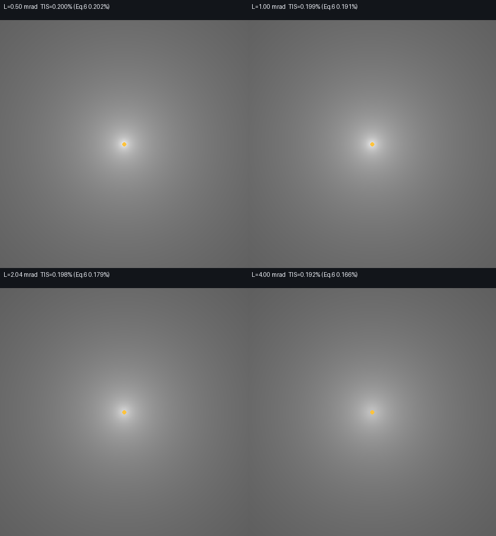

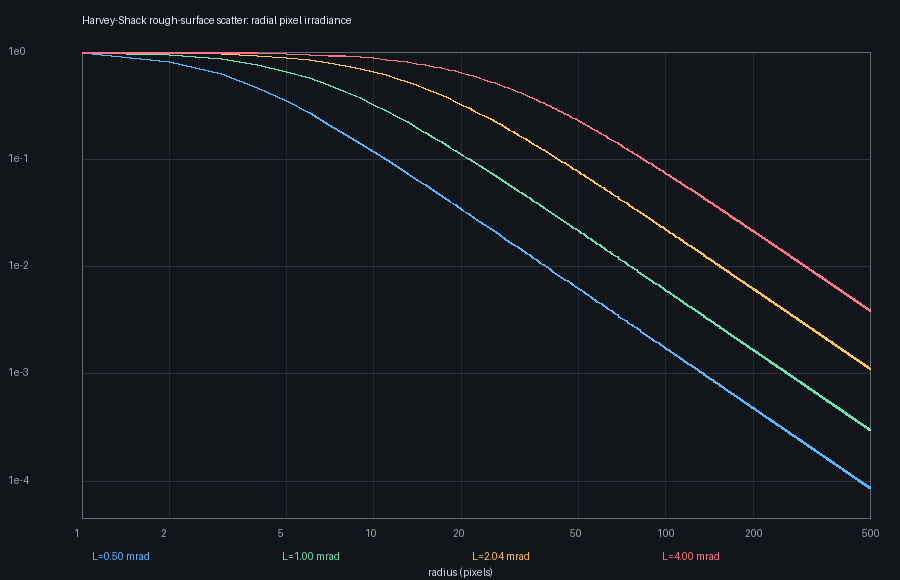

Reproduce both figures and the per-pixel-radius CSV with:

```powershell
python tools/LensFlareLab/evaluate_harvey_scatter_reference.py
```

This applies the rotationally symmetric pupil-to-image approximation. It omits
the surface-specific beam radii and `a_ent²/a_j²` factors from Peterson's full
focal-plane model, field dependence, aperture clipping, the coherent PSF core,
ghosts, and measured sensor response; see the [2022 validation paper](https://www.mdpi.com/1424-8220/22/23/9447).
It is a research-grounded scatter layer candidate, not a camera-calibrated
effect and not yet part of the C++ renderer.

## Controlled wavefront-aberration PSFs

`evaluate_wavefront_aberration_psf.py` extends the ideal six-blade pupil with
controlled wavefront error. It computes `PSF = |FFT(T · exp(i 2πW/λ))|²`,
then integrates the sampled irradiance cells over detector pixels. The modes
are Noll-style primary defocus, astigmatism, coma, and spherical aberration;
each single-mode case is scaled to 0.25 waves RMS optical path difference at
550 nm over the sampled open hexagonal pupil. The mixed case's actual RMS is
measured and written to the CSV. The PSF uses the complex pupil Fourier
formulation described for computed wavefronts by
[Chen et al. (2024)](https://doi.org/10.1038/s41598-024-84790-6); the Zernike
mode family follows [Noll (1976)](https://doi.org/10.1364/JOSA.66.000207).
This is a controlled experiment, not a fitted measurement of the Angenieux
prescription or a claim of camera-specific aberration.

The fixture uses the Lab's nominal f/11 stop-radius/focal-length scale and a
640×360 detector. Its 610/550/460 nm channels are a diagnostic RGB mapping,
not a calibrated source spectrum or sensor response. At this pixel pitch the
diffraction core is much smaller than one detector pixel, so detector-area
integration visibly moderates the response to these fairly strong wavefront
errors. The full PSFs retain the six-blade starburst; the zoomed center and
absolute-difference views expose the subtler core changes.

The zero-aberration NumPy result agrees with the existing LensFlareLab render
to 0.00237% RGB L1 and 0.00003% relative peak error for the same pixel-area
kernel and Gaussian source. Across all six cases, the 2048² pupil results
differ from 1024² by at most 0.1073% RGB L1 in a centered 97×97 detector crop.
At 0.25 waves RMS, average detector-pixel peak ratios versus the ideal case
are 0.9912 defocus, 0.9981 astigmatism, 0.9653 coma, and 0.9541 spherical;
these are pixel-integrated peak ratios, not optical Strehl ratios. Shape L1
versus the ideal RGB PSF is 1.72%, 0.50%, 7.59%, and 8.94%, respectively.
The asymmetric coma response is especially visible in the core-difference
view.

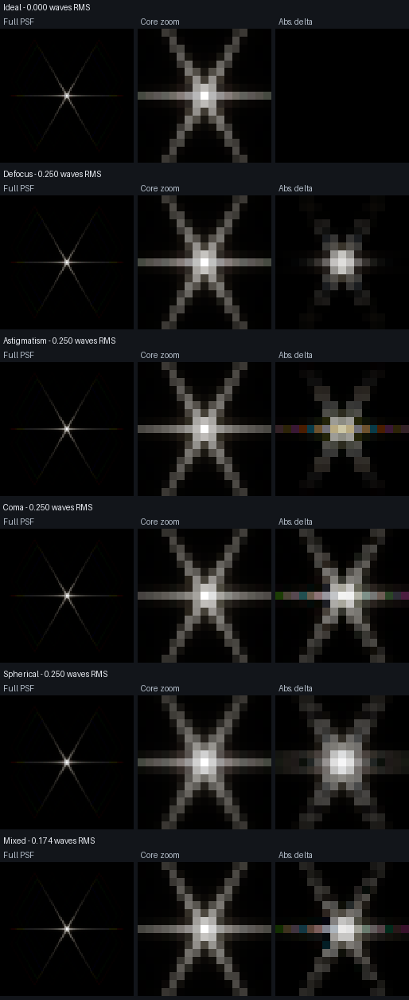

Linear RGB PSFs and per-wavelength metrics are in
[`wavefront-aberration-psf.csv`](examples/wavefront-aberration-psf.csv); the
script also writes per-case PFM kernels under its build output directory.
Reproduce against an existing LensFlareLab executable with:

```powershell
python tools/LensFlareLab/evaluate_wavefront_aberration_psf.py build/tools/LensFlareLab/LensFlareLab.exe
```

The controlled wavefront modes establish a coherent-PSF prototype and test
its sampled output. The Lab still needs prescription-derived exit-pupil
wavefronts or measured lens data before this path can claim real-lens
aberration fidelity. Hullin et al. describe both lens-specific aberrations
and wave-optical flare effects in [Physically-Based Real-Time Lens Flare
Rendering (2011)](https://resources.mpi-inf.mpg.de/lensflareRendering/).

## Pupil diffraction image quality: symmetry and FFT convergence

I added `evaluate_pupil_psf.py` to inspect both the rendered image and numeric
PSF diagnostics for a centered, neutral, subpixel Gaussian point source. The
matrix covers five, six, eight, and ten pupil blades, a six-blade pupil with a
0.30-radius central obstruction, and 512²/1024²/2048²/4096² aperture FFTs.
Every output is source-subtracted, uses three wavelengths and pixel-area
detector integration, and is compared with the matching 4096² pupil case.

The largest RGB L1 error at 1024² is 0.1413% (obstructed six-blade pupil), and
the largest at 2048² is 0.0583%. The default 1024² clear six-blade result is
0.0864% from its dense reference. Center-of-mass errors stay below 0.000006 px;
horizontal mirror L1 remains below 0.0006% in all cases. At 4096², measured
central-obstruction throughput is 0.891310, close to the geometric open-area
ratio 0.891172; differences reflect finite pupil rasterization. The
obstruction measurement is independent of absolute camera transmission.

| Pupil | FFT | Throughput | RGB L1 vs 4096² |
|---|---:|---:|---:|
| 5 blades, clear | 1024² | 1.000022 | 0.0878% |
| 6 blades, clear | 1024² | 1.000025 | 0.0864% |
| 8 blades, clear | 1024² | 1.000010 | 0.0681% |
| 10 blades, clear | 1024² | 1.000021 | 0.0758% |
| 6 blades, ε=0.30 | 1024² | 0.891109 | 0.1412% |

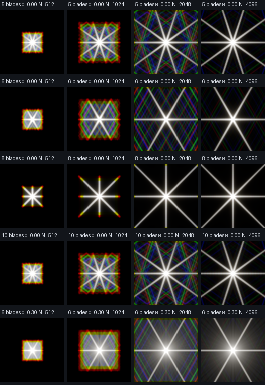

Raw image metrics are recorded in
[`pupil-psf-diagnostic.csv`](examples/pupil-psf-diagnostic.csv). Reproduce by
building the opt-in LensFlareLab target and running:

```powershell
python tools/LensFlareLab/evaluate_pupil_psf.py build/tools/LensFlareLab/LensFlareLab.exe
```

The image plate uses a shared display scale within each pupil family, while
the CSV separately records throughput. These tests establish FFT convergence
and symmetry for an ideal binary pupil only; they do not add measured
aberrations, scattering, sensor response, or real lens data. Pupil diffraction
follows the Fourier relationship reviewed in
[Goodman, *Introduction to Fourier Optics*](https://www.macmillanlearning.com/college/us/product/Introduction-to-Fourier-Optics/p/1319119166)
and the modeled obstruction's dependence on pupil shape is consistent with
[Hakobyan (2020)](https://academic.oup.com/mnras/article/496/4/5414/5874233).

## Direct-source PSF across emitter sizes and frame position

`evaluate_source_field_psf.py` compares three neutral Gaussian emitter sizes
(σ=0.7, 3, and 7 px) at the frame center and 4/5 px from the left/right
boundaries. For each case it compares the renderer against a linear convolution
of the same 1024² measured point-source PSF with the finite source, cropped to
the 640×360 detector. This follows the incoherent-image formation model: each
source point contributes a shifted intensity PSF, as described in Goodman and
used for direct aperture diffraction by Hullin et al. The reference validates
the renderer's source convolution and frame-crop behavior; it is not an
independent optical-accuracy reference.

| Emitter σ | Center throughput / full source | Edge source visible | Edge PSF / full source | Edge PSF / visible source | Edge centroid offset |
|---:|---:|---:|---:|---:|---:|
| 0.7 px | 1.000025 | 100.0% | 0.998747 | 0.998747 | 0.015 px |
| 3 px | 1.000024 | 93.4% | 0.932276 | 0.998053 | 0.433 px |
| 7 px | 1.000022 | 74.0% | 0.738760 | 0.998298 | 3.092 px |

The edge results separate two losses: the detector first clips the emitter,
then the finite PSF spreads a small additional fraction beyond the frame. The
renderer retains 99.805–99.830% of the already visible source energy in the
two extended cases. Across all nine cases, RGB L1 against the numerical
convolution reference is at most 0.00498%. Thus the synthetic image-space
convolution and crop agree closely, while the growing centroid offset at the
edge follows the truncated emitter footprint. The mirrored left/right values
also check field symmetry for this centered lens model.

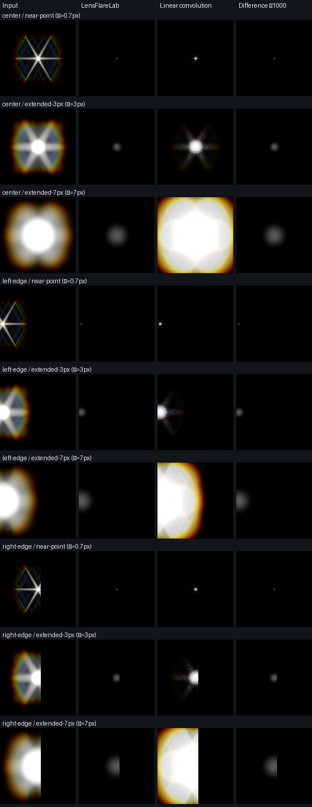

Measurements are in [`source-field-psf.csv`](examples/source-field-psf.csv).
Reproduce with:

```powershell
python tools/LensFlareLab/evaluate_source_field_psf.py build/tools/LensFlareLab/LensFlareLab.exe --diffraction-resolution 1024
```

The source is a synthetic neutral Gaussian, and the reference uses the same
renderer-derived point PSF. No measured aberrations, scattering, spectral
source, sensor response, or real camera flare capture is included. The result
supports the implementation's linear convolution and edge accounting only; it
does not establish photographic accuracy.

## Adaptive pupil sampling across source fields

I compared uniform 64² pupil sampling, adaptive 64² sampling at a 0.75 px
screen-error threshold, and uniform 128² reference sampling. The four neutral
1 px source fields are center `(0.50,0.50)`, upper-left `(0.26,0.26)`, top edge
`(0.50,0.02)`, and lower-right `(0.74,0.74)`. Each isolated render includes all
eligible ghost paths, uses three spectral bands, and disables direct and ghost
diffraction so the comparison measures geometric ray-map sampling.

| Field | Mode | Render time | RGB L1 vs 128² | Flux-normalized shape L1 | Centroid error |
|---|---|---:|---:|---:|---:|
| Center | Uniform 64² | 1.004 s | 4.09% | 4.13% | 0.044 px |
| Center | Adaptive 64² | 1.576 s | 2.90% | 4.18% | 0.032 px |
| Upper-left | Uniform 64² | 0.564 s | 3.99% | 5.51% | 0.065 px |
| Upper-left | Adaptive 64² | 1.030 s | 2.13% | 2.72% | 0.038 px |
| Top edge | Uniform 64² | 0.534 s | 3.88% | 5.45% | 0.067 px |
| Top edge | Adaptive 64² | 0.993 s | 1.75% | 2.30% | 0.036 px |
| Lower-right | Uniform 64² | 0.566 s | 3.99% | 5.51% | 0.065 px |
| Lower-right | Adaptive 64² | 1.009 s | 2.13% | 2.72% | 0.038 px |

Adaptive sampling lowers absolute RGB L1 at every tested field, by 29% at
center and 47–55% off-axis. It substantially improves normalized shape and
centroid away from center; at center, shape error is essentially unchanged
(4.18% versus 4.13%). It costs 1.6–1.9× the uniform-64 render time in this CPU
standalone run, while remaining faster than the 128² reference (about 0.57×).
The four positions are not a complete field validation, and the 128² output is
itself sampled rather than ground truth; this evidence supports adaptive
sampling as a useful quality/performance option, not a universal default.

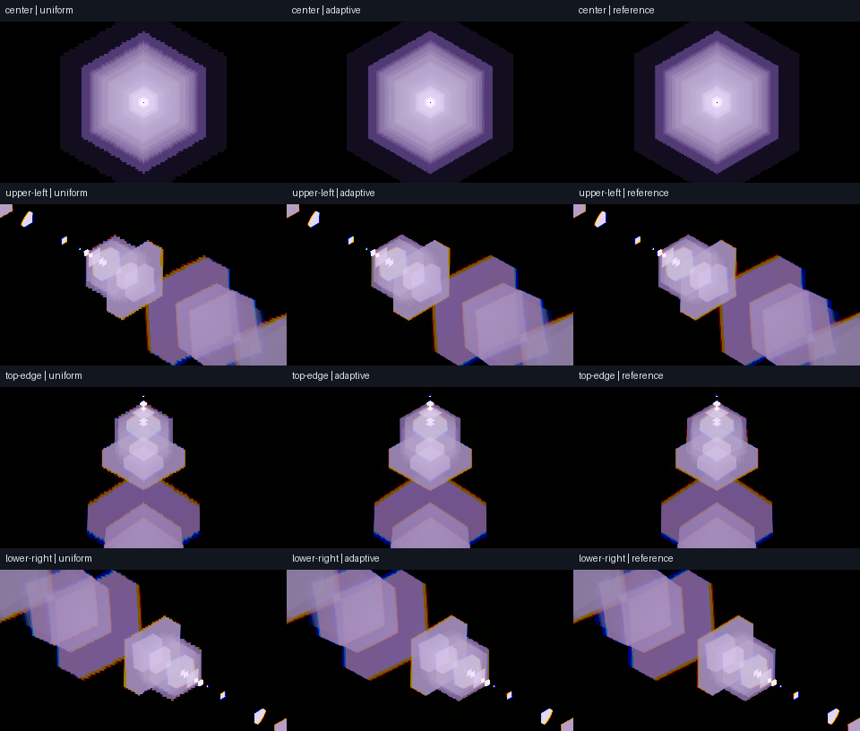

Per-field measurements are in
[`adaptive-field-convergence.csv`](examples/adaptive-field-convergence.csv).
Reproduce with:

```powershell
python tools/LensFlareLab/evaluate_adaptive_field_convergence.py build/tools/LensFlareLab/LensFlareLab.exe
```

### Isolated-path error and refinement-threshold sensitivity

The all-path field metric can hide a weak ghost's centroid or shape error, so I
also rendered five individual paths (13→9, 6→5, 5→0, 12→9, 10→7) at the same
four source fields. For every path/field pair with nonzero 128² reference flux,
adaptive 64² reduced RGB L1. The weak 5→0 and edge-shaped 6→5 paths showed the
largest uniform-grid shape errors: up to 25.13% and 12.42%, respectively; the
adaptive result reduced these to 8.84% and 4.26% in the top-edge field and to
13.83% and 4.72% in the upper-left field. One limitation emerged: for 6→5 at
upper-left and its symmetric lower-right field, adaptive sampling increased
the weighted-centroid error from 0.302 px to 1.362 px even while normalized
shape L1 fell from 12.42% to 4.72%. A single shape metric is therefore not a
sufficient acceptance measure for small, asymmetric ghosts.

To identify why a cell refines, the standalone renderer now reports separate
mapping-error, energy-error, partial-validity, and foldover trigger counts and
the maximum measured errors. The relative energy threshold is independently
configurable with `--adaptive-ray-refinement-energy-threshold` (default 0.25,
range 0.000001–4). A 42-path × four-field scan at 64² found 138 nonempty
path-field maps and 27,497 refined cells; every one came from the partial-
validity boundary rule. Maximum mapping error was 0.03422 px and maximum
relative energy error was 0.01463%; mapping, energy, and foldover triggers were
zero at the defaults. Repeating at energy threshold 0.01 produced identical
counts. An extreme 0.000001 threshold produced 377,796 energy triggers, while
the tested image quality changed negligibly. These results characterize the
sampled fields, not the entire optical field.

On upper-left 6→5, lowering the screen threshold to 0.005 px adds only two
mapping-error cells (139→141 total); at 0.001 px it adds 969 (1,108 total).
Against the 128² reference, RGB L1 improves from 4.106% to 4.098%, normalized
shape L1 stays about 4.720%, and centroid error stays about 1.362 px. For
13→7, 0.001 px adds 4,507 mapping cells but improves RGB L1 by only 0.016
percentage points over 0.005 px. The energy-only stress on 6→5 adds 129 cells
at 0.000001 without a material image-metric change. In these cases, denser
interior sampling offers little benefit; the remaining centroid shift is
consistent with clipped-boundary quadrature, but that attribution remains a
hypothesis requiring a targeted experiment.

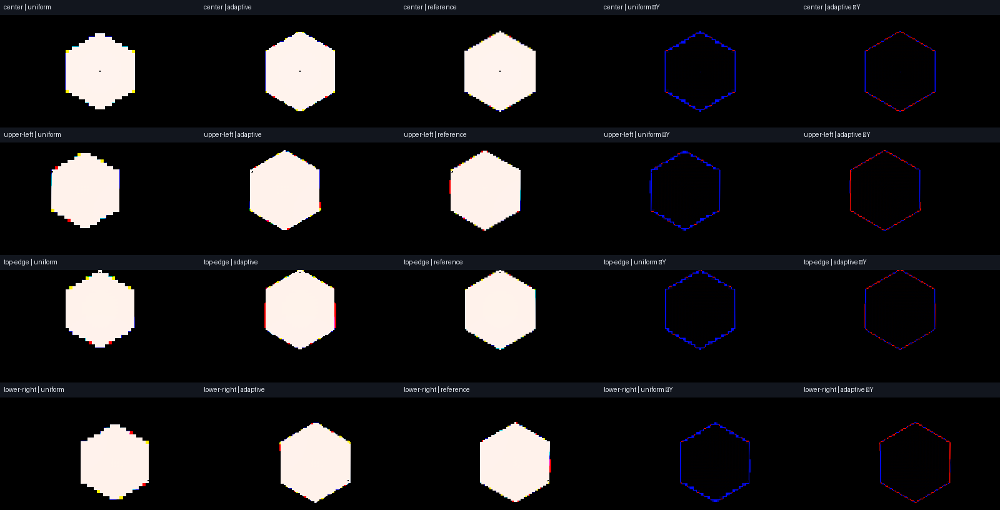

The per-path measurements and signed-difference plates are in
[`adaptive-path-convergence.csv`](examples/adaptive-path-convergence.csv) and
[`adaptive-path-convergence`](examples/adaptive-path-convergence/). The
threshold sweep is in [`adaptive-threshold-sensitivity.csv`](examples/adaptive-threshold-sensitivity.csv)
and [its comparison image](examples/adaptive-threshold-sensitivity.png).
The complete trigger map is in [`adaptive-trigger-map.csv`](examples/adaptive-trigger-map.csv)
and [its heatmap](examples/adaptive-trigger-map.png); the 0.01 energy-threshold
repeat and 0.000001 stress run are in
[`adaptive-trigger-map-energy001.csv`](examples/adaptive-trigger-map-energy001.csv)
and [`adaptive-trigger-map-energy1e6.csv`](examples/adaptive-trigger-map-energy1e6.csv).
The 13→7 comparison is in [`adaptive-threshold-13-7.csv`](examples/adaptive-threshold-13-7.csv).
Reproduce the studies with:

```powershell
python tools/LensFlareLab/evaluate_adaptive_ghost_paths.py build/tools/LensFlareLab/LensFlareLab.exe
python tools/LensFlareLab/evaluate_adaptive_threshold_sensitivity.py build/tools/LensFlareLab/LensFlareLab.exe
python tools/LensFlareLab/scan_adaptive_refinement_triggers.py build/tools/LensFlareLab/LensFlareLab.exe
```

## Full-field coverage of reflected paths

The 42 eligible surface-pair paths were measured over a 5×5 source grid
(`u,v = 0.02, 0.26, 0.50, 0.74, 0.98`) with a neutral 1 px source, 96² pupil
sampling, three spectral bands, and diffraction disabled. A path is visible
when the standalone renderer's per-path pixel-integrated luminance is positive.
All 42 paths appear at the central field; only 23 appear in the earlier
edge-only survey. The edge-only absence therefore did not indicate that those
paths are blocked—their images land inside the sensor at central field angles.
Several paths have restricted footprints: 10→7, 12→7, and 12→9 registered at
only the center sample in the coarse grid.

A second 5×5 grid over `u,v = 0.44, 0.47, 0.50, 0.53, 0.56`, at the same 96²
pupil grid, found all 42 paths in all 25 fields. In particular, the three
coarse-grid center-only paths remain visible throughout this central region;
they were not isolated to the exact on-axis point. Their integrated Y ranges
were 0.0446–0.0745 (10→7), 0.0723–0.0755 (12→7), and 0.1225–0.1302 (12→9).
This demonstrates that visibility can change substantially with field angle
and that a coarse full-frame grid can miss intermediate narrow footprints,
but it does not establish the full boundary of each path's footprint.

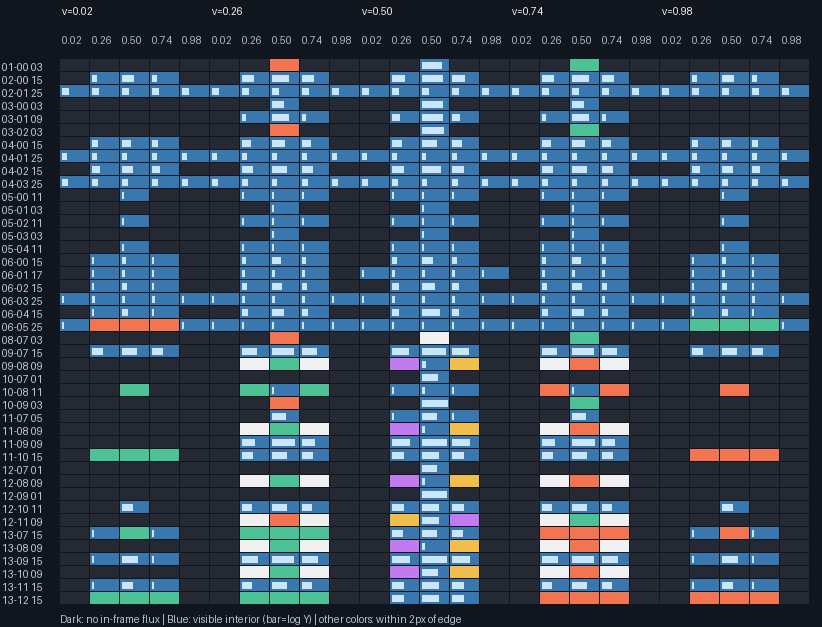

The center refinement CSV and its heatmap are in
[`ghost-field-center-refine.csv`](examples/ghost-field-center-refine.csv) and
[`ghost-field-center-refine.png`](examples/ghost-field-center-refine.png).
Reproduce the two scans with:

```powershell
python tools/LensFlareLab/evaluate_ghost_field_coverage.py build/tools/LensFlareLab/LensFlareLab.exe
python tools/LensFlareLab/evaluate_ghost_field_coverage.py build/tools/LensFlareLab/LensFlareLab.exe --output-dir build/tools/LensFlareLab/field-center-refine --ray-grid 96 --positions 0.44 0.47 0.50 0.53 0.56 --csv-output tools/LensFlareLab/examples/ghost-field-center-refine.csv --image-output tools/LensFlareLab/examples/ghost-field-center-refine.png
```

The per-field/per-path flux, weighted centroid, sensor bounds, and edge-contact
mask are recorded in [`ghost-field-coverage.csv`](examples/ghost-field-coverage.csv).
The coarse sweep is a detection map, not a proof of continuous visibility or a
comparison against a measured lens image.

## Fig. 10 analytical-reference path-layout diagnostic

The paper's Angenieux `Ref.` image is an analytical ray-tracing reference,
but it does not publish the source coordinates, coating stack, sensor mapping,
or radiometric calibration needed for absolute image error. To make the
qualitative comparison inspectable, LensFlareLab now exports every visible
reflected path's integrated luminance and sensor-space bounds for each
estimated source marker. The bounds are geometric extents, while
`centroid_x/y` is the per-path pixel-luminance-weighted centroid. Surface
indices are zero-based. Reproduce the diagnostic with:

```powershell
python tools/LensFlareLab/make_fig10_comparison_chart.py
LensFlareLab.exe build/tools/LensFlareLab/fig10-angenieux-two-light-input.pfm build/tools/LensFlareLab/fig10-two-light-diagnostic.pfm --source-samples 1 --ray-grid 192 --gain 1 --diffraction off --ghost-report-csv tools/LensFlareLab/examples/fig10-ghost-paths.csv
python tools/LensFlareLab/make_fig10_ghost_path_chart.py
```

Both highlights are detected from the same image in one invocation, avoiding
per-source rerendering; measured centers are `(0.245696,0.356546)` and
`(0.389671,0.693593)`, close to the estimated marker centers. Source A has 31
visible paths and summed in-frame ghost luminance 3.92259; source B has 40 and
6.94671. The strongest paths are surfaces 13→9 for A and 11→9 for B. These
sums depend on the synthetic source radiance and approximate coatings; they
are diagnostic, not paper measurements. The plotted rectangles show
sensor-space bounds for all visible paths; the six brightest are labeled and
marked with white centroid dots.

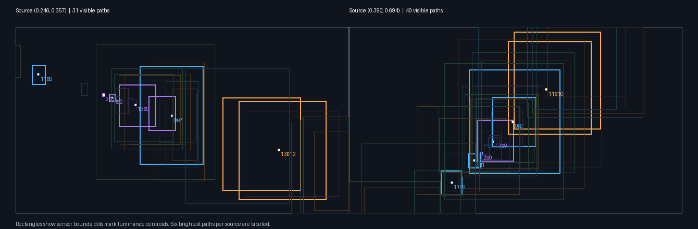

### Off-axis, weak-path, and sensor-edge continuity

The continuity sweep covers four cases at grid 96: bright paths 13→9 and
11→9 under horizontal ±6 px source motion, weak path 5→0 under vertical ±6 px
motion, and path 6→5 for a source near the upper-left field under vertical
±18 px motion. All 20 samples retained a visible path and showed no centroid
jump. The weak path's Y varied smoothly from `8.05e-5` to `9.39e-5`. The edge
path's visible bounds approached y=1 px at one end and moved to y=11 px at the
other; its in-frame Y varied by 2.8% peak-to-peak across the sweep. This checks
near-edge motion for that path; the full boundary scan below separately
measures paths that reach the raster border.

For the two bright horizontal cases, path 13→9's centroid X moves 4.32 px as
the source moves 12 px; path 11→9's centroid X moves 20.43 px. Their distinct
motion sensitivities rule out a single global source-to-ghost motion scale.

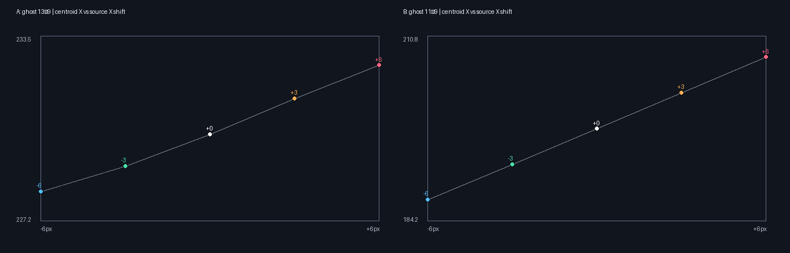

The reproducible sweep and measurements are in
[`evaluate_fig10_field_continuity.py`](evaluate_fig10_field_continuity.py) and
[`fig10-field-continuity.csv`](examples/fig10-field-continuity.csv). It creates
a neutral point-source fixture for the edge case and uses the Fig. 10 chart for
the other three cases.

### All eligible ghost paths near the four sensor edges

The edge survey sampled 20 source fields: five positions along each normalized
sensor edge, with the other coordinate fixed at 0.02 or 0.98. It examined all
42 eligible reflection paths at ray grid 96. Of 840 path/field combinations,
206 produced in-frame light across 23 unique paths. Thirty observations entered
the 2 px boundary band; all were on the top or bottom edges. None of the tested
left/right-edge fields produced a path in the boundary band. The recurring
boundary paths were 6→5 (10 observations), 11→10 (6), 13→7 (6), 13→12 (6),
and 10→8 (2). This side imbalance is limited to these normalized source
positions; the sensor's physical aspect ratio makes equal normalized x/y
offsets different physical field angles.

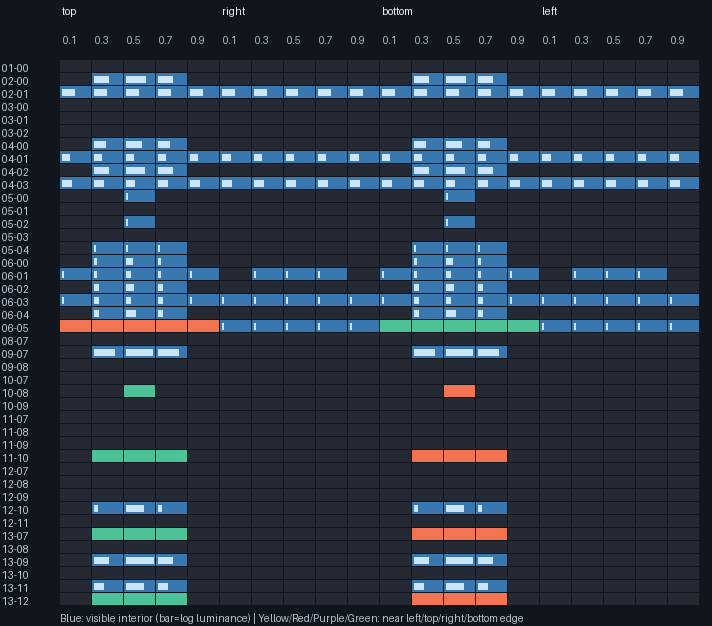

The five recurring paths were then sampled at nine vertical source positions
from each edge to the center. All 90 path/field samples remained visible. For
path 6→5, the top-edge band flag cleared between source `v=0.04` and `v=0.06`;
the mirrored bottom-edge flag appeared between `v=0.94` and `v=0.96`. The four
other paths also moved away from the opposite edge: 11→10, 13→12, and 10→8
cleared the bottom band between `v=0.20` and `v=0.30`, while 13→7 cleared it
between `v=0.30` and `v=0.40`. The mirrored top-band flags cleared between
`v=0.70` and `v=0.80` for 11→10, 13→12, and 10→8, and between `v=0.60` and
`v=0.70` for 13→7. Bounds and weighted centroids moved continuously through
these sampled transitions; none of these paths disappeared before the source
reached the center.

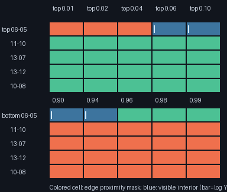

Reproduce the full scan and focused edge sweep with:

```powershell
python tools/LensFlareLab/evaluate_field_edge_visibility.py build/tools/LensFlareLab/LensFlareLab.exe --ray-grid 96
python tools/LensFlareLab/evaluate_sensor_edge_path_motion.py build/tools/LensFlareLab/LensFlareLab.exe --ray-grid 96
```

The corresponding measurements are in
[`field-edge-visibility.csv`](examples/field-edge-visibility.csv) and
[`sensor-edge-path-motion.csv`](examples/sensor-edge-path-motion.csv). The
boundary flag denotes a raster extent within 2 px of an image edge; it is not
a measurement of energy outside the sensor crop.

The qualitative evidence is that moving between the two marker positions
changes both the number of sensor-visible paths and their spatial arrangement.
This makes the Lab useful for tracing discrepancies against the analytical
reference, while avoiding unsupported pixel-error claims. The published
reference is [Bodonyi et al., Fig. 10](https://doi.org/10.1007/s00371-024-03625-7).

### Ray-grid convergence at the same two detected sources

To check whether the polygon patches are only a coarse-grid artifact, the
combined two-source fixture was rendered at ray grids 192 and 512 with all
other settings fixed. The 512 result raises integrated in-frame Y by 1.10%,
raises peak Y by 1.99%, and shifts the combined luminance centroid by 0.22 px.
The shared-display relative Y image L1 is 1.99%. The 512 image retains the
same broad polygon boundaries visible at 192, so pupil-grid density alone does
not remove their faceted appearance. This points to an image-formation or
display-calibration gap, though the tiny paper panel and its unpublished tone
curve prevent assigning that difference to a specific optical cause.

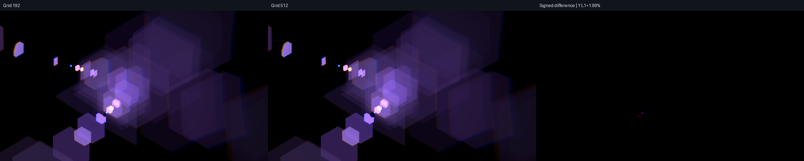

Reproduce the two renders and plate with:

```powershell
LensFlareLab.exe build/tools/LensFlareLab/fig10-angenieux-two-light-input.pfm build/tools/LensFlareLab/fig10-two-light-grid192.pfm --source-samples 1 --ray-grid 192 --gain 1 --diffraction off
LensFlareLab.exe build/tools/LensFlareLab/fig10-angenieux-two-light-input.pfm build/tools/LensFlareLab/fig10-two-light-grid512.pfm --source-samples 1 --ray-grid 512 --gain 1 --diffraction off
python tools/LensFlareLab/compare_fig10_raygrids.py build/tools/LensFlareLab/fig10-angenieux-two-light-input.pfm build/tools/LensFlareLab/fig10-two-light-grid192.pfm build/tools/LensFlareLab/fig10-two-light-grid512.pfm
```

Its positive-channel p99.9 white point is shared across both display panels;
signed difference is linear. These are sampled model convergence
measurements, not validation against calibrated camera data.

## Display-only logarithmic view for full-field ghost comparison

`make_ghost_diffraction_comparison.py` keeps the legacy Reinhard view as its
default and adds `--tone-map log` for inspection of low-radiance structures.
The log view derives one white point from the selected source-subtracted crop
across both renders (99.9th percentile by default), so geometric and propagated
panels use the same display scale. `--log-contrast` controls display contrast;
the signed-difference panel remains linear and has an independent
`--difference-gain`. These controls affect only the diagnostic PNG, not the
PFM radiance or the lens/ghost model.

On the 640×360 multi-source evaluation chart, a 64² ray grid, three spectral
bands, all 42 eligible ghost paths, and direct diffraction produced 2,254
path-band patches at 100 mm propagation distance. The common log white was
10.0469971 radiance at p99.9. The log view reveals faint polygonal ghost
structures that are largely hidden by the legacy Reinhard view. They are useful
to inspect, but their visibility in this display is not evidence of extra
physical energy: logarithmic contrast intentionally lifts the low end. A
separate ray-grid convergence study below shows that the large polygonal faces
are also present in the geometric baseline and remain recognizable through
512² sampling, so they are not unique to the Fresnel pass; residual discretizing
error still remains. The Fresnel integrated input and normalized output both
measured 1847.42022, while the uncorrected cropped output was 1847.4055.

Hullin et al. describe photographic flare from lens interreflections and model
ghost structure through the actual lens, with wavelength-dependent coatings
and aberrations ([SIGGRAPH 2011 paper](https://resources.mpi-inf.mpg.de/lensflareRendering/)).
Abd El-Maksoud and Sasian likewise describe ghost images as structured images
whose nonparaxial form depends on the optical system, rather than generic spots
([Applied Optics 2011](https://doi.org/10.1364/AO.50.002305)). Those results make
the mapped polygonal ghost footprints plausible, but do not validate this
synthetic prescription or its phase model against a real lens.

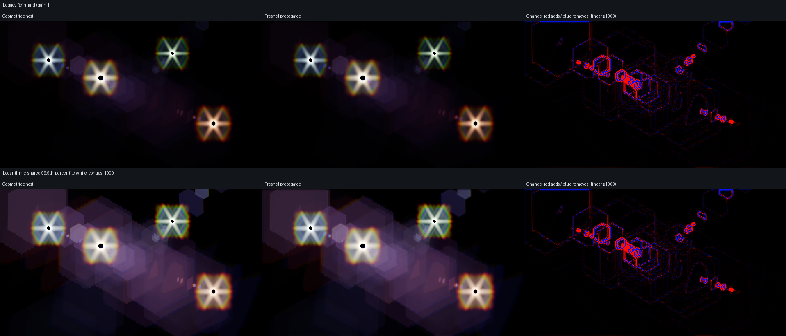

Recreate the comparison from the standard evaluation chart and its matched
geometric/Fresnel PFM renders with:

```text
python tools/LensFlareLab/make_ghost_diffraction_comparison.py build/tonemap-full-input.pfm build/tonemap-full-geometric.pfm build/tonemap-full-fresnel.pfm build/tonemap-full-log.png --crop 0 0 639 359 --gain 1 --difference-gain 1000 --tone-map log --log-contrast 1000 --white-percentile 99.9
```

Use the same command with `--tone-map reinhard` to reproduce the legacy
comparison. For an isolated bright ghost, the same logarithmic settings can
compress highlights heavily; choose crop and contrast for the diagnostic and
do not interpret either display transform as exposure-calibrated output.

## Ghost ray-grid convergence and adaptive sampling

To test whether the large polygonal ghost structure was created by the Fresnel
display path, I rendered the same isolated neutral 1 px source at `(0.3834,
0.3844)` with 3 spectral bands, 42 eligible paths, and ray grids 32, 64, 128,
256, and 512. Each geometric render is compared with its own 512² result, and
each Fresnel render is compared with its matching 512² result; 512² is a finite
reference, not ground truth. RGB shape error first scales each render to the
reference's channel-summed flux, so it separates shape changes from the slower
flux quadrature convergence.

| Sampling | Runtime (geometric / Fresnel) | Geometric flux error / shape L1 | Fresnel flux error / shape L1 | Centroid error, geometric / Fresnel |
| --- | ---: | ---: | ---: | ---: |
| Uniform 64² | 0.80 / 2.78 s | 4.11% / 6.34% | 4.17% / 6.47% | 0.302 / 0.287 px |
| Adaptive 64², 0.75 px threshold | 1.35 / 3.53 s | 1.44% / 2.40% | 1.50% / 2.57% | 0.044 / 0.032 px |
| Uniform 128² | 2.46 / 4.67 s | 2.30% / 3.64% | 2.35% / 3.83% | 0.077 / 0.070 px |
| Uniform 256² | 9.27 / 11.93 s | 0.63% / 1.14% | 0.66% / 1.28% | 0.024 / 0.021 px |
| Uniform 512² | 35.88 / 38.16 s | reference | reference | reference |

The 32² uniform grid classified 41/42 paths as visible; 64² and higher found
all 42. At adaptive 64², 10,292 cells were refined (2.06%), with 500,094 center
rays and 41,168 edge rays. Against the 512² reference, adaptive 64² lowered
shape L1 about 62% relative to uniform 64² and reduced flux error by roughly
2.7 percentage points, while taking 1.35 s geometric / 3.53 s Fresnel in this
run. Uniform 256² is more accurate, but took about 7–9 times longer. This makes
the existing adaptive option a strong Lab quality/performance candidate for
these settings, not a universal default: the sweep uses one point-like source,
one field, one prescription, and only 3 spectral bands.

At matching grid sizes, the Fresnel-to-geometric RGB image difference stays
near 9.2% from 64² through 512². This confirms that the propagated result is
not merely a coarse-grid residual in this fixture. The polygonal faces persist
in both models as resolution increases, consistent with the lens-mapped ghost
images discussed in the cited optics literature. Fine edge convergence and
phase realism still need a broader field/path sweep and real-lens reference
images.

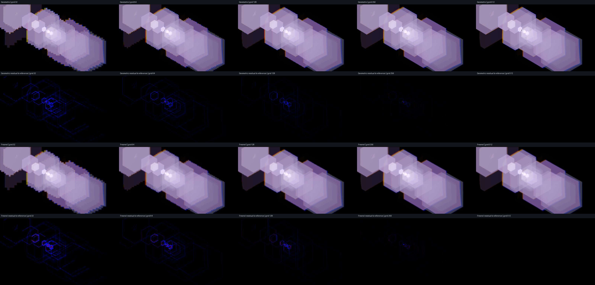

The per-grid flux, runtime, centroid, RGB L1, and flux-normalized shape L1
measurements are in
[`ghost-raygrid-convergence.csv`](examples/ghost-raygrid-convergence.csv).
The first and third rows of the contact sheet use a shared log-display white;
the residual rows use a shared p99.9 absolute-luma scale within each model, with
red for added and blue for missing radiance relative to grid 512.
Recreate them with:

```text
python tools/LensFlareLab/make_evaluation_chart.py --output build/tools/LensFlareLab/raygrid-input.pfm --source-only --light-scale 4096 --single-light-position 0.3834 0.3844 --source-radius 1 --single-light-neutral
python tools/LensFlareLab/evaluate_ghost_raygrid_convergence.py build/tools/LensFlareLab/LensFlareLab.exe build/tools/LensFlareLab/raygrid-input.pfm --output-dir build/tools/LensFlareLab/raygrid-study --grids 32 64 128 256 512
python tools/LensFlareLab/evaluate_ghost_raygrid_convergence.py build/tools/LensFlareLab/LensFlareLab.exe build/tools/LensFlareLab/raygrid-input.pfm --output-dir build/tools/LensFlareLab/raygrid-adaptive-study --grids 64 --extra-arg=--adaptive-ray-refinement --extra-arg=on
```

### Radiance-weighted source-bin placement

The experimental `--source-sampling weighted-quantile` option places source
bin boundaries at weighted luminance quantiles of the detected footprint;
`equal-grid` remains the default. The implementation applies the quantiles to
the horizontal and vertical luminance marginals, then retains the existing
2D-bin flux, centroid, and chromaticity accumulation. This is a deterministic
footprint-aware partition, not a Monte Carlo estimator or a claim of unbiased
importance sampling. The motivation is consistent with the general sampling
principle of distributing strata over a contribution domain, while the precise
quantile-binning scheme here is an experimental LensFlareLab heuristic; see
[pbrt's discussion of careful sample placement](https://www.pbr-book.org/3ed-2018/Monte_Carlo_Integration/Careful_Sample_Placement).

In a synthetic four-light HDR chart, isolated path 10→8, ray grid 96, and
threshold-default settings, weighted quantiles populated substantially more
bins for both the small off-axis blue source and the larger center source.
For the small blue source, equal-grid 9 bins populated only 1 direction and
weighted-quantile populated 9; at 25 requested bins, weighted mode populated
25 while equal-grid populated 9. Against the weighted 49-bin render, weighted
9/25-bin image L1 was 1.064%/0.494%, compared with 4.928%/4.451% for
equal-grid 9/25. Weighted mode reached its 49-bin image at 49 requested bins;
225 requested bins did not add occupied directions. For the larger center
source, weighted 9/25/49 bins produced 1.475%/0.822%/0.515% L1 against the
weighted 225-bin reference, compared with 7.105%/3.650%/2.387% for equal-grid
9/25/49. Weighted 49 took about 1.96 s versus 2.26 s for equal-grid 169 in
this run, while weighted 225 took 4.73 s and equal-grid 225 took 2.72 s.

The weighted 225-bin image is only a denser comparison reference, not ground
truth: changing pupil ray grid 64→128 at fixed source sampling 225 changed
image L1 by 2.28% in this same optical path. These results cover two sources,
one synthetic prescription and one ghost path; they do not establish a general
quality threshold. The mode stays opt-in because additional occupied bins can
increase render time, and footprint-aware placement changes the look of finite
source integration. The equal-grid default was checked against prior PFM
renders and remained byte-identical.

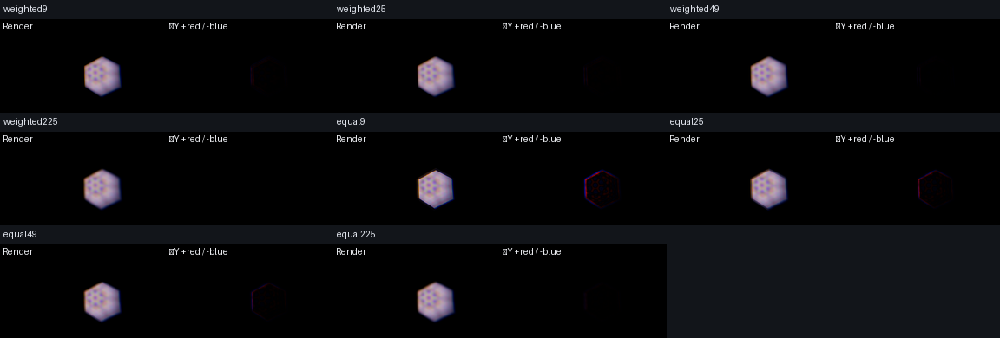

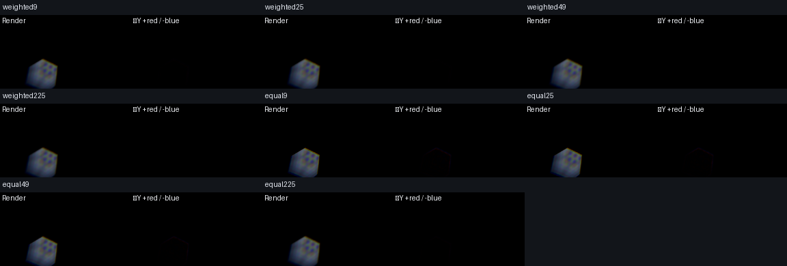

Reproduce the comparisons using the four-light PFM fixture and
`--source-sampling equal-grid|weighted-quantile`, keeping `--ray-grid 96`,
`--position` fixed to the source under study, and `--ghost-pair 10 8`. The
chart generator takes the resulting PFM images and reports the shared-reference
L1 and centroid metrics.

### Asymmetric multi-lobe source and a second ghost path

To see whether the result depended on a single Gaussian emitter, a reproducible
neutral source was built from three overlapping Gaussian lobes at unequal
offsets and strengths. Both source modes used the same source center, threshold,
ray grid 96, and only the requested path. Source flux was preserved within
0.00003% by the bin accumulation. The following relative L1 values use the
weighted 225-bin image of each path as the comparison reference; they measure
agreement with that sampling layout rather than error against physical truth.

| Path | Sampling layout | Active bins at requested 9 / 49 / 225 | Relative L1 at 9 / 49 / 225 |
| --- | --- | ---: | ---: |
| 9→8 | Equal grid | 9 / 27 / 93 | 7.70% / 2.70% / 1.34% |
| 9→8 | Weighted quantile | 9 / 49 / 182 | 3.08% / 1.02% / reference |
| 10→8 | Equal grid | 9 / 27 / 93 | 6.62% / 1.96% / 0.80% |
| 10→8 | Weighted quantile | 9 / 49 / 182 | 2.14% / 0.69% / reference |

The equal-grid 225-bin images differ from weighted 225 by 1.34% on 9→8 and
0.80% on 10→8. This is a visible sampling-layout effect and prevents treating
either mode's densest image as an unbiased reference. A single wall-clock run
of path 10→8 took 0.365/1.022/3.469 s for equal-grid 9/49/225 and
0.351/1.832/6.772 s for weighted quantiles. Timings are machine- and load-
dependent; the larger weighted cases are slower because they trace more active
directions. The 49-bin comparison gains substantial image agreement at about
1.8× the equal-grid time for this emitter.

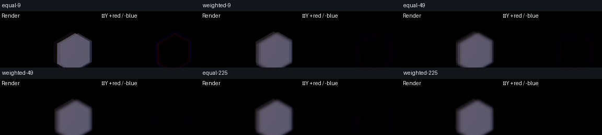

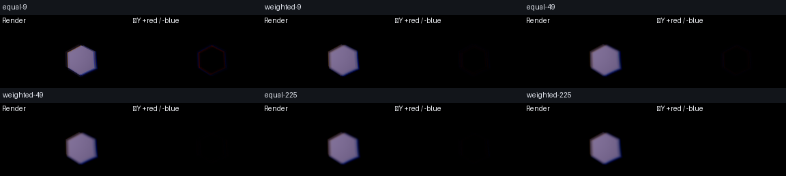

Regenerate the source with `python tools/LensFlareLab/make_multilobe_source.py`.
For both paths, render with `--position 0.383 0.384 --ray-grid 96
--ghost-pair FIRST SECOND --diffraction off`, source counts 9/49/225, and both
`--source-sampling equal-grid` and `weighted-quantile`. The charts use the same
shared exposure and display the 225-bin weighted image as an explicitly
sampling-dependent comparison reference.

#### Extraction-threshold sensitivity

The same three-lobe source and 10→8 path was rendered at thresholds 0.85, 2,
and 4 radiance units, holding ray grid 96 fixed. At 49 requested bins,
equal-grid populated 27/23/22 directions as the threshold rose; weighted
quantiles populated all 49 in each case. Relative L1 against the weighted
225-bin image stayed in a narrow range: equal-grid 49 measured
1.963%/1.963%/1.964%, and weighted 49 measured 0.694%/0.738%/0.726%.
The input footprint flux fell from 138,364 to 136,112, while each mode's
reported sampled flux remained within 0.00002% of its corresponding extracted
flux. For these three thresholds, the weighted-bin advantage is not an artifact
of one threshold choice. This is still one synthetic spatial profile and one
path, so it does not establish behavior for clipping, saturation, or measured
sources.

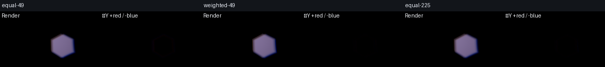


#### Lobe-separation sensitivity

The same profile was regenerated with its lobe offsets multiplied by 1.8 while
keeping each lobe's width and intensity fixed. On path 10→8, equal-grid versus
weighted active bins were 27 versus 49 at 49 requested and 110 versus 194 at
225 requested. Against the weighted 225-bin image, L1 at 9/49 bins was
5.39%/1.89% for equal-grid and 2.59%/1.07% for weighted quantiles. The
equal-grid 225 image differed from the weighted reference by 0.81%. This
supports the benefit on a more spatially spread source, while again exposing
sampling-layout dependence at high counts.

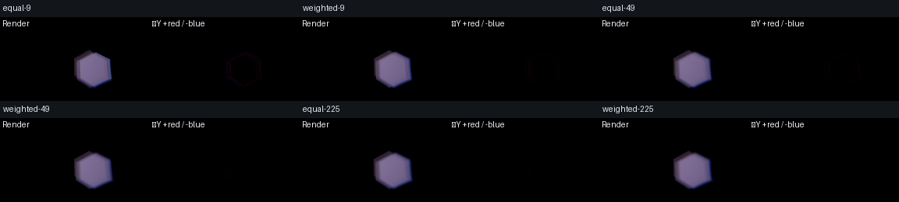

#### Color-separated source lobes

The generator's `--color-separated` mode assigns warm, blue, and red spectra
to the three lobes. On path 10→8 at ray grid 96, the weighted 225-bin render
is again only a denser comparison reference. RGB L1 is measured on the flare
after subtracting the original input, so the bright emitter itself does not
dilute the metric.

| Sampling | RGB L1 | Red L1 | Green L1 | Blue L1 |
| --- | ---: | ---: | ---: | ---: |
| Equal grid, 9 | 7.55% | 6.93% | 6.94% | 8.52% |
| Weighted quantile, 9 | 2.92% | 2.90% | 2.70% | 3.05% |
| Equal grid, 49 | 2.69% | 2.67% | 2.68% | 2.71% |
| Weighted quantile, 49 | 1.16% | 1.10% | 1.09% | 1.25% |
| Equal grid, 225 | 1.25% | 1.23% | 1.22% | 1.29% |

Blue has the largest residual at low sampling, but weighted quantiles reduce
the per-channel error along with the combined RGB error. The source's
integrated luminance flux is preserved within 0.00003% by the binning. This
does not imply spectral accuracy: the three source colors are synthetic RGB
triplets and the comparison still uses this model's path optics.

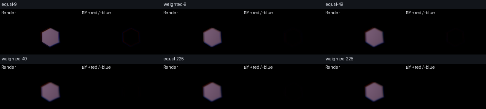

Reproduce with `python tools/LensFlareLab/make_multilobe_source.py
--color-separated`, render 9/49/225 bins in both modes on path 10→8, then run
`measure_rgb_error.py INPUT WEIGHTED_225 --case LABEL RENDER ...`. The utility
subtracts the unprocessed input and reports flare-only RGB and per-channel L1.

#### Sources clipped by the image boundary

The generator's `--position U V` places the asymmetric emitter near a frame
edge. At x=0.01, only 87,320 of the centered profile's 138,364 thresholded
luminance units remain in-frame (63.1%); at x=0.99, 131,826 remain (95.3%),
because the brighter and weaker lobes point in different directions. `--auto`
detected both sources near the edge and `--source-report` marked
`touchesFrameBoundary=true`; the centered control reports false. The detector
preserves the measured visible flux within float-rounding error, but cannot
infer the missing off-frame 36.9% or 4.7%. It intentionally does not multiply
the visible source by a guessed completion factor.

For the visible 6→5 path at grid 96, the weighted 225-bin image again serves
only as a layout-dependent reference. At requested 9/49 bins, left-edge
equal-grid L1 is 3.54%/1.40% and weighted L1 is 1.13%/0.40%; right-edge values
are 3.39%/1.66% and 1.76%/0.51%. Flare-only RGB L1 at 49 bins is 1.47% equal
versus 0.45% weighted on the left, and 1.73% versus 0.57% on the right. The
equal-grid 225 image differs from the weighted reference by 0.53%/0.57% at
the left/right edge. Automatic source-center estimates (0.003,0.379) and
(0.981,0.379) produce 0.53%/0.65% RGB L1 against the corresponding weighted
225 reference at 49 bins, including detection-center variation.

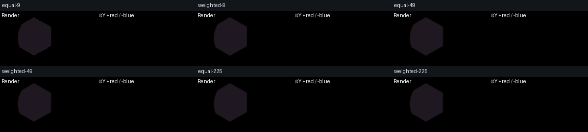

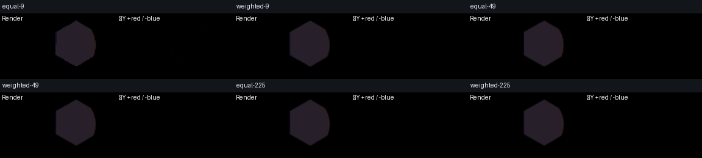

Regenerate with `make_multilobe_source.py --position 0.01 0.384` or
`--position 0.99 0.384`, render the visible `--ghost-pair 6 5` at 9/49/225
bins with both sampling modes, and compare against the weighted 225 image.
`--source-report` flags visible source pixels touching the frame boundary; it
is a truncation warning, not an estimate of the complete emitter energy.

### Optical path length diagnostic

The optional `--optical-path-report` traces the selected ghost pair at the
central and four half-radius pupil coordinates for 610/550/460 nm. The
`--optical-path-map CSV` option extends this to every active pupil-grid ray.
Optical
path accumulates `n × segment length` through the actual reflected and
refracted ray sequence, including air travel to the iris. A common incident
reference plane 100 mm before the first surface is used so the entrance-pupil
origin shift is included. Coating phase is omitted.

For the Angenieux 9→8 path at source `(0.3834,0.3844)`, the x half-radius pupil
rays differ in OPL by 1.516/1.523/1.538 mm at 610/550/460 nm (about 2,485/
2,769/3,344 phase cycles). This confirms that a future coherent model must
retain dense pupil sampling and handle phase modulo wavelength carefully.
The diagnostic does not yet model complex Fresnel amplitudes, thin-film
reflection phase, phase unwrapping, or coherent propagation, and therefore
does not alter or validate the rendered flare image. Enabling the report leaves
the PFM byte-identical to the same render without the report.

The full 9→8 path map was sampled at grids 64/128/256/512 for source
`(0.3834,0.3844)`. Median absolute phase change between neighboring valid
pupil rays at grid 512 is 6.48/7.23/8.75 cycles at 610/550/460 nm; the 90th
percentiles are 12.50/13.90/16.72 cycles. These exceed the 0.5 cycle/sample
Nyquist limit by more than an order of magnitude, so even grid 512 cannot
sample the path phase. Coarser grids produce aliased wrapped phase maps, and
the regular rings at grid 512 still represent undersampling rather than a
converged diffraction pattern. The map establishes that a coherent model
needs a different formulation or much more efficient oscillatory integration;
it does not provide evidence for simply multiplying the current ghost pixels
by an OPL-derived phase.


Reproduce maps with `--ray-grid N --ghost-pair 9 8 --optical-path-map
build/opl-grid-N.csv`, then create the chart with:

```powershell
python tools/LensFlareLab/make_optical_path_phase_chart.py `
  --case grid64=build/opl-grid-64.csv `
  --case grid128=build/opl-grid-128.csv `
  --case grid256=build/opl-grid-256.csv `
  --case grid512=build/opl-grid-512.csv `
  tools/LensFlareLab/examples/ghost-optical-path-phase-sampling.png
```

Reproduce with `LensFlareLab input.pfm output.pfm --position 0.3834 0.3844
--ray-grid 32 --source-samples 1 --diffraction off --ghost-pair 9 8
--optical-path-report`.

### Adaptive off-axis ray refinement

Adaptive refinement probes every pupil-cell center and refines cells when the
mapped center departs from corner interpolation by more than 0.75 px, raw
ray energy changes by more than 25%, or the map folds. Four traced edge
midpoints form an eight-triangle center fan; each child keeps one quarter of
the parent pupil-cell ray weight. Refinement is one level deep. The energy
criterion uses unweighted optical-trace energy, so enabling the optional FrFT
aperture texture cannot change the selected mesh.

The updated multi-field comparison uses neutral point sources at `(0.1,0.1)`
and `(0.5,0.5)`, ray grid 64 adaptive and uniform, source sampling 1, and the
same triangle-normalized FrFT settings. Uniform grid 512 is the densest available
reference, but it is not converged ground truth: uniform 192→512 image L1 is
2.23% at the corner and 4.12% at center; frame Y changes +2.26% and -1.76%.

Against the grid-512 render, adaptive-64 FrFT relative image L1 is 4.52% at
the corner and 5.52% at center, compared with 9.25%/7.58% for uniform 64.
Adaptive does not always beat an intermediate uniform grid: at the corner,
uniform 128 gives 3.97%; at center adaptive is slightly better than uniform
128 (5.52% vs 5.94%). Frame Y for adaptive is `9.67245` / `396.83152`,
versus `10.03722` / `387.34909` for grid 512. Centroid shifts from the
reference are 0.074 px / 0.017 px. The adaptive mesh refines 820 cells (0.16%
of all probes) at the corner and 10,148 (2.03%) at center, across all paths
and spectral maps. The central field therefore triggers substantially more
work despite the source being on-axis.

One-shot process wall times on the same machine, including image I/O, were
0.875 s adaptive-64 vs 0.915 s uniform-96 at the corner, and 1.680 s vs 1.879 s
at center. Adaptive was 1.56–1.81x slower than uniform 64, while slightly
faster than uniform 96 in these runs. These single measurements show a possible
quality/runtime tradeoff around grid 96, not a stable performance guarantee.


The comparison plates show the isolated flare and signed luminance difference
(red adds, blue removes) at a shared exposure. Recreate them with
`make_adaptive_refinement_comparison.py` after rendering adaptive grid 64 and
uniform grids 64/96/128/192/512 from identical source PFMs and render settings.
The tool reports frame Y, relative L1, peak, and centroid for every candidate.

### Automatic four-source flare evaluation

The synthetic full-scene chart was rendered at source scale 1024 with automatic
light detection, 3x3 source sampling, and the adaptive base grid 64. It detected
four emitters at `(0.383,0.384)`, `(0.657,0.217)`, `(0.185,0.265)`, and
`(0.814,0.696)`, with 42/42, 32/42, 25/42, and 29/42 visible ghost paths.
The weaker three emitters populated only 1/9, 5/9, and 6/9 source-direction
bins, while the strongest populated 9/9; this is a limitation of the current
thresholded source sampler in a multi-light scene. The adaptive planner traced
10,501,974 center probes and refined 135,503 cells (1.29%), identically with
FrFT enabled and disabled.

In the complete flare with direct-source diffraction enabled, adaptive64 versus
uniform96 FrFT gives relative image L1 0.145%, frame Y `2943.80` vs `2941.49`,
and centroid shift 0.042 px. The direct-source diffraction dominates this
whole-frame metric. With direct-source diffraction disabled to isolate reflected
ghosts, adaptive64 vs uniform96 gives 1.59% L1, Y `275.05` vs `272.69`
(+0.87%), and centroid shift 0.189 px; uniform64 is 2.57% L1 from uniform96.
Thus adaptation improves the four-source ghost image over the base uniform grid
for this chart, while the final composite is visually much less sensitive.

Comparing adaptive geometry against adaptive triangle-FrFT at the same mesh,
the full composite changes by 1.57% relative L1, +0.076% frame Y, and 0.127 px
centroid shift. In the ghost-only image the aperture texture changes L1 by
17.06%, increases frame Y by 0.72%, and moves the centroid 1.55 px. These
measures keep the visual effect visible without hiding its small contribution
to the full image.

One-shot wall times including PFM I/O were 22.6–23.5 s for adaptive64,
13.0–13.1 s for uniform64, and 25.6–28.6 s for uniform96 across the ghost-only
and full-composite runs. Adaptive64 costs substantially more than uniform64
and only saves about 8–18% against uniform96 on this machine. These are single
runs on a deterministic synthetic plate, not benchmark statistics or measured
real-lens validation.


Recreate the source with `make_evaluation_chart.py --light-scale 1024`. Render
all modes with `--source-samples 9 --gain 1 --adaptive-ray-refinement on` for
adaptive cases, adding `--diffraction on|off` and `--ghost-frft on|off` as
appropriate; uniform references use the same commands without the adaptive flag
and with `--ray-grid 64|96`. Use
`make_adaptive_refinement_comparison.py` to create the shared-exposure plates
and report frame Y, image L1, peak, and centroid.

### Source-bin convergence on the automatic multi-light chart

To separate source-angle sampling from pupil-ray sampling, the four-light HDR
chart at scale 1024 was rendered with only path `10→8`, fixed `--position`,
triangle FrFT normalization, and pupil ray grid 96. The detected emitter near
`(0.383,0.384)` has integrated flux `288180.09`; across requested source grids
1, 9, 25, 49, 81, 121, 169, and 225, the report activates 1, 9, 9, 21, 29,
45, 57, and 69 bins. The sum of input energy stays within about 0.0001% of the
same total, while the sampled angular distribution changes.

| Requested bins | Active bins | FrFT crop Y | Relative L1 vs 225 | One-shot time |
| ---: | ---: | ---: | ---: | ---: |
| 1 | 1 | 19.4685 | 7.46% | 0.150 s |
| 9 | 9 | 19.4702 | 6.74% | 0.447 s |
| 25 | 9 | 19.4520 | 3.30% | 0.447 s |
| 49 | 21 | 19.4442 | 2.12% | 0.938 s |
| 81 | 29 | 19.4677 | 1.31% | 1.204 s |
| 121 | 45 | 19.4600 | 1.20% | 1.809 s |
| 169 | 57 | 19.4110 | 0.45% | 2.261 s |
| 225 | 69 | 19.4127 | reference | 2.718 s |

The point source and 3×3 render are nearly identical because thresholding leaves
only one active spatial bin at this emitter size. By 169 bins the measured
image is within 0.45% L1 of 225, but this is not a universal sample-count
recommendation: peak Y is non-monotonic, and ray-grid 64/96 differ by 2.28%
L1 at 225 source bins (grid 96/128 differ by 1.41%). Pupil sampling is therefore
still a larger uncertainty than the 169→225 source-bin residual in this case.

The weaker blue emitter at `(0.657,0.217)` has only 1/9 active bins at requested
9, but 9/25 and 9/49 at higher counts. Its one- and nine-bin images are
pixel-identical; 25 vs 49 differs by 0.92% L1 and frame Y changes only 0.004%.
Adding requested bins helps expose the finite source until the support and
threshold stop populating new bins; the requested count is not the number of
actual ray directions.


These are single-path synthetic-chart measurements with the fixed 10→8 ghost,
not a real camera capture. Reproduce by rendering the same four-light PFM at
`--position 0.383 0.384 --ray-grid 96 --ghost-pair 10 8 --ghost-frft on
--ghost-frft-normalization triangle --diffraction off` for each source-sample
count, then use `make_finite_source_convergence_chart.py` with full-frame crop.
Use `--source-report` to verify active bins and source-flux preservation.


For a separate isolated neutral source at `(0.1,0.1)`, base grid 64, adaptive
refinement selected 820 of 63² cells and traced 3,280 edge rays in both modes.
Triangle quadrature makes the reported all-map Y (`83.3918`) match the geometric
mesh integral, while vertex mode reports `86.2618` (+3.44%). After sensor
clipping, triangle mode gives Y `9.67245` versus `10.00667` for vertex mode
(-3.34%), with normalization-mode relative image L1 3.34%. The full-plane
equality is by construction; adaptive topology still follows the established
unweighted optical-trace energy probe rule. This is a numerical consistency result,
not a physical-camera validation.


Reproduce the adaptive case using the off-axis input chart, all paths, and
`--ray-grid 64 --source-samples 1 --diffraction off
--adaptive-ray-refinement on`; render a uniform baseline by omitting the last
option. Compare against uniform grids 96 through 512 with the same input,
position, ghost/fringe settings, and source sample count.

## Method

The implementation follows the physical stages described by Hullin et al.
(2011): enumerate two-interface reflection paths, trace parallel ray grids
through spherical interfaces, apply Snell refraction and unpolarized Fresnel
weights, clip against the iris and each lens clear aperture, and rasterize the
resulting sensor grids. It also computes a sampled Fraunhofer intensity kernel
from the polygon aperture. A later real-time method similarly stresses that
realistic ghosts depend on the optical prescription, per-interface energy,
aperture coordinates, and lens-housing clipping; its faster polynomial method
requires precomputation and validation against analytical ray tracing. Its
Angenieux f/11 setup reports 42 ghost paths and retains paths with one stop
crossing. The 15 mm stop-to-rear-group air gap is applied once, between
surfaces 6 and 7.

References: [Hullin et al., Physically-Based Real-Time Lens Flare Rendering
(2011)](https://matthias.hullin.net/publications/HullinEtAl-LensflareRendering-SIGGRAPH2011.pdf);
[TUDelft Advanced Optical Imaging, Fourier analysis](https://qiweb.tudelft.nl/aoi/fourieranalysis/fourieranalysis/);
[Takaki, implementation notes and CPU prototype](https://qiita.com/AngularSpectrumMTD/items/aeea1046c0ec5d4dd1d5);
[Bodonyi et al., 2024 real-time lens flare rendering paper](https://link.springer.com/article/10.1007/s00371-024-03625-7);
[Carbajal-Domínguez et al., numerical near-field scalar diffraction with angular spectrum and FFT](https://rmf.smf.mx/ojs/index.php/rmf-e/article/view/4636);
[reference implementation dispersion model](https://github.com/bodonyiandi94/LensFlareFramework/blob/4136459dffa1ed582f199a9a43950730b4ddcd66/Source/Scene/Components/LensFlare/PhysicalCamera.cpp).

Historical evaluation images and measurements in this document were rendered
with the prior `point-sample` rasterizer unless explicitly identified as
`pixel-area`. Use `--rasterizer point-sample` to reproduce those baselines. The
current default and the two updated Fig. 10 rasterization images use
`pixel-area`.

The included 640x360 HDR chart has four similarly bright colored point lights.
The strongest warm source is at `(245, 138)`.


At the chart's standard source intensity, the coated ghosts are intentionally
subtle. For a visibility check, the following chart raises only the four light
radiances by 4096 while keeping the background fixed; this drives the source
cores into display clipping, as a high-dynamic-range camera capture would.


For diagnostics, the next image amplifies the standard-exposure flare
difference by 256 before display mapping. It is not the physically exposed
final image.


This isolates reflected ghosts (`--diffraction off`), subtracts the input, and
amplifies the result by 16384 to inspect their geometry. The display applies
log compression after that gain so bright ghost regions retain visible shape;
this is diagnostic visualization, not a physical exposure curve.


On the high-radiance four-source chart, the corrected report shows 42 of 42
eligible paths visible for the warm source; a selected-pair report shows `1/1`.
It ranks the strongest warm-source ghosts as surface pairs
`9 -> 8`, `10 -> 8`, and `11 -> 8`. Each isolated render produces one
aperture-shaped hexagonal patch at a distinct sensor position. This shows the
large hexagons in the combined image come from individual traced ghost paths;
they are not created by blending unrelated paths together. This visual check
does not yet validate their coordinates against the paper's reference image.


A 3x3 source-position sweep uses a single warm light at normalized coordinates
`0.1`, `0.5`, and `0.9` on each axis. The source radiance is multiplied by 4096
to make the ghost-only images visible; each tile subtracts the input and uses
the same 16x diagnostic multiplier. The 42 eligible paths are drawn from the 91 combinatorial surface pairs,
matching the paper's Angenieux count; all 42 are visible on-axis. At
`(0.1, 0.1)`, seven paths remain visible after aperture and housing clipping.


## Pixel-area rasterization and caustic convergence

The default rasterizer now clips each mapped ray triangle against sensor-pixel
squares and integrates its linearly interpolated ray energy over the overlap.
Unlike a pixel-center test, this deposits a subpixel triangle's full sampled
flux into the covered pixel instead of making the result depend on whether the
pixel center happens to land inside it. The prior point-sample rasterizer
remains available with `--rasterizer point-sample`; its hard Jacobian cap is
useful for historical comparisons but changes energy and centroid as the cap
varies. Pixel-area mode ignores that cap because the finite pixel footprint
provides the integration area.

At the two Fig. 10 source positions, ray-grid 96 to 192 changed integrated
ghost luminance by +1.19% for source A and +1.09% for source B. Peak luminance
changed by -0.02% (0.04772 to 0.04771) and +1.22% (0.08182 to 0.08281). The
luminance centroids moved 0.72 and 0.71 pixels respectively. For comparison,
legacy point-sample mode with cap 512 changed the same peaks by -75.0% and
-72.9%; its integrated luminance changed +0.11% and +0.59%. Pixel-area mode
therefore stabilizes local caustic peaks substantially while keeping total
energy and centroid near the denser-grid result. This is convergence evidence
for the sampled single-source image, not validation against measured optics.


On the high-radiance four-source chart at grid 64 with nine source bins and
diffraction disabled, pixel-area mode adds 1,060.56 luminance versus 1,057.46
for legacy point-sample (+0.29%). Its peak is 4.124 versus 2.664 and the
luminance centroid differs by 0.39 pixels. This shows that the rasterizer
choice has little effect on aggregate energy for this scene while changing
how unresolved caustic peaks land in individual pixels.


A separate cap sweep at ray-grid 192 for source A further shows why raising
the legacy cap is not a convergence fix: cap 512 to 4096 changes ghost energy
from 10.1684 to 10.3519 (+1.80%), raises the peak from 0.00719 to 0.05099
(7.1x), and moves the luminance centroid about 5.1 pixels. The default
pixel-area result at grid 192 has energy 10.3436 and peak 0.04771, close to the
legacy high-cap energy without its point-sampling spikes.


## Angenieux comparison against Fig. 10

Bodonyi et al. show three results for each lens: the full polynomial model,
analytical ray tracing, and their partial polynomial model. The Angenieux setup
is f/11, 100 mm, 14 refracting surfaces, and 42 ghost paths. Their method uses
distant directional sources, so this comparison collapses each light to one
source sample and disables aperture diffraction to isolate reflected ghosts.

The two normalized source positions `(0.246, 0.356)` and `(0.390, 0.693)` are
estimated from the red and green markers in the paper's Angenieux panel; they
are not coordinates published by the authors. The helper script creates a
black 640x360 chart with small neutral Gaussian source cores. Its radiance is
only selected to make the source detector stable; the evaluation image removes
the input before display. To reproduce the renders:

```powershell
python tools/LensFlareLab/make_fig10_comparison_chart.py
LensFlareLab.exe build/tools/LensFlareLab/fig10-angenieux-two-light-input.pfm build/tools/LensFlareLab/fig10-light-a.pfm --position 0.246 0.356 --source-samples 1 --ray-grid 192 --gain 1 --diffraction off
LensFlareLab.exe build/tools/LensFlareLab/fig10-angenieux-two-light-input.pfm build/tools/LensFlareLab/fig10-light-b.pfm --position 0.390 0.693 --source-samples 1 --ray-grid 192 --gain 1 --diffraction off
```

The visualization separates the two point-source contributions and shows their
combined result using one shared logarithmic display mapping. The broad ghost
field placement is qualitatively comparable to the paper's Angenieux reference,
with aperture-shaped patches and source-dependent field changes, but our patch
boundaries remain more visibly faceted than the smooth reference blobs. This is
not a pixel-matched validation: the paper does not publish exact source coordinates,
radiance, sensor mapping, tone curve, or the per-surface coating data needed to
recreate its rendering setup. Our coatings and d-line/Abbe-derived dispersion
remain approximations.

The historical point-sample baseline at ray-grid 96 to 192 changed source A's
integrated ghost luminance from 10.1576 to 10.1684 (+0.11%) and moved its
centroid 2.34 pixels; source B changed from 20.7533 to 20.8764 (+0.59%) and
moved its centroid 0.05 pixels. Peak luminance fell from 0.02873 to 0.00719
for source A and from 0.03551 to 0.00962 for source B. This grid-dependent
peak behavior is why the newer pixel-area results are reported separately.


### Aperture-FrFT look-development at the Fig. 10 source positions

The paper compares polynomial approximations with analytical geometric ray
tracing; it does not provide the calibrated sensor data needed to validate our
render numerically. This additional plate therefore compares our own geometric
ghost render with the optional aperture-FrFT appearance at the same two
estimated source positions. It is a look-development check, not a reproduction
of the paper's reference result. The FrFT mode adds spatial aperture structure
to each geometric ghost and is distinct from the paper's analytical ray tracer
([Bodonyi et al., 2025](https://link.springer.com/article/10.1007/s00371-024-03625-7)).

Both rows use the same source-subtracted logarithmic display mapping (`gain
900`). At ray-grid 64 and texture resolution 256, source A's ghost Y sum changes
from 9.97742 to 10.98809 (+10.13%), with 25.20% relative L1 and an 8.54 px
luminance-centroid shift. Source B changes from 20.49858 to 21.33169 (+4.06%),
with 18.87% relative L1 and a 0.32 px centroid shift. These figures measure
only the finite sensor image, not all light leaving the exit pupil. To separate
the two, the 9→8 path was rendered by itself at source A and ray-grid 192. The
renderer reported that path's visible bounds reaching the sensor edges
`(639,359)` in the 640x360 frame. Its pupil-map normalization range was
0.9276–0.9438; for the reported maximum map, geometric ray energy 4.75883
divided by textured energy 5.04221 gives the applied 0.9438 scale. After that
per-map correction, the on-sensor Y sum still changes from 1.22161 to 1.50040
(+22.82%), with a 0.94 px centroid shift. The edge-touching ghost is cropped by
the sensor, so the visible-window integral changes as the aperture weighting
redistributes rays across sensor coordinates. This is not evidence of a 22.82%
full-path energy gain. Do not renormalize the final frame to hide that
crop-dependent change. Ray-grid 96 gives the same clipped bounds
`(551,175)..(639,359)` and a +22.55% on-sensor Y change (1.22126 to 1.49668),
so this result is not a ray-grid-64 artifact. The numbers remain a low-resolution
look-dev evaluation, not calibrated physical accuracy.


#### Sensor-window versus whole-map energy

The first whole-map experiment used the original vertex-sum normalization.
`--ghost-frft-report` estimates the summed luminance over all mapped triangles
before sensor clipping, then subtracts the deposits inside the frame to estimate
the off-sensor remainder. On Fig. 10 source A with all 42 paths, the sensor Y
sum increases by 9–10% with FrFT, while the whole-map triangle estimate
converges toward a sub-1% change as the pupil ray grid gets denser. The
off-sensor remainder decreases, showing that much of the apparent frame gain
is redistribution onto the sensor. This initial vertex-normalized result is
retained below as the baseline for the quadrature-matching experiment.

| Ray grid | Whole-map estimated Y, geometric → FrFT | Whole-map change | Sensor Y, geometric → FrFT | Sensor change |
|---:|---:|---:|---:|---:|
| 64 | 25.7513 → 26.3654 | +2.39% | 9.9774 → 10.9881 | +10.13% |
| 96 | 26.4453 → 26.8762 | +1.63% | 10.2220 → 11.1993 | +9.56% |
| 128 | 26.4888 → 26.8238 | +1.27% | 10.1858 → 11.1461 | +9.43% |
| 192 | 26.8528 → 27.0806 | +0.85% | 10.3436 → 11.2714 | +8.97% |

At grid 192, the estimated off-sensor Y remainder falls from 16.5082 to
15.8083 (-4.24%). The estimate is the sum of linearly interpolated triangle
energy before clipping, weighted by the same RGB luminance coefficients as the
image. Its residual whole-map drift falls from 2.39% at grid 64 to 0.85% at
grid 192. This is a sampling/conservation diagnostic, not a calibrated
wave-optics result; the off-sensor remainder is meaningful only with the
pixel-area rasterizer. Do not treat the frame-only Y change as created optical
energy or hide it by normalizing the final image.


Reproduce the energy diagnostic by rendering the same input at ray grids 64,
96, 128, and 192 with `--ghost-frft off` and `--ghost-frft on`, keeping
`--position 0.246 0.356 --source-samples 1 --gain 1 --diffraction off
--ghost-frft-normalization vertex --ghost-frft-resolution 256
--ghost-frft-report` fixed. The report emits
`allMapsRasterY` and `allMapsEstimatedOutsideSensorY`; subtract the latter
from the former for the sensor-window estimate and compare with the saved PFM
Y sum. Use `--rasterizer pixel-area` for this accounting.

#### Match FrFT normalization to rasterization quadrature

The first diagnostic exposed a systematic mismatch: FrFT weights were
normalized by summing valid pupil-ray vertices, but the image renderer
integrates valid ray triangles. `--ghost-frft-normalization triangle` now
normalizes each path/source-sample/wavelength map using the same complete
two-triangle cells, triangle energy average, degeneracy threshold, and ray
weights used by the pixel-area rasterizer. It is the default when FrFT is on;
`vertex` retains the earlier method for direct comparison. Adaptive refinement now uses the same selected mesh for normalization and
rasterization: unrefined cells use the two-triangle split; refined cells trace
four edge midpoints and use the eight-triangle center fan. Refinement decisions use the raw, unweighted optical-trace energy and
therefore select the same topology with FrFT enabled or disabled; final FrFT
weights are normalized against that exact mesh.

Across 12 isolated cases (paths 9→8, 10→8, 5→4, and 10→9 at the estimated
Fig. 10 source A, center, and right-of-center fields; grid 96), vertex
normalization changed full-map Y by -0.17% to +3.05%. Triangle normalization
matched the geometry-only triangle integral to the report's 0.0001 precision in
all 12 cases. Its frame Y still changes when a ghost is clipped: source A's
9→8 path changes by +21.00% after triangle normalization, compared with
+22.55% under vertex normalization. The corresponding right-of-center 10→9
path changes by +2.51% versus +3.28%; at center, fully contained paths remain
within 0.04% frame Y. This separates finite-grid normalization drift from
actual redistribution across the sensor boundary.

The equality is by construction because the normalizer and report share the
same finite triangle quadrature; it is not an independent proof that the
prescription or FrFT matches a physical lens. It removes the mismatch between
two numerical integration rules and makes frame cropping easier to interpret.

The 12-case plate shows geometry, the default triangle-normalized FrFT, and
signed luminance change at a shared exposure. Relative image L1 remains
20.95–46.59% for the visible cases: the normalization fixes integrated
triangle energy without suppressing the aperture texture or field-dependent
ghost movement. The remaining sensor-window change is expected from clipping,
not an additional normalization target.


Recreate this plate with `make_frft_field_path_sweep.py` after rendering each
field/path with `--ghost-frft off` and `--ghost-frft on
--ghost-frft-normalization triangle`; keep ray grid, source, texture size, and
other options identical. The script reports per-case frame Y, relative L1,
and luminance-centroid movement.

Recreate the isolated path measurement with the same generated input. Run both
render commands with identical settings except `--ghost-frft`, retain
`--ghost-report` to inspect the clipped sensor bounds, then create the crop:

```powershell
python tools/LensFlareLab/make_fig10_comparison_chart.py --output build/tools/LensFlareLab/fig10-two-light-input-current.pfm
LensFlareLab.exe build/tools/LensFlareLab/fig10-two-light-input-current.pfm build/tools/LensFlareLab/ghost-9-8-geo-192.pfm --position 0.246 0.356 --source-samples 1 --ray-grid 192 --gain 1 --diffraction off --ghost-frft off --ghost-pair 9 8 --ghost-report
LensFlareLab.exe build/tools/LensFlareLab/fig10-two-light-input-current.pfm build/tools/LensFlareLab/ghost-9-8-frft-192.pfm --position 0.246 0.356 --source-samples 1 --ray-grid 192 --gain 1 --diffraction off --ghost-frft on --ghost-frft-normalization vertex --ghost-pair 9 8 --ghost-report
python tools/LensFlareLab/make_ghost_frft_comparison.py build/tools/LensFlareLab/fig10-two-light-input-current.pfm build/tools/LensFlareLab/ghost-9-8-geo-192.pfm build/tools/LensFlareLab/ghost-9-8-frft-192.pfm tools/LensFlareLab/examples/ghost-9-8-flux-diagnostic-crop.png --crop 520 140 640 360 --gain 900 --difference-gain 1000
```

`make_ghost_frft_sweep_chart.py` now reports integrated Y, flux change, relative
L1, peak Y and centroid movement for each case in addition to creating the
plate. Reproduce it by generating the input as above, rendering each source
with `--ghost-frft off` and `--ghost-frft on` at the same `--ray-grid 64` and
`--ghost-frft-normalization vertex --ghost-frft-resolution 256`, then passing the input and both renders for each
source through the script's repeated `--case LABEL INPUT GEOMETRIC FRFT`
arguments. Keep the ray grid and every other render setting fixed when
comparing the modes.

The highlight detector integrates positive luminance above threshold over each
source footprint, keeps source chromaticity separate, and distributes that
source flux over the sampled pupil rays once. Sampling the physical stop
backwards through the front lens group maps rays to the entrance pupil instead
of wasting samples over the full front-element diameter.

The detector now retains the spatial radiance distribution inside each
highlight footprint. In default mode it accumulates energy and chromaticity in
3x3 bins and traces each occupied bin from its own field direction for the
reflected ghosts. Aperture diffraction instead uses the full input footprint.
This is an image-space proxy for a finite emitter: it assumes the thresholded input
footprint represents emitter extent, so sensor bloom or an existing point
spread function can be mistaken for source size. It does not infer a 3D emitter
or separate emitter size from camera blur. `--source-samples 1` collapses the
same integrated flux and chromaticity to a single point source for comparison;
`--source-samples 25` selects a 5x5 bin grid for source-integration convergence
checks. The historical nine-bin measurements below remain unchanged.
With `--source-report`, the four-chart input preserved a combined integrated
flux of 2,202,271.78 versus 2,202,271.69 summed across the bins (less than
0.00001% numerical difference). The four highlights occupied 9, 3, 5, and 8
of the nine bins.


`--source-samples` controls the directions traced for reflected ghosts. The
diffraction calculation uses the original spatial highlight radiance directly,
so changing the ghost sampling count does not collapse the source footprint to
one, nine, or twenty-five diffraction points.


### Finite-source integration refinement

The lab now accepts `--source-samples 25`, partitioning the same thresholded
detector footprint inside a 24-pixel radius into 5x5 radiance bins. The default remains
3x3, and `1` remains the point-source baseline. This refines source-angle
quadrature without changing the lens, stop pupil grid, ray grid, or total input
highlight energy.

For a single warm source at `(0.3834, 0.3844)` with radiance scale 4096,
ray-grid 96, gain 1, and source diffraction off, point / 3x3 / 5x5 ghost
luminance sums inside the sensor were `931.474`, `931.031`, and `926.547`.
Peak luminance fell from `4.659` to `4.233` to `2.818`; centroids were
`(353.413, 199.140)`, `(353.467, 199.168)`, and `(353.856, 199.397)`. The
sensor-frame energy decrease at 5x5 is consistent with ghost rays shifted
beyond the sensor boundary, not with source-energy renormalization. The 5x5 image differs
from 3x3 by 4.24% L1 relative to its in-frame flare luminance, so the current
3x3 approximation has visible sampling dependence. A 5x5 grid is a refinement
sample, not a proven converged result; more bins can change clipping and cost.


### Dense finite-source FrFT convergence

The source-bin control now accepts any odd square count through 225 (15x15),
and the fixed storage holds all 225 radiance bins. For the isolated 9→8 ghost
at `(0.3834,0.3844)`, a 4096-scaled warm source, pupil grid 64, polygon-mask
FrFT on, and source diffraction off, the 225-bin render is used as a dense
comparison reference. Relative image L1 falls from 4.39% at 25 bins to 3.10%
at 49, 2.12% at 81, 1.96% at 121, and 0.83% at 169. Crop Y stays within
0.3% of the 225-bin result from 25 bins upward. Peak luminance decreases from
0.00574 at 25 bins to 0.00565 at 225; centroid movement from 25 to 225 is
about 0.30 px. The broad caustic placement is stable, while finer aperture
structure and edges continue to average out as more source directions are
integrated.

| Source bins | Relative L1 vs 225 | Crop Y / 225 | Peak Y | Centroid (px) |
| ---: | ---: | ---: | ---: | ---: |
| 1 | 9.50% | 0.99842 | 0.005920 | (457.588, 255.486) |
| 9 | 8.62% | 0.99818 | 0.005889 | (457.583, 255.454) |
| 25 | 4.39% | 0.99742 | 0.005743 | (457.557, 255.346) |
| 49 | 3.10% | 0.99710 | 0.005690 | (457.541, 255.311) |
| 81 | 2.12% | 0.99744 | 0.005664 | (457.537, 255.291) |
| 121 | 1.96% | 0.99945 | 0.005669 | (457.602, 255.284) |
| 169 | 0.83% | 1.00073 | 0.005651 | (457.640, 255.266) |
| 225 | reference | 1.00000 | 0.005648 | (457.611, 255.262) |


The `--source-report` check at 225 bins found 89 occupied bins and sampled
flux `1,154,385.625` against integrated flux `1,154,385.750` (about
0.000011% difference). This supports correct flux partitioning, not optical
ground truth. The 225-bin grid is a denser numerical reference and the finite
source is still an image-space thresholded footprint; neither alone proves
convergence for other source shapes, fields, or prescriptions.

At 225 source bins, raising the pupil grid from 64 to 96/128 changes crop Y
from `130.438` to `131.706/131.322`; image L1 against pupil grid 128 is
1.83%/1.38%. The peak stays near `0.00565`, but the centroid shifts by up to
about 0.8 px. Thus source-angle sampling improves smoothly against the fixed
64-ray reference, while pupil-ray sampling remains a similarly sized source
of image error and must be converged independently.


Reproduce with the 4096-scale single-light chart, render the same isolated
path at `--source-samples 1 9 25 49 81 121 169 225` and identical
`--ray-grid 64 --ghost-frft on --ghost-frft-normalization vertex --diffraction off --ghost-pair 9 8`, then pass
each render as a `--case COUNT FILE` to
`make_finite_source_convergence_chart.py`. A separate pupil-ray sweep uses the
same 225-bin source at `--ray-grid 64`, `96`, and `128`, compared with
`make_ray_grid_comparison.py --source-samples 225`.

### Finite-emitter size versus source-bin density

The source chart generator now exposes a Gaussian scale parameter `R` in pixels
for its isolated light, with profile `exp(-r²/(0.48 R²))`. At `R=3/5/7` px,
the 25-bin image differs from the 225-bin
reference by 2.47%/4.36%/4.39% relative L1; 81 bins reduce that to
1.61%/1.97%/2.12%. Crop Y remains within 0.3% for all three radii. In this
case the small emitter is adequately represented with fewer directions,
while the larger footprints need denser angular integration to capture their
different field directions. This supports exploring a source-extent quality
preset, though the 225-bin and pupil-grid128 references remain sampled rather
than ground truth.

| Gaussian scale R | 25 bins L1 | 81 bins L1 | 25-bin Y / 225 | 81-bin Y / 225 | Wall time ms (25 / 81 / 225) |
| ---: | ---: | ---: | ---: | ---: | ---: |
| 3 px | 2.47% | 1.61% | 0.99987 | 1.00031 | 254 / 347 / 706 |
| 5 px | 4.36% | 1.97% | 0.99742 | 0.99910 | 349 / 657 / 1,288 |
| 7 px | 4.39% | 2.12% | 0.99742 | 0.99743 | 449 / 1,076 / 2,433 |

Wall times are single-process measurements on the evaluation machine, including
PFM I/O. Larger footprints occupy more bins, so cost rises with both grid size
and source extent; treat these timings as directional, not a benchmark.


The 225-bin `--source-report` preserved integrated source flux to within
0.000022% for these inputs. Reproduce with `make_evaluation_chart.py
--source-only --single-light-position 0.3834 0.3844 --source-radius R
--light-scale 4096`, render 25/81/225 bins at fixed pupil grid64 with the
isolated 9→8 path and polygon FrFT, then pass each radius and its three PFM
files to `make_finite_source_size_sweep.py`.

Reproduce the input and three renders with:

```powershell
python tools/LensFlareLab/make_evaluation_chart.py --output build/tools/LensFlareLab/finite-source-convergence-input.pfm --light-scale 4096 --single-light-position 0.3834 0.3844
LensFlareLab.exe build/tools/LensFlareLab/finite-source-convergence-input.pfm build/tools/LensFlareLab/finite-source-1-convergence.pfm --position 0.3834 0.3844 --source-samples 1 --ray-grid 96 --diffraction off
LensFlareLab.exe build/tools/LensFlareLab/finite-source-convergence-input.pfm build/tools/LensFlareLab/finite-source-9-convergence.pfm --position 0.3834 0.3844 --source-samples 9 --ray-grid 96 --diffraction off
LensFlareLab.exe build/tools/LensFlareLab/finite-source-convergence-input.pfm build/tools/LensFlareLab/finite-source-25-convergence.pfm --position 0.3834 0.3844 --source-samples 25 --ray-grid 96 --diffraction off
python tools/LensFlareLab/make_source_sampling_comparison.py build/tools/LensFlareLab/finite-source-convergence-input.pfm build/tools/LensFlareLab/finite-source-1-convergence.pfm build/tools/LensFlareLab/finite-source-9-convergence.pfm build/tools/LensFlareLab/finite-source-25-convergence.pfm tools/LensFlareLab/examples/finite-source-sampling-convergence-x256.png
```

### Pupil ray-grid convergence with finite-source bins

Using that same warm source and the pixel-area rasterizer, the 3x3 and 5x5
source-bin renders were also swept at pupil ray grids 64, 96, and 128. The
integrated in-frame ghost luminance and peak were:

| Source bins | Ray grid | Integrated Y | Peak Y | Centroid (px) |
| --- | ---: | ---: | ---: | ---: |
| 3x3 | 64 | 910.728 | 4.096 | (353.328, 199.238) |
| 3x3 | 96 | 931.031 | 4.233 | (353.467, 199.168) |
| 3x3 | 128 | 928.495 | 4.280 | (353.223, 199.263) |
| 5x5 | 64 | 908.465 | 2.833 | (353.592, 199.379) |
| 5x5 | 96 | 926.547 | 2.818 | (353.856, 199.397) |
| 5x5 | 128 | 924.095 | 2.522 | (353.709, 199.521) |

The 64-to-128 image L1 difference is about 3.00% of the 128-grid in-frame
flare energy for both bin counts. The 96-to-128 L1 differences are 2.07% for
3x3 and 1.97% for 5x5. Integrated luminance at 96 and 128 differs by only
0.27% and 0.26%, while peaks and subpixel ghost edges still change. The 9-bin
grid-64 render took 6.72 s and grid-128 took 20.70 s on the evaluation
machine. This sweep supports 96 as a reasonable look-development compromise
for this chart, but does not establish optical accuracy or convergence for
other fields, prescriptions, or source shapes.


The plate generator is `make_ray_grid_comparison.py`; pass the same input and
three output PFMs in grid order, then set `--source-samples 9` or `25` to label
the plate. The 5x5 render is appreciably more expensive, so use it as an
offline convergence reference rather than the interactive default.

## Diffraction PSF and source-energy conservation

The aperture transmission mask is Fourier transformed and its squared
magnitude forms a Fraunhofer point-spread function. The sampled PSF is
integrated onto sensor-pixel offsets, normalized to unit energy, then
convolved with the detected source footprint. A 512x512 pupil FFT is resampled
to the pixel grid before convolution. The threshold-excess source radiance is
replaced by its PSF-blurred version, avoiding the previous double addition of
an unchanged source core and a second diffraction copy. At gain 0 the source
is unchanged; gain 1 performs the full replacement, and higher values amplify
the PSF after removing the core once. RGB channels use wavelength-specific
PSFs. Finite-source bins remain in use for ghost ray tracing; diffraction
preserves the input source's full pixel-space shape. The source detector still
treats threshold excess as emitter radiance, so existing bloom or camera blur
can be interpreted as emitter extent.

For the standard chart's warm source at `(0.3834, 0.3844)`, ray-grid 64 and one
ghost source sample, the input integrated luminance is 3712.266. With
diffraction enabled it is 3712.366; with diffraction disabled it is 3712.366.
The reflected ghosts contribute about 0.0999 luminance, while the net
diffraction replacement changes the full-frame sum by only 0.00011. On the
high-radiance four-source chart at grid 64 and nine ghost bins, diffraction-on
versus diffraction-off changes the frame sum by +1.054 luminance (0.000048% of
the 2.21-million input luminance; 0.099% of the 1,060.56 ghost contribution).
Source peak luminance falls from 15,632.08 to 15,504.77. The small frame-sum
residual is from float accumulation against the bright HDR source. These checks
support energy-preserving convolution of the assumed source radiance, not
validation against a measured camera PSF.

One high-radiance chart render took 2.25 s with one ghost direction and about
14.0 s with nine directions at ray-grid 64 on the evaluation machine. Both
include the diffraction FFT and source convolution; timing varies with system
load.


An aperture-blade sweep isolates diffraction with a single centered source.
Five, six, eight, and twelve blades produce visibly different PSF footprints;
the six-blade result retains the corresponding sixfold structure. Across the
sweep, positive and negative luminance changes nearly cancel (net frame change
is below 0.05% of the absolute redistributed luminance), and their centroids
remain within 0.02 pixels of the source center. This checks aperture-dependent
shape and energy accounting in the sampled model; it is not a camera capture
comparison.


#### Point-source versus finite-source PSF and frame clipping

To inspect the direct-source PSF separately from reflected ghosts, the renderer
was run with `--ghosts off` on neutral Gaussian sources with radii 1 px
(near-point) and 7 px (extended), at the frame center and near the left edge.
The 512² aperture FFT produces the expected five/six/eight/ten-blade star
patterns for the near-point source. The extended source retains a broader,
smoother highlight and suppresses the long visible spikes because each
incoherent source point contributes a shifted PSF. The RGB PSFs are sampled at
610/550/460 nm, producing small wavelength-dependent edge colors. This follows
the aperture Fourier-power model in [Hullin et al. (2011)](https://matthias.hullin.net/publications/HullinEtAl-LensflareRendering-SIGGRAPH2011.pdf),
but does not constitute a measured camera match.

For centered sources, total frame luminance changed by less than 0.0001% when
diffraction was enabled: `7.025735→7.025740` for radius 1 px and
`332.506152→332.506323` for radius 7 px. Near the left edge, PSF energy
propagates out of the finite image: visible frame luminance changes by
`7.025735→7.022879` (-0.0407%) for radius 1 px and
`323.005342→322.840697` (-0.0510%) for radius 7 px. The PSF kernel is unit
normalized before convolution; the residual edge loss is cropping at the
sensor boundary, not energy normalization of each clipped output.


Regenerate source PFM inputs with `make_evaluation_chart.py --source-only
--single-light-position U V --single-light-neutral --source-radius 1|7`, render
each with `--ghosts off --diffraction on|off`, and create plates with
`make_source_diffraction_comparison.py`. Use
`make_aperture_diffraction_sweep.py` for the blade-count plates. These
measurements check source-shape and frame-crop behavior in the Lab's sampled
model; they do not establish coherence, measured PSF accuracy, or optical
energy beyond the image bounds.

#### Subpixel phase of the sampled PSF

Detector-pixel integration matters when the diffraction core is narrower than
one pixel. The PSF source was therefore sampled at eight horizontal phases
from 0 to 0.875 px, while its vertical phase stayed at 0.375 px. Each neutral
R=1 px Gaussian was integrated analytically over source-pixel areas, so its
total input luminance stayed constant. The same six-blade, 4.545 mm pupil,
1024² aperture FFT, and source-subtracted diffraction render were used for
both tent and pixel-area resampling. This follows the optical-PSF-plus-pixel-
response detector model discussed by
[Bickerton & Lupton (2013)](https://doi.org/10.1093/mnras/stt244), while
remaining a synthetic, uniform-pixel experiment.

The recovered throughput ratio varied only from 1.0000248 to 1.0000249; the
largest centroid error was 0.0035 px. The 50%-encircled radius varied from
0.625 to 0.729 px for both resampling modes. The 99% radius varied 2.325–2.427
px with tent and 2.095–2.226 px with pixel-area. Total energy and centroid
remain stable while the sampled core profile changes modestly with pixel
phase. A four-phase 4096² repeat is recorded below.


Per-phase flux, centroid, and encircled-radius values are in
[`diffraction-pixel-phase.csv`](examples/diffraction-pixel-phase.csv). Recreate
the study with:

```powershell
python tools/LensFlareLab/evaluate_diffraction_pixel_phase.py build/tools/LensFlareLab/LensFlareLab-dev.exe
```

To repeat the four diagnostic phases against the denser aperture-FFT sample,
add `--phases 0 0.25 0.5 0.75 --diffraction-resolution 4096` and select
build-directory CSV/image outputs.

#### Pixel phase versus aperture FFT resolution

The phase sweep was repeated with pixel-area resampling at aperture FFT sizes
128², 256², 512², 1024², and 4096². It uses the same analytically pixel-
integrated neutral R=1 px Gaussian, eight horizontal phases (0–0.875 px),
vertical phase 0.375 px, six-blade 4.545 mm pupil, and 640×360 detector. The
normalized RGB shape in a centered 88×88 crop is compared per phase with the
4096² result. That result is a denser sample of the same binary-pupil FFT
model, not a measured optical PSF.

| Aperture FFT | Maximum shape L1 vs same-phase 4096² | r99 radius across phases | Maximum centroid error | Throughput span |
| ---: | ---: | ---: | ---: | ---: |
| 128² | 0.5922% | 1.976–2.129 px | 0.00342 px | 1.15×10⁻⁷ |
| 256² | 0.2906% | 2.050–2.211 px | 0.00342 px | 1.09×10⁻⁷ |
| 512² | 0.1566% | 2.050–2.211 px | 0.00342 px | 6.74×10⁻⁸ |
| 1024² | 0.0839% | 2.095–2.226 px | 0.00342 px | 1.34×10⁻⁷ |
| 4096² | 0.0000% | 2.095–2.226 px | 0.00342 px | 1.08×10⁻⁷ |

The shape difference decreases with aperture sampling density. The small r99
changes across phases remain because encircled energy is measured on discrete
detector pixels; they are not a monotonic convergence measure. The throughput
and centroid are stable for this centered synthetic source. Results describe
the sampled model and do not validate a physical lens or sensor.


Per-phase measurements and shape errors are in
[`diffraction-pixel-phase-convergence.csv`](examples/diffraction-pixel-phase-convergence.csv).
Recreate with the existing standalone renderer and Python NumPy/Pillow:

```powershell
python tools/LensFlareLab/evaluate_pixel_phase_convergence.py build/tools/LensFlareLab/LensFlareLab-source-field-dev.exe
```

#### Independent oversampled sensor-integration reference

To check the resampling methods, the 1024-sample hexagonal pupil was
zero-padded to a 4096² FFT, providing four-times denser samples of the same
discrete pupil transform. The FFT intensity cells were integrated into a 9×
subpixel grid, convolved with the analytic R=1 px Gaussian emitter, then
integrated into detector pixels. The same source profile was area-integrated
into PFM inputs for LensFlareLab. Four horizontal phases (0, 0.25, 0.5, 0.75
px), vertical phase 0.375 px, and the six-blade 4.545 mm pupil were compared.

An independent NumPy implementation of the Lab's discrete pupil-sample
accumulator matched the C++ output to at most 0.0026% RGB L1. Against the
oversampled continuous-source reference, C++ pixel-area renders ranged from
0.388% to 0.715% RGB L1; tent renders ranged from 3.339% to 3.941%. Pixel-area
was closer at all four phases. This supports the default change for the tested
uniform-pixel detector model. The reference shares the sampled binary pupil
and does not model a real sensor response, lens aberrations, or measured
source spectrum, so it is a numerical image-formation check rather than a
camera calibration.


The comparison metrics and independent-kernel cross-check are in
[`diffraction-supersampled-reference.csv`](examples/diffraction-supersampled-reference.csv).
Recreate with:

```powershell
python tools/LensFlareLab/evaluate_diffraction_supersampled_reference.py build/tools/LensFlareLab/LensFlareLab-dev.exe
```

The reference uses a 1024² aperture mask, zero-padded to 4096², and 9× spatial
sampling per detector pixel. It improves detector-response verification but
does not establish measured optical accuracy.

#### Aperture-radius and wavelength scaling

The near-point source was rerendered with six blades at aperture radii
2.5/4.545/8/12.5 mm, corresponding to approximately f/20/f/11/f/6.25/f/4 for
the 100 mm lens. The measured 99.9%-encircled-energy radii shrink as the
aperture opens, and red stays wider than blue as expected from the
Fraunhofer scale `r ∝ λ f / D`:

| Approx. f-number | Aperture radius | Red r99.9 | Green r99.9 | Blue r99.9 |
|---:|---:|---:|---:|---:|
| f/20 | 2.5 mm | 26.42 px | 24.00 px | 20.00 px |
| f/11 | 4.545 mm | 14.42 px | 13.00 px | 11.00 px |
| f/6.25 | 8 mm | 8.06 px | 7.21 px | 6.00 px |
| f/4 | 12.5 mm | 5.00 px | 5.00 px | 4.00 px |

Recovered per-channel PSF energy was within 0.002% of the extracted source
energy at all four radii. The r50/r80 core is still contained in the central
pixel for most bands, so the sensor-resolution image does not resolve the
physical diffraction core; the 99.9% radius mostly measures the faint wings
and starburst. The visible scaling and conservation support the model's
parameter dependence, but do not validate its pixel-integration filter or
calibrate the PSF against a real sensor.


Reproduce with `python tools/LensFlareLab/make_evaluation_chart.py --source-only
--single-light-position 0.5 0.5 --single-light-neutral --source-radius 1 --output
build/aperture-radius-input.pfm`, then render it with
`--ghosts off --diffraction on --aperture-blades 6` and
`--aperture-radius 2.5|4.545|8|12.5`. Use
`measure_source_psf.py INPUT RENDER` for per-channel encircled radii and
`make_aperture_diffraction_sweep.py` for the crop plate.

#### FFT-to-sensor pixel resampling A/B

The existing bilinear tent placement was compared with `pixel-area`. The
latter treats each mapped FFT intensity sample as piecewise constant over its
sensor-space cell and integrates the overlap with unit-area sensor pixels.
This follows the detector model in which the continuous PSF is integrated
through a pixel response before point sampling; the effective PSF includes
that response ([Bickerton & Lupton, 2013](https://doi.org/10.1093/mnras/stt244),
[Petrov et al., 2017](https://doi.org/10.1364/OE.25.007945)). The
implementation integrates the sampled FFT intensity, not a continuous
analytic PSF, and assumes a uniform pixel response. Both modes normalize the
kernel to unit energy. The centered neutral near-point source (radius 1),
six-blade aperture, and threshold were held fixed while aperture radii were
2.5, 4.545, and 12.5 mm. Each PSF is reconstructed after subtracting the same
unchanged source contribution; the comparison does not use flare-only positive
differences.

| Aperture radius | PSF RGB-channel L1 range | Energy delta range (pixel-area vs tent) | r99 result |
|---:|---:|---:|---|
| 2.5 mm | 11.15–11.48% | -0.000341% to +0.000195% | Unchanged at reported precision |
| 4.545 mm | 7.92–9.76% | -0.000222% to -0.000038% | Same except green: 2.000→1.414 px |
| 12.5 mm | 4.18–5.02% | -0.000002% to +0.000043% | Same except blue: 1.000→0 px |

Sensor-pixel integration redistributes several percent of channel energy
between neighboring pixels while preserving total PSF energy to float-rounding
precision. The broad r99 statistic barely moves because the central pixel
contains most energy and faint wings determine the radius. The area-integrated
mode assumes piecewise-constant FFT sample cells and a uniform sensor response;
it has not been validated against a measured camera PSF. The subpixel-phase
reference study below provides a denser numerical validation for this model,
so pixel-area resampling is now the LensFlareLab default. Tent remains available
for A/B comparisons. Against the previous nearest-pixel accumulator, the
cell-overlap result differs by 0.02–1.32% normalized channel L1 across the
three tested apertures, consistent with the FFT cells being narrower than a
sensor pixel. Explicit 512² tent output remains byte-identical to the prior
implementation; the 1024² pixel-area default changes output intentionally.


At 4.545 mm, the source was shifted by 0 or 0.5 pixel horizontally and
vertically, using a zero extraction threshold to retain the complete synthetic
Gaussian source. Across all four phases, RGB-channel L1 between modes ranged
from 3.85% to 5.51% and per-channel energy deltas stayed within 0.00023%. The
input source's own sampled energy changed from 7.03 to 6.55 across these
phases, so the experiment compares both modes within each phase and does not
claim phase invariance of the complete imaging model. The source chart
generator now preserves fractional source centers instead of rounding them
to integer pixels.

Reproduce the aperture sweep by rendering the same input with
`--ghosts off --diffraction on --aperture-blades 6 --aperture-radius R`,
selecting `--diffraction-resampling tent|pixel-area`. Run
`compare_diffraction_resampling.py INPUT TENT_PFM PIXEL_AREA_PFM` for per-band
energy, normalized PSF L1, and r99. Use
`make_diffraction_resampling_chart.py INPUT TENT_PFM PIXEL_AREA_PFM OUTPUT`
for a source/PSF/difference plate. Fractional phase inputs are generated with
`make_evaluation_chart.py --source-only --single-light-position U V
--single-light-neutral --source-radius 1`; set `--threshold 0` on both renders
and the comparison utility for a full-source phase comparison.

#### Aperture FFT resolution convergence

The direct-source aperture transform was rendered at 128², 256², 512²,
1024², 2048², and 4096² with the same centered near-point source, six-blade
f/11 stop, and area-integrated pixel sampling. Reconstructed RGB PSFs were
compared against 4096², which is a dense numerical reference rather than
ground truth:

| FFT size | RGB-channel normalized PSF L1 vs 4096² | One render time |
|---:|---:|---:|
| 128² | 0.67–0.77% | 33 ms |
| 256² | 0.33–0.34% | 28 ms |
| 512² | 0.18% | 58 ms |
| 1024² | 0.099–0.103% | 190 ms |
| 2048² | 0.038% | 803 ms |
| 4096² | reference | 4,193 ms |

The non-monotonic 128²/256² time reflects variability in these single runs and
is not a stable timing comparison; higher resolutions cost progressively more
from 512² onward. The 1024² output differs by
about 0.1% L1 from the 4096² reference at 190 ms, so it is now the Lab default.
The 512² setting reproduces the former default and is available for quick
look-development; 2048²/4096² are offline references. The sixfold spikes are
already visible at 512², while 128² shows obvious central aliasing.


This is one wavelength-mixed RGB source, one aperture radius, and one sensor
resolution. Increasing the aperture grid improves discrete-mask sampling but
does not add measured aberrations, real glass dispersion, polarization,
coherence between extended-source points, or a measured detector response.
Reproduce by rendering the same source with
`--diffraction-resolution 128|256|512|1024|2048|4096`, then compare each output
against the 4096² PFM with `compare_diffraction_resampling.py` and create the
plate with `make_diffraction_resolution_chart.py`.

To check whether that result depended on the f/11 six-blade case, the sweep was
repeated at f/20 and f/4 with six blades, and at five and ten blades with the
f/11 stop. The 1024² and 2048² PSFs remain close to their same-condition
4096² references:

| Condition | 1024² RGB-channel L1 | 2048² RGB-channel L1 |
|---|---:|---:|
| 2.5 mm, 6 blades (f/20) | 0.093–0.106% | 0.031–0.035% |
| 4.545 mm, 6 blades (f/11) | 0.099–0.103% | 0.038% |
| 12.5 mm, 6 blades (f/4) | 0.081–0.085% | 0.037% |
| 4.545 mm, 5 blades | 0.090–0.091% | 0.043% |
| 4.545 mm, 10 blades | 0.080% | 0.036% |

Thus 1024² stayed below 0.11% channel L1 in all five tested setups; the
2048² result stayed below 0.043%. This supports the 1024² default for these
parameters, but does not bound other pupil obstructions, blade rotations,
sensor sizes, or lenses. The reference remains a sampled binary aperture, not
a measured optical PSF.


#### Sensor pixel pitch and direct-source PSF

To separate sensor sampling from optical scale, I rendered the same neutral
point source and six-blade f/11 pupil at 320×180, 640×360, 1280×720, and
2560×1440 while keeping the modeled sensor width fixed at 53.96 mm and the
pupil FFT at 1024². The resulting pixel pitch spans 168.63 to 21.08 μm. For
each raster size, the source-subtracted output was compared with an independent
NumPy implementation of the sampled Fraunhofer pupil and pixel-area overlap
integral. Pixel-area integration represents the uniform detector response used
in the optical-PSF-plus-pixel-response model of
[Bickerton & Lupton (2013)](https://doi.org/10.1093/mnras/stt244).

| Raster | Pixel pitch | Energy in central 4 pixels | r99 (sensor mm) | r99.9 (sensor mm) | C++ vs NumPy RGB L1 |
|---:|---:|---:|---:|---:|---:|
| 320×180 | 168.63 μm | 98.93% | 0.1686 | 1.3595 | 0.00039% |
| 640×360 | 84.31 μm | 97.88% | 0.1686 | 1.3490 | 0.00237% |
| 1280×720 | 42.16 μm | 95.42% | 0.1520 | 1.3490 | 0.00474% |
| 2560×1440 | 21.08 μm | 90.50% | 0.1414 | 1.3391 | 0.00995% |

The r99.9 radius stays within 0.021 mm across an 8× change in pixel pitch,
while the central-pixel concentration falls as finer pixels resolve more of
the starburst. The r50/r90 core remains in the source pixel through 1280×720;
at 2560×1440 r90 reaches one pixel (0.0211 mm). This is expected for the
modeled diffraction core being narrower than even the finest tested detector
pixel, while the faint diffraction wings remain spatially resolved. The
independent C++/NumPy image difference is at most 0.010%; this confirms the
implementation of the sampled pupil and detector-area integration, not the
physical accuracy of the pupil or a real camera's pixel response.


The measurements are in [`sensor-sampling.csv`](examples/sensor-sampling.csv).
Recreate with:

```powershell
python tools/LensFlareLab/evaluate_sensor_sampling.py build/tools/LensFlareLab/LensFlareLab.exe --diffraction-resolution 1024
```

The evaluator requires NumPy, SciPy, and Pillow.

This experiment assumes a uniform pixel response and the same ideal polygonal
pupil at every raster size. It does not model fill factor, microlenses, sensor
MTF, aberrations, scattering, or per-pixel calibration. Its NumPy reference
uses the same 1024² sampled binary pupil, so it is an independent numerical
implementation check rather than empirical optical validation.

#### Shared aperture rotation

`--aperture-rotation-degrees` applies one polygon orientation to the direct
Fraunhofer pupil, geometric iris clipping, and the ghost FrFT aperture mask.
For a centered six-blade f/11 source at 1024², rotating 0°→15° changed the
direct PSF by 2.20–2.55% normalized channel L1; 0°→30° changed it by
1.65–2.63%. The sixfold star pattern rotates with the pupil. Because a regular
hexagon repeats every 60°, 60° produced a byte-identical direct PSF to 0°.
Negative and wrapped angles (-15° and 345°) were also byte-identical.
The zero-angle direct, geometric-ghost, and polygon ghost-FrFT outputs all
remain byte-identical to the pre-rotation implementation.


The off-axis geometric 9→8 ghost at `(0.3834,0.3844)` and ray grid 64 changed
by 10.34% RGB L1 at 15° and 13.47% at 30° relative to 0°; 60° again matched
exactly. Enabling polygon-based ghost FrFT changed the 15° comparison by
29.23% L1 and retained the exact 60° period. This demonstrates that the same
stop orientation reaches both the physical ray clipping and the approximate
FrFT path. The numbers describe this one synthetic source and one ghost path;
they do not validate a particular real lens orientation.


Reproduce with `--aperture-rotation-degrees 0|15|30|60`, keeping aperture
radius, blade count, source, and all other options fixed. For the ghost
comparison use `--diffraction off --ghost-pair 9 8 --ray-grid 64`; add
`--ghost-frft on` to compare the aperture FrFT path. The rotation is reduced
modulo `360 / aperture blade count`, so symmetry-equivalent angles resolve to
the same pupil orientation.

Reproduce the blade sweep with:

```powershell
python tools/LensFlareLab/make_evaluation_chart.py --output build/diffraction-single-source.pfm --light-scale 4096 --single-light-position 0.5 0.5
LensFlareLab.exe build/diffraction-single-source.pfm diffraction-6-blades.pfm --position 0.5 0.5 --source-samples 1 --ray-grid 16 --gain 1 --diffraction on --ghosts off --aperture-blades 6
```

The 2024 reference implementation derives a Cauchy dispersion curve from the
prescription d-line index and Abbe number. LensFlareLab now uses that
parameterization by default; `--dispersion linear` keeps the previous linear
Abbe estimate available for direct comparison. The comparison below uses the
high-radiance four-light chart, ray-grid 64, nine source samples, gain 1, and
diffraction disabled. After subtracting the unchanged input chart, the ghost
luminance sum is 1,067.74 for linear Abbe and 1,057.46 for Cauchy (-0.96%);
peak luminance is 3.076 and 2.664 respectively. The luminance centroid moves
from `(342.36, 200.03)` to `(343.31, 200.73)`. These are modest changes and do
not establish which model better matches physical glass: both are estimates
from d-line index and Abbe number, not measured Sellmeier coefficients.


### Spectral ghost separation across the image field

The existing four-light comparison averages together paths and source colors,
so it can hide wavelength-dependent displacement. This evaluation uses a neutral
isolated point source and only surface path 9→8, rendered at the same 610/550/460
nm bands, ray-grid 192, no diffraction, and no aperture FrFT. The on-axis source
is `(0.5,0.5)`; the off-axis source is `(0.4,0.5)`. Both ghosts remain inside
the 640x360 sensor. Source radiance is raised 1024x only for visibility; both
models use the same input and logarithmic display gain.

| Field | Model | R centroid (610 nm) | G centroid (550 nm) | B centroid (460 nm) | Max RGB separation |
|---|---|---:|---:|---:|---:|
| On-axis | Cauchy | (319.500, 179.500) | (319.500, 179.500) | (319.500, 179.500) | 0.0001 px |
| On-axis | Linear Abbe | (319.500, 179.500) | (319.500, 179.500) | (319.500, 179.500) | 0.0001 px |
| Off-axis | Cauchy | (446.453, 179.500) | (447.174, 179.500) | (448.936, 179.500) | 2.4827 px |
| Off-axis | Linear Abbe | (446.573, 179.500) | (446.934, 179.500) | (447.805, 179.500) | 1.2312 px |

At the off-axis position, the two dispersion models therefore predict about a
2x difference in lateral RGB ghost spread. Relative to Cauchy, linear Abbe
changes per-channel ghost flux by +0.34% red, -0.38% green, and -4.75% blue.
The field-dependent separation is visible in the comparison plate; the signed
difference panel uses a stronger amplification than the two image panels.


This is a model-sensitivity result, not a measurement of which dispersion curve
is more accurate. The prescription provides d-line index and Abbe number but no
glass identity or Sellmeier coefficients. The Cauchy parameterization follows
the 2024 reference implementation, while the alternative linear estimate is a
legacy approximation. Hullin et al. evaluate rays per wavelength: three bands
represent most ghosts, but their paper notes that a few cases need many more
samples and describes interpolation with up to seven bands for high quality.

This specific comparison uses the default three wavelengths, so it does not
prove that 610/550/460 nm adequately resolve this ghost's continuous spectrum.
See [Hullin et al. (2011)](https://resources.mpi-inf.mpg.de/lensflareRendering/pdf/flare.pdf)
and [Bodonyi et al. (2025)](https://link.springer.com/article/10.1007/s00371-024-03625-7).

Hullin et al. report that a few ghosts may need up to 60 wavelength samples for
smooth brute-force results; their runtime configuration uses three bands for
standard quality and up to seven with interpolation for high quality. LensFlareLab
now has an opt-in seven-band reflected-ghost mode. The measurements below test
the interpolation's sensitivity; they do not establish physical accuracy.

### Optional multi-band reflected ghosts

`--spectral-samples 7|15|31|61` evaluates reflected ghost rays at evenly spaced
wavelengths from 430 to 610 nm, then integrates the results back to RGB. Input
RGB is expanded into a piecewise-linear set of triangular channel weights
between the existing blue, green, and red reference wavelengths. For counts
above three, a quadrature-weighted dual basis maps the result back to RGB and
preserves integrated channel energy for a wavelength-independent transfer.
This is an algebraic RGB interpolation experiment, not a CIE standard-observer
conversion, measured emitter spectrum, or full visible-spectrum
reconstruction. Glass dispersion still comes from the prescription's d-line
index and Abbe number. Source Fraunhofer diffraction and reflected ghosts both
use the selected band count. The default three-band output is unchanged;
higher counts also integrate the direct-source PSF over the same RGB-basis
wavelengths. CIE 1931 color matching functions describe a human standard
observer, not a camera sensor ([CIE data](https://cie.co.at/datatable/cie-1931-colour-matching-functions-2-degree-observer),
[CIE 015:2018](https://cie.co.at/publications/colorimetry-4th-edition)). RGB
illumination spectral upsampling requires a chosen or measured spectral basis;
RGB values alone do not determine a unique spectrum ([Guarnera et al.,
Eurographics 2022](https://diglib7.eg.org/items/7e4bf7d5-d288-41af-bf04-1346b4a1d9bf)).
Hullin et al. use three bands for
standard quality and discuss up to seven interpolated bands for higher quality,
while noting that brute-force smooth results can require around 60 wavelength
samples. LensFlareLab exposes 15/31/61 as offline integration probes for its
own RGB-basis model.

### Optional spectral integration of direct-source diffraction

The same `--spectral-samples 3|7|15|31|61` option now builds and integrates a
Fraunhofer PSF at each selected wavelength. At 3 bands it uses the existing
610/550/460 nm channel-to-channel mapping, which remains byte-identical to the
prior direct-source output. Higher counts use the existing 430–610 nm
piecewise-linear RGB-basis model and trapezoidal integration. Output uses a
quadrature-weighted dual basis, which preserves integrated channel energy for
a wavelength-independent transfer.

The image evaluation uses neutral, red, green, and blue Gaussian point sources,
a six-blade 4.545 mm pupil, 512² aperture FFT, and pixel-area detector sampling.
Each row is compared with its 61-band render. RGB L1 errors were:

| Source | 3 bands | 7 bands | 15 bands | 31 bands |
|---|---:|---:|---:|---:|
| Neutral | 0.023% | 0.006% | 0.001% | 0.0003% |
| Red | 0.070% | 0.021% | 0.006% | 0.0007% |
| Green | 0.124% | 0.035% | 0.006% | 0.0012% |
| Blue | 0.086% | 0.025% | 0.003% | 0.0011% |

Compared with the earlier triangular analysis basis, the dual output basis
reduces primary-color error against the 61-band numerical reference by orders
of magnitude. Across all four inputs and counts, integrated output channel
energy differs from the removed source energy by at most 0.00022%. The largest
negative linear-RGB mass is 0.0473% of removed source energy (green at 61
bands); display conversion clamps negative values. This measures numerical
convergence and energy consistency of the chosen RGB basis, not measured
spectral or camera accuracy. Median 512² render times across three runs,
including launch and PFM I/O, were 54–136 ms at 3 bands, 108–156 ms at 7,
211–236 ms at 15, 420–428 ms at 31, and 812–838 ms at 61 on this machine.
These are standalone CPU measurements, not frame-time benchmarks.


The raw metrics are in
[`direct-diffraction-spectral-dual-basis.csv`](examples/direct-diffraction-spectral-dual-basis.csv).
Recreate with:

```powershell
python tools/LensFlareLab/evaluate_direct_diffraction_spectral.py build/tools/LensFlareLab/LensFlareLab-rgb-dual-basis-dev.exe --output-dir build/tools/LensFlareLab/direct-diffraction-spectral-dual-basis --resolution 512
```

The script needs NumPy and Pillow. The 61-band case is a dense reference for
this RGB-basis model and is not an empirical ground truth.

#### Spectral PSF shape across source color, size, and field

The centered primary-color convergence above did not measure partial-frame
clipping or whether the dominant channel's starburst changes with emitter size.
I extended the image evaluation to red, green, and blue Gaussian sources
(σ=0.7 and 7 px), at frame center and 4 px from the left edge, using 3, 15,
and 61 wavelength integrations and the default 1024² pupil FFT. The 61-band
result is a dense reference for this same RGB-basis model, not measured spectral
truth. The wavelength-dependent aperture PSF follows the formulation in
[Hullin et al. (2011)](https://matthias.hullin.net/publications/HullinEtAl-LensflareRendering-SIGGRAPH2011.pdf);
RGB source primaries still do not define real source spectra or a camera's
spectral sensitivity.

| Measurement | Result |
|---|---:|
| σ=7 px source energy visible at left edge | 74.0% |
| 61-band dominant-channel PSF throughput / visible input | 99.82–100.00% |
| Maximum 3-band dominant-channel shape L1 vs 61 bands | 0.089% |
| Maximum 15-band dominant-channel shape L1 vs 61 bands | 0.0086% |
| Maximum positive output in non-primary channels at 61 bands | 0.067% of output energy |
| Maximum negative linear-RGB mass at 61 bands | 0.066% of visible input energy |

The visible-source fraction measures emitter clipping before diffraction; the
dominant-channel throughput measures PSF spill after that clipping. In the
tested cases the dominant channel's r90 is unchanged at the reported pixel
precision between 3 and 61 bands, because the subpixel diffraction core is
unresolved by this sensor grid and σ=7 px source width dominates the image.
The small cross-channel and negative components come from the RGB-basis
spectral reconstruction, not a physical color filter. The plate uses a
logarithmic display and individually scaled difference panels to reveal these
small changes; panel brightness is not a radiometric comparison.


Per-channel energy, centroids, encircled radii, shape errors, and clipping
fractions are in [`spectral-field-psf.csv`](examples/spectral-field-psf.csv).
Recreate the 1024² study with:

```powershell
python tools/LensFlareLab/evaluate_spectral_field_psf.py build/tools/LensFlareLab/LensFlareLab.exe --resolution 1024
```

The experiment checks internal color/field consistency and numerical spectral
sampling only. Realistic colored flare still requires a selected or measured
emitter spectrum and camera response, plus comparison with calibrated RAW
captures; the primary-color fixtures are not such calibration data.

The 3-band default was compared byte-for-byte against the preceding build for
geometric ghost rasterization, aperture-FrFT ghost rendering, and scalar ghost
Fresnel propagation. All three outputs were identical. The 7-band option is
therefore opt-in while the RGB-to-spectrum reconstruction and lens data remain
uncalibrated.

For an isolated, un-clipped 9→8 path at `(0.4,0.5)`, ray-grid 192, neutral RGB
source, and Cauchy dispersion, the maximum RGB centroid separation changes
from 2.4827 px at 3 bands to 2.2886 px at 7. Channel flux changes by -4.28%
red, +5.50% green, and -5.03% blue (7-band relative to 3-band). On the full
42-path field image at ray-grid 96, the in-frame R/G/B sums change by -11.75%,
+14.65%, and -3.35%; several ghosts touch the sensor boundary, so these are
cropped frame totals rather than complete path energy. The maximum RGB centroid
separation for that combined image is 19.78 px at 3 bands and 19.99 px at 7.
Thus the isolated path spread moves modestly, while the combined field's spread
does not improve; more bands alone are not evidence of a more realistic flare.

| Case | 3 bands | 7 bands |
|---|---:|---:|
| 9→8, off-axis maximum RGB centroid separation | 2.4827 px | 2.2886 px |
| All 42 paths, off-axis maximum RGB centroid separation | 19.7792 px | 19.9935 px |
| 9→8 render time, warm mean of 3 runs | 153.71 ms | 332.32 ms |

The timing includes process launch and PFM file I/O and was measured on the
same machine and settings; it is an indicative standalone CPU comparison, not
a frame-time benchmark. Seven bands cost about 2.16x for the isolated path.
Keep the mode as an offline look-development choice until it can be checked
against measured glass/emitter spectra or a validated spectral reference.


Reproduce the isolated comparison by rendering the neutral source twice with
identical settings, changing only `--spectral-samples 3` to `7`, then passing
both results to `make_dispersion_comparison.py` with
`--model-labels "3 bands" "7 bands"`. Use the same option with
`--ghost-frft on` or `--ghost-diffraction on` to exercise spectral ghost
layers; the direct-source Fraunhofer PSF uses the selected wavelength count as
well (see the primary-color convergence study above).

Recreate the plate by generating neutral point inputs at both fields, rendering
each with the same path/settings except `--dispersion`, and passing the two
models for each field to `make_dispersion_comparison.py`:

```powershell
python tools/LensFlareLab/make_evaluation_chart.py --output build/tools/LensFlareLab/dispersion-center-input.pfm --source-only --single-light-position 0.5 0.5 --single-light-neutral --light-scale 1024
python tools/LensFlareLab/make_evaluation_chart.py --output build/tools/LensFlareLab/dispersion-offaxis-input.pfm --source-only --single-light-position 0.4 0.5 --single-light-neutral --light-scale 1024
LensFlareLab.exe build/tools/LensFlareLab/dispersion-center-input.pfm build/tools/LensFlareLab/dispersion-center-cauchy.pfm --position 0.5 0.5 --source-samples 1 --ray-grid 192 --gain 1 --diffraction off --ghost-frft off --ghost-pair 9 8 --dispersion cauchy
LensFlareLab.exe build/tools/LensFlareLab/dispersion-center-input.pfm build/tools/LensFlareLab/dispersion-center-linear.pfm --position 0.5 0.5 --source-samples 1 --ray-grid 192 --gain 1 --diffraction off --ghost-frft off --ghost-pair 9 8 --dispersion linear
LensFlareLab.exe build/tools/LensFlareLab/dispersion-offaxis-input.pfm build/tools/LensFlareLab/dispersion-offaxis-cauchy.pfm --position 0.4 0.5 --source-samples 1 --ray-grid 192 --gain 1 --diffraction off --ghost-frft off --ghost-pair 9 8 --dispersion cauchy
LensFlareLab.exe build/tools/LensFlareLab/dispersion-offaxis-input.pfm build/tools/LensFlareLab/dispersion-offaxis-linear.pfm --position 0.4 0.5 --source-samples 1 --ray-grid 192 --gain 1 --diffraction off --ghost-frft off --ghost-pair 9 8 --dispersion linear
python tools/LensFlareLab/make_dispersion_comparison.py tools/LensFlareLab/examples/dispersion-ghost-field-sweep.png --gain 2400 --difference-gain 250000 --case "on-axis 9-8" build/tools/LensFlareLab/dispersion-center-input.pfm build/tools/LensFlareLab/dispersion-center-cauchy.pfm build/tools/LensFlareLab/dispersion-center-linear.pfm --case "off-axis (0.4, 0.5) 9-8" build/tools/LensFlareLab/dispersion-offaxis-input.pfm build/tools/LensFlareLab/dispersion-offaxis-cauchy.pfm build/tools/LensFlareLab/dispersion-offaxis-linear.pfm
```

The legacy point-sample rasterizer uses a 1-pixel reference area and exposes a
cap for local caustic gain; the default is 512 and the supported maximum is
4096. This is a numerical guard, not a paper-derived physical parameter. At ray-grid 192, cap
512 clipped 141,378 of 4,878,908 ray triangles (2.90%); cap 128 clipped
234,342 (4.80%), and cap 4096 clipped 128,315 (2.63%). The comparison below
uses an on-axis high-radiance source with diffraction disabled. Each panel uses
the same warm false-color scale (128x display gain); the source core is masked
so the surrounding ghost field is easier to compare.


At gain 1, the standard chart with one source sample has `192.52` integrated
luminance above the source threshold. With the updated pixel-area rasterizer,
ray-grid 64, and diffraction on, total added luminance is `0.09998`, almost
all of it the `0.09987` reflected-ghost contribution. The earlier additive
diffraction overlay reported `6.38` luminance here; that was a second copy of
the source radiance and has been removed. In the same executable and standard
chart, disabling the illustrative single-layer coating changes the flare field
substantially; see the coating sensitivity evaluation below. These are
synthetic measurements, not a match validated against a captured lens.

For the harder on-axis single-light case with diffraction disabled in legacy
point-sample mode, ghost-only energy at cap 512 was `1312.15`, `1316.72`, and
`1329.00` for ray-grids 64, 128, and 192; peak ghost pixel luminance was `5.206`, `1.289`, and `0.766`.
The 128-to-192 energy difference is `0.93%`. At grid 192, increasing cap from
128 to 512 changes total ghost energy from `1326.85` to `1329.00` (0.16%),
while cap 4096 reaches `1338.74` (0.73% above cap 512) and raises the peak to
`3.202`. Cap 512 was the legacy point-sample look-development compromise between energy
retention and unresolved caustic peaks; 2.90% of mapped triangles still reach
that limit, so it is not a claim of full physical convergence.

## Reproduce

```powershell
python tools/LensFlareLab/make_evaluation_chart.py
LensFlareLab.exe tools/LensFlareLab/evaluation-chart.pfm output.pfm --auto --ray-grid 128 --gain 1
LensFlareLab.exe tools/LensFlareLab/evaluation-chart.pfm ghosts.pfm --auto --ray-grid 128 --gain 1 --diffraction off --ghost-report
python tools/LensFlareLab/make_evaluation_chart.py --output build/high-exposure.pfm --light-scale 4096
LensFlareLab.exe build/high-exposure.pfm high-exposure-output.pfm --auto --ray-grid 128 --gain 1
LensFlareLab.exe build/high-exposure.pfm diffraction-only.pfm --auto --ray-grid 64 --gain 1 --ghosts off --diffraction on
LensFlareLab.exe build/high-exposure.pfm diffraction-off.pfm --auto --ray-grid 64 --gain 1 --ghosts off --diffraction off
LensFlareLab.exe build/high-exposure.pfm one-ghost.pfm --position 0.3834 0.3844 --ray-grid 128 --gain 1 --diffraction off --ghost-pair 9 8 --ghost-report
python tools/LensFlareLab/make_evaluation_chart.py --output build/off-axis.pfm --light-scale 4096 --single-light-position 0.1 0.1
LensFlareLab.exe build/off-axis.pfm off-axis-flare.pfm --auto --ray-grid 64 --gain 1 --diffraction off --ghost-report
```

The tracked PNGs are display-mapped previews. The PFM chart is generated on
demand and is not stored in the source tree.

## Scalar Fresnel propagation on ray-mapped ghost layers

The lab now has a separate, opt-in wave-optics look-development path. For each
source bin, two-reflection path, and RGB wavelength, it first produces the
usual ray-mapped irradiance layer. It uses the square root as a real,
zero-phase scalar field, pads the local image-space layer, and applies the
paraxial free-space transfer function
`H(fx,fy)=exp(-i π λ z (fx²+fy²))` between a 2D FFT and inverse FFT. Squared
amplitude replaces that path-band's geometric irradiance. The physical pixel
pitch comes from sensor width and image width; default `z=100 mm` is the lens
effective focal length. This creates wavelength-dependent Fresnel-scale edge
ripples, while each source bin/path remains mutually incoherent with the next.

This is not a full diffraction model of the compound lens. The geometry pass
does not track optical path length or complex phase through refractive and
reflective surfaces, and the effective propagation plane/distance is only a
proxy. A four-Fresnel-scale local ROI captures the visible near-edge structure;
small numerical flux correction is applied to the full padded ROI, then light
outside the sensor is clipped. `--ghost-diffraction-distance-mm` is exposed to
measure sensitivity rather than imply a calibrated path distance. The option
defaults off, so the geometric baseline remains bit-identical. This path is
not promoted to Core/App.

### Numerical check of the Fresnel propagator

The production FFT and propagation helper were exercised directly by a
temporary standalone probe that includes `main.cpp`; the probe did not alter
the application source. The forward/inverse radix-2 FFT round-trip maximum
absolute complex error was `3.21e-7`, `2.43e-6`, and `6.04e-6` for square
arrays of 8, 32, and 128 samples per side.

For a 550 nm Gaussian beam with a 0.30 mm 1/e field-radius waist, 100 mm
propagation, and 0.01 mm sample pitch, the propagated intensity RMS radius was
`0.216108236 mm`; the paraxial Gaussian-beam solution
`w(z)/sqrt(2)`, with `zR=πw0²/λ`, gives `0.216108219 mm`. The relative
difference is `7.8e-8` and the measured centroid error is below
`2.1e-7 mm`. The raw ROI energy scale was `1.0000017`, so this case did not
depend materially on the flux correction. This checks FFT normalization,
frequency indexing, and the sign-insensitive beam-width evolution for a smooth
field; it does not validate phase-sensitive output, hard aperture edges, or
the ghost exit-pupil approximation.

References for the scalar model and analytic check:
[Carbajal-Domínguez et al., near-field scalar diffraction with angular
spectrum and FFT](https://rmf.smf.mx/ojs/index.php/rmf-e/article/view/4636);
[Goodman, *Introduction to Fourier Optics*, Fresnel transfer function](https://djvu.online/file/ej4aFH0hNKFsF);
[University of Oxford, Gaussian-beam diffraction](https://academic.oup.com/book/25444/chapter-abstract/192619632).

The image comparisons above remain diagnostic: an isolated hexagonal ghost
shows edge redistribution, but the 42-path and default nine-source-bin images
change much less visibly. Without path optical phase and a calibrated
exit-pupil plane, the current scalar propagation is a numerically checked
look-development experiment rather than evidence of camera-realistic flare.

On the isolated 9→8 reflection (source `(0.3834, 0.3844)`, ray grid 128,
point source, Fraunhofer source diffraction off), the geometric ghost has
integrated luminance `128.328`, peak `0.003364`, and centroid `(465.157,
257.015)`. With `z=100 mm`, the result is `128.235`, `0.005375`, and `(465.164,
256.938)`. The small integrated loss is light clipped beyond the sensor edge
(the ghost reaches the bottom boundary); centroid movement is 0.08 px. At 50
and 200 mm, the integrated luminances are `128.269` and `128.190`, and the
peak values are `0.004714` and `0.005295`. This confirms distance-sensitive
ring redistribution, not agreement with a physical camera capture.


With all 42 eligible paths enabled on the same one-source chart (ray grid 96,
source diffraction off), geometric and propagated integrated luminance are
`931.474` and `931.004`; centroid shifts from `(353.413, 199.140)` to
`(353.463, 199.162)`. The peak falls from `4.659` to `1.227`, because the
propagation spreads overlapping caustic peaks across neighboring pixels. The
absolute sum of the signed difference is `38.243` luminance, so this is a
material shape change even though total flux is close. The full default mode
(ray grid 64, nine finite-source bins, Fraunhofer source diffraction on) gives
ghost-only luminance `911.115` (geometric) and `911.309` (propagated), peak
`13.397` and `13.253`, respectively, and centroid motion below `0.06 px`.
This is an integrated default-path
measurement in addition to the source-diffraction-off image comparison below.


Reproduce an isolated path comparison and its preview with:

```powershell
LensFlareLab.exe build/ghost-diffraction-input.pfm build/ghost-geometric.pfm --position 0.3834 0.3844 --ray-grid 128 --source-samples 1 --diffraction off --ghost-pair 9 8
LensFlareLab.exe build/ghost-diffraction-input.pfm build/ghost-fresnel.pfm --position 0.3834 0.3844 --ray-grid 128 --source-samples 1 --diffraction off --ghost-pair 9 8 --ghost-diffraction on --ghost-diffraction-distance-mm 100 --ghost-diffraction-report
python tools/LensFlareLab/make_ghost_diffraction_comparison.py build/ghost-diffraction-input.pfm build/ghost-geometric.pfm build/ghost-fresnel.pfm tools/LensFlareLab/examples/ghost-fresnel-propagation-x300.png --gain 300
```

To regenerate the all-path comparison, use the same input with `--ghost-pair`
omitted, ray grid 96, and `--ghost-diffraction on`; render the baseline with
the flag omitted, then run the comparison script with `--crop 0 0 639 359
--gain 40`.

## Limits and next evaluation gates

Hullin et al. distinguish Fraunhofer starburst from near-field ringing in
ghost elements. Their pipeline builds an aperture-transmission texture for
each ghost path and applies a fractional Fourier transform (FrFT), with the
heuristic order `α = 0.15 × (λ / 400 nm) × (f/# / 18)` (Eq. 5). The lab now
exposes `--diffraction-report` and `--fresnel-frft-order` to inspect and sweep
that RGB order. The separate scalar Fresnel propagation prototype above does
not substitute for the per-path aperture texture, and the Fraunhofer source
PSF is not a ghost diffraction model. The first standalone aperture-FrFT
look-development path is evaluated below.

For the default 100 mm, f/11 setup, Eq. (5) gives RGB orders approximately
`0.140, 0.126, 0.106` for 610, 550, and 460 nm. These are the paper's
look-matching heuristic, not a calibration of this prescription.

The prescription table gives d-line refractive indices and Abbe numbers, not
full Sellmeier coefficients. The lab approximates RGB dispersion with a Cauchy
approximation derived from those Abbe values and uses one idealized coating
layer; the real coating stack and manufacturing scatter are unknown. The
aperture diffraction is a discrete FFT approximation, and source
visibility/occlusion is not modeled. One pixel-area, single-source render with
diffraction off took 0.67 s at ray-grid 64, 1.86 s at 128, and 3.97 s at 192
on the evaluation machine. These are single-run timings and vary with CPU load.
The lab remains a look-development reference, not an editor frame path.

Next: compare ghost coordinates against Fig. 10's analytical ray-traced
reference in the [2024 paper](https://link.springer.com/article/10.1007/s00371-024-03625-7)
and against real lens captures. Replace Abbe-derived Cauchy/coating
approximations with measured optical data before considering an
allocation-bounded GPU integration.

## Aperture FrFT look-development

Hullin et al. trace a sparse ray grid and use aperture functions to add
near-field ringing; Eq. (5) gives a heuristic FrFT order. The current lab
captures each valid ray's iris-plane crossing, applies a separable
direct-kernel FrFT to a binary polygon iris, and weights ghost ray energy by
the transformed intensity. Each path/source-sample/wavelength map is
normalized to its original sampled ray-energy sum before rasterization. The
default `polygon` mode shares one transformed iris across ghost paths.
`--ghost-frft-report` prints effective orders, normalizers, and transform
timings.

The α=0 limit is an exact geometric bypass: the isolated 9→8 path is
pixel-identical to the geometric baseline. For the default f/11 lens, the
paper's Eq. (5) RGB orders are `0.139806, 0.126054, 0.105427`. With a point
source at `(0.3834, 0.3844)`, ray grid 128, and source diffraction off, the
isolated 9→8 path changes from Y flux `128.328` to `131.499`, peak luminance
`0.003364` to `0.005954`, and centroid `(465.157, 257.015)` to
`(457.916, 254.927)`. The sensor-cropped integrated flux rises 2.47% despite
per-map ray normalization; transformed weighting moves some energy across the
sensor boundary. The absolute image difference is 31.62% of geometric ghost Y
flux, with visible sixfold aperture ringing.


With all 42 eligible paths at ray grid 64, the sensor-cropped Y flux changes
from `911.276` to `930.914`, relative image L1 is 18.37%, peak changes from
`4.388` to `4.585`, and centroid moves from `(353.274, 199.223)` to
`(352.082, 198.837)`. This shows that the aperture pattern remains visible
among overlapping ghosts, while the individual pattern is clearer in the
isolated comparison.


The α=1 endpoint uses the Fourier kernel and shows the expected aperture
diffraction pattern. It is a transform endpoint, not the order used for normal
ghost rendering. Explicit orders below 0.01 bypass the sampled kernel: at
256² its sharply concentrated kernel is unresolved and produced unstable
energy before this guard. The direct 256² RGB precompute took about 90 ms on
the evaluation machine; it is standalone cold-path work, not suitable for a
per-frame editor path. The remaining 1–3% in-frame flux difference and
empirical ray-map normalization make this a look-development approximation,
not a calibrated optical-energy solution.


### Per-path transport-mask FrFT experiment

Tang's [University of Toronto project report](https://www.cs.toronto.edu/~hxtang/projects/flare_render/index.html) describes a complementary method:
construct a binary aperture-transport mask from the traced ray grid for each
ghost, then FrFT that mask before mapping the result to the sensor. The new
`--ghost-frft-mask transport` mode implements this as an opt-in comparison for
one selected `--ghost-pair`; the visibility mask is nearest-resampled from the
active ray grid to the FrFT texture size. It therefore carries that grid's
sampling limits and is not an implementation of Hullin et al.'s exact method.

On the 9→8 path, source `(0.3834,0.3844)`, ray grid 128, texture 256, and the
default RGB Eq. (5) orders, transport-mask FrFT changes crop Y from
`0.013373` to `0.014010` (+4.76%); relative image L1 between the two FrFT modes
is 36.63% of polygon-mode crop Y. Over the full frame, Y changes from
`0.014617` to `0.014822`, peak from `6.63e-7` to `8.26e-7`, and centroid from
`(457.917,254.929)` to `(465.113,259.418)`. The comparison image uses display
gain 300,000 to expose this very dim isolated ghost.


This large image difference confirms that the path mask materially changes
ghost texture, not that it is more accurate. The experiment currently lacks a
measured capture or a phase-correct reference; mask resampling, per-map flux
normalization, and the empirical FrFT order remain approximations. Keep the
polygon mode as default pending optical reference comparison. The transport
mode performs a separate direct FrFT for each active wavelength and is intended
for offline isolated-path look development.

At fixed FrFT texture size 256, transport-mask ray-grid outputs at 64/128/256
have relative image L1 errors of 3.15%/2.74%/1.18% against grid 512. In-frame
Y is `0.014834/0.014822/0.014943/0.014945` at grids 64/128/256/512. This
supports grid 256 as a reasonable preview setting for this one path; grid 512
is only a denser comparison, not ground truth. The mask FrFT cost at grid 128
and texture 256 was 81 ms for the three wavelength maps on the evaluation
machine, excluding base ray tracing.

At fixed ray grid 128, transport-mask textures at 64²/128²/256²/512² were
compared against 512². Crop relative L1 is 3.846%/0.117%/0.054%; crop Y is
`0.0140206/0.0140102/0.0140101/0.0140102`, and the 128²/256²/512² centroids
agree within 0.001 px. Mask-build plus direct-FrFT time was 1.4/10.4/82/706 ms
for the three RGB bands (excluding ray tracing and mask resampling). For this
path, 256² is visually close to the 512² reference at much lower transform
cost; 64² shows measurable texture loss.


Reproduce this plate with `make_ghost_transport_resolution_chart.py`; render
the same source and ray grid at each `--ghost-frft-resolution` value.

Reproduce with `--position 0.3834 0.3844 --ray-grid 128 --source-samples 1
--diffraction off --ghost-pair 9 8 --ghost-frft on --ghost-frft-normalization vertex
--ghost-frft-mask transport`.
The comparison plate can be generated with
`make_ghost_transport_mask_comparison.py` using the geometric, polygon, and
transport PFM renders.

### Transport-mask sensitivity across ghost paths

The same source `(0.3834,0.3844)`, ray grid 128, texture 256, and isolated
transport/polygon comparison was repeated for four paths. In each selected
crop, transport-mask vs polygon-mask relative L1 was 37.52% for 9→8, 36.89%
for 10→8, 37.28% for 5→4, and 59.59% for the weaker 8→7 path. Transport to
polygon crop-Y ratios were 1.0140, 1.0108, 1.0134, and 1.1030 respectively.
The first three paths therefore show a similar texture change and modest
integrated crop-flux change, while the weak path is more sensitive to the
same ray-grid mask approximation. These are per-crop metrics, not a common
full-frame photometric comparison.


The signed difference is shown at display gain 1,000,000; the two render
columns use gain 300,000. Reproduce the renders with `--position 0.3834 0.3844
--ray-grid 128 --source-samples 1 --diffraction off --ghost-pair FIRST SECOND
--ghost-frft on --ghost-frft-normalization vertex --ghost-frft-mask MODE
--ghost-frft-resolution 256`, then use
`make_transport_mask_path_sweep.py` with the matching path crops. This sweep
checks path sensitivity only. It does not validate physical accuracy; a weak
path's larger relative discrepancy may come from sparse sampling and
per-path normalization rather than a better optical model.

### Source-radiance scaling and extraction threshold

To separate optical transport from source extraction, the isolated 9→8 ghost
was rendered from a source-only input at radiance scales 0.25/1/4, fixed
position `(0.3834,0.3844)`, ray grid 128, one source sample, and no source
diffraction. With `--threshold 0`, dividing the output flare by its input
scale gives identical crop pixels in both polygon and transport-mask modes:
relative L1 is 0% and crop Y is exactly 1.00000× the scale-1 result. Thus the
rendering and per-path FrFT weighting are homogeneous for this case when the
source extraction floor is removed.

With the default absolute threshold 0.85, the same normalized crop falls to
1.6909% (polygon) and 1.6704% (transport) at source scale 0.25; at scale 4 it
rises to 1.75316× and 1.75315× the scale-1 crop Y. This is caused upstream by
`estimateLight` accumulating `max(luminance - threshold, 0)`, which clips dim
source samples before optical transport. It is therefore an exposure-dependent
source extraction behavior, not a transport-mask energy leak. Keep the
threshold as an explicit artistic detection control; use zero only for
controlled linearity measurements, and retune the threshold when the input
exposure changes.


Scaling the threshold with the known exposure factor restores the same
linearity without changing extraction: thresholds 0.2125/0.85/3.4 for source
scales 0.25/1/4 produce 0% normalized L1 and 1.00000× crop Y in both modes.
This is a controlled-input result; it does not provide automatic exposure
metadata handling for arbitrary images.


The comparison uses crop `(300,100)..(590,360)`, display gain 300,000, and
reports the normalized flare crop against the scale-1 render. Generate the
source-only inputs with `make_evaluation_chart.py --source-only
--single-light-position 0.3834 0.3844 --light-scale N`; render with
`--ray-grid 128 --source-samples 1 --diffraction off --ghost-pair 9 8`, and
select `--threshold 0` for the linearity control, or scale the threshold by
the same known exposure factor (baseline `--threshold 0.85`) for the matched
threshold sweep. Use `make_ghost_flux_linearity_chart.py` to produce the plates.

### Texture-resolution convergence

Texture resolution can be selected from 64 to 512. The same isolated 9→8 path
at source `(0.3834,0.3844)` and ray grid 128 was re-rendered with the default
triangle normalization. In crop `(360,165)..(560,345)`, the 128² image differs
from 512² by 1.62% relative L1 and its centroid is 0.47 px away. At 256², the
difference falls to 0.067% and the centroid is 0.0027 px away. The 256² to
512² change in crop Y is +0.00046%; peak changes from `0.0059133` to
`0.0059195` (+0.11%). This supports 256² as the current standalone quality
setting for this path; 64² has 2.06% relative L1 against 512².

| Texture | Crop Y | Peak Y | Centroid | Relative L1 vs 512² | Precompute time |
|---:|---:|---:|---:|---:|---:|
| 64² | 119.45968 | 0.00590958 | (457.245,255.898) | 2.06% | 1.96 ms |
| 128² | 119.53104 | 0.00603869 | (456.337,256.015) | 1.62% | 12.26 ms |
| 256² | 119.48611 | 0.00591327 | (456.807,255.976) | 0.067% | 90.57 ms |
| 512² | 119.48665 | 0.00591952 | (456.806,255.978) | reference | 744.75 ms |


Precompute time is the three-band direct FrFT texture build from
`--ghost-frft-report`; full render time additionally includes ray tracing and
PFM I/O. This is one polygon-aperture path and not a convergence guarantee for
transport masks, other ghost paths, or measured lenses. Reproduce with the
same input and render settings, changing only
`--ghost-frft-resolution 64|128|256|512`, then pass the four renders to
`make_ghost_frft_resolution_chart.py` with crop `360 165 560 345`.

### Aperture shape and field sweep

For the same point source and 9→8 path at ray grid 96, 5/6/8/10-blade
apertures produce geometric-to-FrFT Y fluxes of `117.931→121.056`,
`128.967→132.305`, `138.052→143.871`, and `145.234→151.369`. Relative L1
changes are 34.48%, 31.73%, 30.12%, and 30.27%. The ring pattern tracks the
blade count, although its radiometry still includes the per-map normalization
described above.


An all-path field sweep used source positions `(0.1,0.1)`, `(0.5,0.5)`, and
`(0.9,0.9)` with a ray grid of 64. The center source yields 42/42 visible
paths and geometric-to-FrFT Y flux `1288.998→1321.126` (11.996% relative
L1). Each corner source yields 7/42 visible paths and `30.660→32.951`
(30.07% relative L1); the two corners agree closely by symmetry. A 9→8-only
comparison at those corners is empty because that path is clipped, so the
all-path comparison is required for field coverage.

At `(0.1,0.1)` with ray grid 128, the largest per-map normalization is 8.15
on the weak 6→2 path (unweighted valid-ray energy `1.05e-4`); the corner
image's total Y is only `30.66`. Repeating the same field with 512² texture
leaves the max factor at 14.55 at ray grid 64 but changes corner-image flux by
only 0.02% and relative image L1 by 0.05%. This points to sparse path sampling
and low-energy outlier maps, rather than texture resolution, as the source of
the large diagnostic factor. It has little effect on this image's aggregate
flux, but deserves a future adaptive-sampling or low-energy-map policy before
this technique is used as a calibrated model.


The initial upper-left all-path sweep at ray grids 64/96/128/192 showed
geometric Y-flux differences of 7.08%/3.71%/1.76% against grid 192 and FrFT
differences of 2.65%/1.41%/0.60%. The ray-grid ceiling was then raised to 512
to continue the convergence check; the first image plate below records that
initial sweep. This field case needs denser rays than the centered example, so
a fixed grid-96 setting is not a general quality guarantee.


The same field was rerendered through the new 512 ceiling. Relative to grid
512, geometric image L1 is 2.31%/1.49%/0.73% at grids 192/256/384; with
FrFT it is 1.03%/0.59%/0.28%. From grid 384 to 512, in-frame Y flux changes
by 0.52% geometrically and 0.20% with FrFT. Grid 512 raises the measured Y
flux from `32.995` to `33.741` (geometric) and `33.848` to `34.079` (FrFT)
relative to grid 192. The centroid changes only about 0.1 px, but peak values
continue to rise as caustics become better sampled. Thus the lower-resolution
images are visually similar in placement while still underestimating flux and
peak brightness. Grid 512 is a stronger reference, not proven convergence.


### Finite-source averaging

At ray grid 48 with diffraction off, source sampling 1/9/25 changes the
geometric ghost peak from `4.420/4.043/2.932` while Y flux stays within 0.08%
(`892.36/892.19/891.72`). With aperture FrFT, peaks are
`4.584/4.121/3.034`, Y flux is `916.30/916.27/915.48`, and the 9-to-25-bin
image difference is 4.22% relative L1. Thus finite-source angular averaging
reduces the caustic peak by about one third without materially changing the
integrated flux in this chart; it also softens the aperture-ring detail.


With the normal source diffraction enabled and the 3×3 source sampling, the
integrated output difference between geometric and FrFT modes is 2.91% relative
L1. The shared direct-source PSF dominates that aggregate; the ghost-only
comparison above is more sensitive to the aperture texture.


Reproduce the texture resolution sweep by rendering the same isolated path at
`--ghost-frft-resolution 128`, `256`, and `512`, then passing each result as a
separate `--case` to `make_ghost_frft_sweep_chart.py`. The aperture sweep uses
the same workflow with `--aperture-blades 5|6|8|10`. For the field sweep,
regenerate the input chart with `make_evaluation_chart.py
--single-light-position U V`, render all eligible paths, then compare the
geometric and FrFT outputs at each field point.

The implementation follows the aperture-coordinate and FrFT look-development
approach in [Hullin et al., 2011](https://matthias.hullin.net/publications/HullinEtAl-LensflareRendering-SIGGRAPH2011.pdf)
and the continuous FrFT kernel described by
[Ozaktas et al., 1996](https://www.ee.bilkent.edu.tr/~haldun/publications/ozaktas108.pdf).
It uses direct separable quadrature rather than Ozaktas's fast
chirp-convolution algorithm. Core/App promotion needs a stable optical-phase
and energy model, calibrated reference captures, and cold-path cached transfer
data before any bounded GPU-frame integration.

Reproduce the isolated comparison and its image plate with:

```powershell
LensFlareLab.exe build/finite-source-convergence-input.pfm build/ghost-geometric.pfm --position 0.3834 0.3844 --ray-grid 128 --source-samples 1 --diffraction off --ghost-pair 9 8
LensFlareLab.exe build/finite-source-convergence-input.pfm build/ghost-frft-eq5.pfm --position 0.3834 0.3844 --ray-grid 128 --source-samples 1 --diffraction off --ghost-pair 9 8 --ghost-frft on --ghost-frft-normalization vertex --ghost-frft-report
python tools/LensFlareLab/make_ghost_frft_comparison.py build/finite-source-convergence-input.pfm build/ghost-geometric.pfm build/ghost-frft-eq5.pfm tools/LensFlareLab/examples/ghost-aperture-frft-x300.png --gain 300
```

### Central pupil obstruction

`--central-obstruction-ratio ε` subtracts a centered opaque disk from the
regular polygon pupil, where ε is the obstruction radius divided by the outer
pupil radius (the same linear ratio as obstruction diameter divided by pupil
diameter). The resulting annular polygon transmission is Fourier transformed
as a complex pupil for direct Fraunhofer diffraction. The same blocked region
clips geometric ghost rays and is included in the polygon mask used by ghost
FrFT. This follows the standard pupil-to-PSF relation; aperture studies also
account explicitly for central obscuration and show that PSF performance
depends on pupil shape ([Hakobyan, 2020, MNRAS](https://academic.oup.com/mnras/article/496/4/5414/5874233),
especially their Fourier-integral definition and central-obscuration parameter).

In a synthetic, neutral, near-point source at image center, the 1024² six-blade
PSF changes visibly as ε increases. The direct kernel is normalized to unit
energy for shape construction, then multiplied by the sampled open-pupil area
relative to the clear hexagon. Against the clear-pupil render, the resulting
throughput and image metrics were:

| Obstruction radius ε | Relative pupil throughput | Whole-frame flare RGB L1 | Unit-energy PSF shape RGB L1 |
|---:|---:|---:|---:|
| 0.15 | 0.97275 (−2.72%) | 15.01% | 0.76% |
| 0.30 | 0.89109 (−10.89%) | 32.14% | 2.01% |
| 0.45 | 0.75500 (−24.50%) | 46.07% | 3.89% |

The sampled throughput agrees with the area of a circular obstruction removed
from the regular hexagonal pupil. At ε=0.30, recovered throughput was
0.89119/0.89109/0.89124/0.89127 at FFT sizes 512²/1024²/2048²/4096²,
within 0.00011 absolute of the analytic area ratio 0.891172. The two L1
measures are complementary: the
full-frame flare metric includes pupil throughput and source replacement,
while the unit-energy PSF metric isolates distribution shape. The clear-pupil
render was byte-identical to the earlier unobstructed executable. In the
off-axis 9→8 ghost at `(0.3834,0.3844)` and ray grid 128, ε=0.30 changed
isolated geometric ghost RGB L1 by 29.55%; with the aperture FrFT path it
changed by 51.09%. Zero obstruction was also byte-exact against the previous
geometric and FrFT outputs. The modeled throughput is relative to the clear
pupil; it does not calibrate glass transmission, coating losses, absolute
exposure, or real detector response.


The geometric ghost alone shows the pupil's outer clipping boundary; its
obstruction effect is primarily a flux change and is less distinct in a small
crop. The FrFT plate makes the annular mask's inner boundary visible. These are
synthetic pupil tests, not measurements of a specific camera. The disk does not
model support spiders, decenter, edge bevels, phase errors, or wavelength-
dependent coating losses. The aperture is a cold-path CPU FFT model and is not
ready to move into a real-time core/app render path.

Reproduce the direct comparison with a source fixture from
`make_evaluation_chart.py --source-only --single-light-position 0.5 0.5
--single-light-neutral --source-radius 1`, then render at
`--central-obstruction-ratio 0|0.15|0.30|0.45 --ghosts off` and compare using
`compare_diffraction_resampling.py --normalize-each-psf` for shape-only metrics
and without the flag to retain throughput in PSF L1; use
`make_diffraction_resampling_chart.py` for the image plate.
For reflected ghosts, use a 4096-scale source at `(0.3834,0.3844)`, select
`--ghost-pair 9 8 --diffraction off --ray-grid 128`, and compare geometric and
`--ghost-frft on --ghost-frft-resolution 128` renders with
`measure_rgb_error.py`.

### Thin-film coating sensitivity

The coating option is an ideal MgF2-like quarter-wave layer (index 1.38,
550 nm design wavelength) on air/glass interfaces only. Interfaces whose two
modeled media are glass remain uncoated and use the bare Fresnel reflectance;
these correspond to cemented glass boundaries in the tabulated prescription.
The layer parameters are illustrative, not the Angenieux lens's measured stack.
Thin-film interference depends on incident angle, polarization, wavelength,
and both adjacent media. Hullin et al. use wavelength- and angle-dependent
reflectance to produce ghost intensity and color; later work accumulates
reflectance and transmittance along each path ([Hullin et al., 2011](https://resources.mpi-inf.mpg.de/lensflareRendering/pdf/flare.pdf),
[Bodonyi et al., 2025](https://link.springer.com/article/10.1007/s00371-024-03625-7)).

An interface-level chief-ray diagnostic exposed a modeling error in the prior
version, which applied the air/MgF2/glass layer even at glass/glass cemented
interfaces. For the isolated off-axis 9→8 path, chief ray at 550 nm reaches
surface 9 (air/glass reflection) at 0.4°; its reflectance falls from 0.0564
uncoated to 0.0064 coated. The returning reflection at surface 8 is a glass to
glass interface at 6.0°; its physical bare reflectance is 0.0006. Applying the
air-optimized MgF2 layer there had incorrectly raised it to 0.0340 and made
the isolated ghost brighter. The corrected model bypasses the layer on this
interface.

For a neutral 1 px synthetic source at `(0.4,0.5)`, path 9→8, ray-grid 64,
pixel-area rasterizer, Cauchy dispersion, and direct diffraction/FrFT off, the
corrected coated render changes integrated ghost radiance as follows. Metrics
use HDR values before display mapping.

| Coating model | Red ghost sum | Green ghost sum | Blue ghost sum | Max RGB centroid separation |
|---|---:|---:|---:|---:|
| Uncoated Fresnel | 0.05567 | 0.06139 | 0.07539 | 1.7637 px |
| Air/glass surfaces coated | 0.01600 | 0.01479 | 0.02917 | 1.8380 px |
| Change | −71.25% | −75.90% | −61.30% | +0.0743 px |


The earlier standard-chart result is also reproducible in direction. At source
`(0.3834,0.3844)`, ray-grid 64, one source sample, and diffraction off, the
uncoated/coated RGB ghost sums were `(2.787, 2.339, 1.676)` and
`(0.0529, 0.0217, 0.0805)`; the coated values changed by −98.10%, −99.07%, and
−95.20%. Its strongest blue shift raises the maximum RGB centroid spread from
1.66 to 7.30 px. For this same field but isolated to path 9→8, RGB sums are
`(0.00110,0.00101,0.00086)` uncoated and
`(0.000315,0.000242,0.000339)` coated (−71.28%, −76.09%, −60.57%); the
inter-channel centroid spread changes from 2.32 to 2.43 px. This confirms that
the earlier uncoated-brighter result at this field came from summing many paths,
while the former isolated `(0.4,0.5)` increase was caused by applying the layer
at the glass/glass reflection.


The second check uses the four-source chart, `--auto`, ray-grid 64, nine source
bins, and diffraction off. Its combined flare field has RGB sums
`(32642,27789,20450)` uncoated and `(620,256,969)` coated; individual paths and
source colors therefore produce a different aggregate spectrum. Coating is
not one global gain. The coating parameters are not calibrated optical data;
coating-layer dispersion, multilayer stacks, absorption, surface-specific
manufacturing details, and polarization state are not modeled.

`--coating-report --ghost-pair 9 8` prints the chief-pupil interface incidence,
uncoated/coated Fresnel reflectance, and cumulative path factor at 610/550/460
nm. Reproduce the isolated comparison with:

```powershell
python tools/LensFlareLab/make_evaluation_chart.py --output build/coating-9-8-input.pfm --source-only --single-light-position 0.4 0.5 --single-light-neutral --source-radius 1 --light-scale 1024
LensFlareLab.exe build/coating-9-8-input.pfm build/coating-9-8-uncoated.pfm --position 0.4 0.5 --ray-grid 64 --source-samples 1 --diffraction off --ghost-pair 9 8 --coating off
LensFlareLab.exe build/coating-9-8-input.pfm build/coating-9-8-coated.pfm --position 0.4 0.5 --ray-grid 64 --source-samples 1 --diffraction off --ghost-pair 9 8 --coating on
python tools/LensFlareLab/make_dispersion_comparison.py tools/LensFlareLab/examples/coating-9-8-field-04.png --gain 200000 --difference-gain 800000 --model-labels Uncoated Air-surface-MgF2-like --case 9-to-8 build/coating-9-8-input.pfm build/coating-9-8-uncoated.pfm build/coating-9-8-coated.pfm
```

The historical source comparison uses the default four-light chart, then
`--position 0.3834 0.3844 --ray-grid 64 --source-samples 1 --diffraction off`
with all paths enabled. `make_dispersion_comparison.py` creates the shared-
exposure plates and reports channel sums/centroids. These synthetic comparisons
are not predictions of a particular coated camera lens.

### Coating response versus spectral sampling

The narrow MgF2-like interference response was also compared with the renderer's
three-, seven-, fifteen-, thirty-one-, and sixty-one-band integrations, holding
source, path 9→8, pupil grid 64, and field `(0.4,0.5)` fixed. Uniform trapezoid
nodes span 430–610 nm; RGB is reconstructed piecewise-linearly at each node,
then each output channel is normalized by its integrated basis response. The
61-band result (3 nm spacing) is a numerical reference for this reconstructed
model, not physical ground truth.

| Coating | RGB L1 vs 61-band: 3 / 7 / 15 / 31 | Per-channel flux error and centroid separation |
|---|---:|---:|---:|
| Off | 1.591% / 0.252% / 0.079% / 0.010% | Prior values use triangular basis; see dual-basis CSV |
| Air-surface MgF2-like | 10.483% / 2.358% / 0.465% / 0.088% | Prior values use triangular basis; see dual-basis CSV |

For this field and path, the dual basis reduces the uncoated seven-band error
to 0.25%; the coated error is 2.36% and falls to 0.47% at fifteen bands. Other
paths and fields remain more sensitive. This RGB-basis model contains no
measured source spectrum, CIE observer weighting, camera spectral sensitivity,
or measured per-surface coating data. Hullin et al. formulate wavelength-
dependent ghost diffraction and ray transport; this experiment checks
quadrature convergence of our RGB-derived implementation, not empirical camera
accuracy.


Reproduce from the neutral source fixture used above. Render the isolated path
with `--spectral-samples 3|7|15|31|61` and `--coating off|on`, keeping
`--position 0.4 0.5 --ray-grid 64 --source-samples 1 --diffraction off
--ghost-pair 9 8` fixed. Subtract the source PFM before integrating ghost RGB
flux; compare each count with 61-band and use `make_dispersion_comparison.py`
to generate the convergence plate. The RGB-to-spectrum interpolation and its
limits are described in the spectral ghost section above.

### Spectral error across ghost paths and field positions

The previous result was one path at one field point. To see whether it
generalizes, the standalone `evaluate_spectral_convergence.py` driver renders
paths 9→8, 10→9, and 12→11 at fields `(0.5,0.5)`, `(0.4,0.5)`, and `(0.2,0.5)`,
with coating on and off. It uses a neutral 1 px source, pupil grid 64, and the
same five integration counts; every render is compared with the matching
61-band output after subtracting the source image.

| Integration bands | Maximum RGB L1 error, uncoated | Maximum RGB L1 error, coated |
|---:|---:|---:|
| 3 | 1.59% | 28.79% |
| 7 | 0.40% | 6.65% |
| 15 | 0.08% | 1.44% |
| 31 | 0.02% | 0.23% |

The maxima cover seven path/field cases with nonzero in-frame ghost flux; six
off-axis 10→9 and 12→11 cases had no detected in-frame energy and are excluded.
The large coated errors are not limited to the earlier 9→8 example: at
midfield, coated 10→9 and 12→11 have 7-band RGB L1 errors of 6.65% and 6.03%,
falling to 1.41% and 1.42% at 15 bands, and 0.23% and 0.21% at 31 bands. This
shows why the single-path 7-band result cannot set a global accuracy claim.

For this synthetic thin-film model, 31 bands are needed to keep the worst
tested coated path below 0.3% against the dense reference; 15 bands are a
faster intermediate with about 1.1% worst-case error. Keep the 3-band default
for speed and use 31/61 only for offline color-sensitive look development.
These thresholds are numerical integration errors within the RGB-basis model;
they do not validate actual lens coatings, source spectra, or camera color.

The table and paragraph above record the original triangular-basis run. The
dual-basis rerun has a maximum valid-case RGB L1 error of 1.59 / 0.40 / 0.08 /
0.02% uncoated and 28.79 / 6.65 / 1.44 / 0.23% coated for 3 / 7 / 15 / 31
bands. These different convergence values arise from the changed RGB output
weights; keep the original chart as a baseline and use the dual-basis CSV for
current numbers. This again shows that integrated neutral light with thin-film
coatings can require more wavelength samples than the direct PSF energy test.

The compact summary below aggregates the seven path/field cases with nonzero
ghost flux; zero-flux cases are excluded instead of being counted as zero error.
For the tested coated paths, 31 bands keep the worst RGB flux error below
0.23% of the 61-band reference. Fifteen bands are an intermediate setting
(maximum 1.44%), while the three-band default has a maximum error of 28.79%.
These are integration errors for the illustrative single-layer coating and
reconstructed RGB spectrum, not evidence of agreement with a real lens.


| Coating | Bands | Mean RGB L1 | Maximum RGB L1 |
|---|---:|---:|---:|
| Off | 3 | 0.680% | 1.591% |
| Off | 7 | 0.143% | 0.402% |
| Off | 15 | 0.038% | 0.079% |
| Off | 31 | 0.009% | 0.023% |
| On | 3 | 19.946% | 28.792% |
| On | 7 | 4.454% | 6.648% |
| On | 15 | 0.934% | 1.444% |
| On | 31 | 0.150% | 0.227% |

Regenerate the compact chart and table with
`python tools/LensFlareLab/plot_spectral_convergence_summary.py`; it reads the
dual-basis per-case CSV and does not launch the renderer.


[`coating-spectrum-field-path-convergence-dual-basis.csv`](examples/coating-spectrum-field-path-convergence-dual-basis.csv)

The matching per-render flux, centroid, and reference-error results are in
[`coating-spectrum-field-path-convergence.csv`](examples/coating-spectrum-field-path-convergence.csv).
Reproduce the full sweep with:

```text
python tools/LensFlareLab/evaluate_spectral_convergence.py build/tools/LensFlareLab/LensFlareLab.exe --output-dir build/spectral-study
```

The driver creates neutral source fixtures, invokes the standalone executable
for each path/field/coating/sample combination, and writes the CSV and contact
sheet. Its 61-band values remain a dense numerical reference, not measured
spectral truth.

## Fresnel ghost diffraction distance and finite-source image check

The scalar ghost propagator exposes distance because the mapped irradiance has
no recovered complex phase or uniquely defined propagation plane. I compared
50, 100, and 200 mm on isolated path 9→8, keeping the 100 mm lens prescription,
field `(0.3834,0.3844)`, 128² pupil grid, coating enabled, 31 spectral bands,
and source diffraction off. The two source cases use either a 1 px source with
one angular sample or a 3 px source with a 3×3 angular sampling grid. The
geometric image is the baseline for each matching source.

| Propagation distance | Point-source RGB L1 vs geometric | 3×3 finite-source RGB L1 vs geometric | Max centroid shift, point / finite |
|---:|---:|---:|---:|
| 50 mm | 0.83% | 0.84% | 0.052 / 0.052 px |
| 100 mm | 1.70% | 1.71% | 0.079 / 0.078 px |
| 200 mm | 2.95% | 2.95% | 0.118 / 0.118 px |

The images show stronger edge ripples as distance increases; the integrated
RGB flux changes by at most 0.12% from the geometric baseline at 200 mm. In
this path, moving from 50 to 200 mm changes normalized image shape by about
2.69% L1. Finite-source angular sampling barely changes that relative distance
sensitivity in this setup. Thus the option is a controlled look-development
parameter, not a recovered physical distance. The contact sheet uses a shared
display gain of one million to reveal the low-radiance isolated ghost; do not
read its brightness as exposure-calibrated output. The two source sizes also
have different total emitted radiance and are not a brightness comparison.


The exact channel flux, full-image RGB error, and centroid measurements are in
[`ghost-fresnel-distance-field-study.csv`](examples/ghost-fresnel-distance-field-study.csv).
Recreate each neutral source with `make_evaluation_chart.py`, then render the
same geometric 9→8 path with `--ray-grid 128 --diffraction off
--ghost-pair 9 8 --coating on --spectral-samples 31`; for the propagated
variants add `--ghost-diffraction on --ghost-diffraction-distance-mm 50|100|200`.
Use `--source-samples 1` with source radius 1, then `--source-samples 9` with
source radius 3 for the finite-source row. This remains a scalar, zero-phase
approximation, not wave-optical propagation through the compound lens.

### Color separation and source-size edge profiles

To separate wavelength-integration error from actual source-size and
propagation effects, I measured the right vertical edge in source-subtracted
PFM renders at row range `[249,266)`. The profile averages 21 interior columns
for its plateau and records the first descending 90%, 50%, and 10% crossings.
The 10–90% width includes any Fresnel side-lobes and should not be read as a
Gaussian blur radius. At 100 mm, the point and radius-3 px source use one and
3×3 angular samples; the radius-8 px source uses 5×5 samples.

| Edge case | RGB 50% edge separation | R/G/B 10–90% width |
|---|---:|---:|
| Geometric point source, 31 bands | 1.591 px | 1.57 / 1.61 / 1.72 px |
| Fresnel point, 50 mm, 31 bands | 1.850 px | 1.71 / 2.10 / 1.87 px |
| Fresnel point, 100 mm, 7 bands | 1.929 px | 2.36 / 2.47 / 2.36 px |
| Fresnel point, 100 mm, 61 bands | 1.861 px | 2.38 / 2.52 / 2.34 px |
| Fresnel point, 200 mm, 31 bands | 1.835 px | 7.06 / 3.39 / 3.05 px |
| Geometric radius-8 px source, 5×5 samples | 1.584 px | 17.73 / 17.73 / 18.09 px |
| Fresnel radius-8 px source, 100 mm, 31 bands | 1.855 px | 16.77 / 17.25 / 17.62 px |

The wave model increases the measured RGB edge separation from 1.59 to about
1.86 px at 100 mm. Changing spectral integration from 7 to 61 bands moves this
measurement by only 0.07 px; the blue outer-fringe peak changes from 10.57% to
9.66% of the interior blue plateau. This indicates that, in this modeled path,
propagation and the source spectrum create the visible colored rim, while the
remaining 7-band error is small for edge position but still visible in fringe
amplitude. At 200 mm the red 10–90% span grows to 7.06 px because the threshold
crossings include a separated Fresnel lobe, rather than because the core edge
simply becomes a broad blur.

The radius-8 px source widens the geometric transition to about 18 px, much
more than wavelength-count changes. In this synthetic source model, finite
source angular extent therefore dominates the visible edge softness. The
radius-3 px source is too small to show that effect at this field point.


The per-channel crossings and outer-fringe measurements are in
[`ghost-fresnel-edge-profile-study.csv`](examples/ghost-fresnel-edge-profile-study.csv).
Reproduce them with `measure_ghost_edge_profiles.py`, supplying the source and
render PFM for each `--case`. The defaults average rows 249–265, use columns
540–560 as the interior plateau, and search columns 540–598 for the falling
edge. These coordinates apply to the 640×360 fixture used here.
