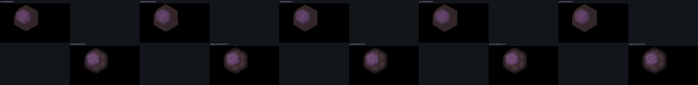

# Lens Flare Optics Evaluation

**最終更新:** 2026-10-27

### Optical path length diagnostic

The optional `--optical-path-report` traces the selected ghost pair at the
central and four half-radius pupil coordinates for 610/550/460 nm. The
`--optical-path-map CSV` option extends this to every active pupil-grid ray.
Optical
path accumulates `n × segment length` through the actual reflected and
refracted ray sequence, including air travel to the iris. A common incident
reference plane 100 mm before the first surface is used so the entrance-pupil
origin shift is included. Coating phase is omitted.

For the Angenieux 9→8 path at source `(0.3834,0.3844)`, the x half-radius pupil
rays differ in OPL by 1.516/1.523/1.538 mm at 610/550/460 nm (about 2,485/
2,769/3,344 phase cycles). This confirms that a future coherent model must
retain dense pupil sampling and handle phase modulo wavelength carefully.
The diagnostic does not yet model complex Fresnel amplitudes, thin-film
reflection phase, phase unwrapping, or coherent propagation, and therefore
does not alter or validate the rendered flare image. Enabling the report leaves
the PFM byte-identical to the same render without the report.

The full 9→8 path map was sampled at grids 64/128/256/512 for source
`(0.3834,0.3844)`. Median absolute phase change between neighboring valid
pupil rays at grid 512 is 6.48/7.23/8.75 cycles at 610/550/460 nm; the 90th
percentiles are 12.50/13.90/16.72 cycles. These exceed the 0.5 cycle/sample
Nyquist limit by more than an order of magnitude, so even grid 512 cannot
sample the path phase. Coarser grids produce aliased wrapped phase maps, and
the regular rings at grid 512 still represent undersampling rather than a
converged diffraction pattern. The map establishes that a coherent model
needs a different formulation or much more efficient oscillatory integration;
it does not provide evidence for simply multiplying the current ghost pixels
by an OPL-derived phase.


Reproduce maps with `--ray-grid N --ghost-pair 9 8 --optical-path-map
build/opl-grid-N.csv`, then create the chart with:

```powershell
python tools/LensFlareLab/make_optical_path_phase_chart.py `
  --case grid64=build/opl-grid-64.csv `
  --case grid128=build/opl-grid-128.csv `
  --case grid256=build/opl-grid-256.csv `
  --case grid512=build/opl-grid-512.csv `
  tools/LensFlareLab/examples/ghost-optical-path-phase-sampling.png
```

Reproduce with `LensFlareLab input.pfm output.pfm --position 0.3834 0.3844
--ray-grid 32 --source-samples 1 --diffraction off --ghost-pair 9 8
--optical-path-report`.

### Adaptive off-axis ray refinement

At source position `(0.1,0.1)`, adaptive refinement at base grid 64 was
compared with uniform grids 64, 96, 192, and 512. It probes each pupil-cell
center, and refines cells when the mapped center departs from the corner-ray
interpolation, relative ray energy changes by more than 25%, or the map folds.
Four edge-midpoint rays then form an eight-triangle center fan; each child gets
one quarter of the parent pupil-cell ray weight. Refinement is one level deep.

Against uniform grid 512, geometric relative image L1 error is 3.76% for
adaptive grid 64, versus 9.15% at uniform 64 and 5.86% at uniform 96. With
FrFT, adaptive grid 64 is 3.45%, versus 5.36% at uniform 64 and 3.06% at
uniform 96. Adaptive improves on the coarse grid, but uniform 96 remains
slightly closer by FrFT image L1. Sensor Y flux errors are 3.66% geometric
and 1.46% FrFT for adaptive 64, versus 5.84% and 2.08% for uniform 96.
Adaptive traced 500,094 center probes, 3,280 geometric edge rays / 820 cells,
and 3,564 FrFT edge rays / 891 cells; refined cells are about 0.16%/0.18% of
the probed cells. The extra tracing therefore targets a small subset, though
center probes still cost one additional ray per base cell.

This demonstrates a useful coarse-grid quality option for the tested corner
field, not a general speed-quality win: grid 512 is a dense reference rather
than ground truth, refinement is currently one level, and no measured lens
capture is available. It stays opt-in and off by default.




For a separate isolated neutral source at `(0.1,0.1)`, base grid 64, adaptive
refinement selected 891 of 63² cells and traced 3,564 edge rays in both modes.
Triangle quadrature makes the reported all-map Y (`83.3918`) match the geometric
mesh integral, while vertex mode reports `86.2131` (+3.38%). After sensor
clipping, triangle mode gives Y `9.67245` versus `9.99158` for vertex mode
(-3.19%), relative image L1 3.19%, and centroid shift 0.083 px. The full-plane
equality is by construction; adaptive topology still follows the established
preliminary vertex-weight probe rule. This is a numerical consistency result,
not a physical-camera validation.


Reproduce the adaptive case using the off-axis input chart, all paths, and
`--ray-grid 64 --source-samples 1 --diffraction off
--adaptive-ray-refinement on`; render a uniform baseline by omitting the last
option. Compare against uniform grids 96 through 512 with the same input,
position, ghost/fringe settings, and source sample count.

## Method

The implementation follows the physical stages described by Hullin et al.
(2011): enumerate two-interface reflection paths, trace parallel ray grids
through spherical interfaces, apply Snell refraction and unpolarized Fresnel
weights, clip against the iris and each lens clear aperture, and rasterize the
resulting sensor grids. It also computes a sampled Fraunhofer intensity kernel
from the polygon aperture. A later real-time method similarly stresses that
realistic ghosts depend on the optical prescription, per-interface energy,
aperture coordinates, and lens-housing clipping; its faster polynomial method
requires precomputation and validation against analytical ray tracing. Its
Angenieux f/11 setup reports 42 ghost paths and retains paths with one stop
crossing. The 15 mm stop-to-rear-group air gap is applied once, between
surfaces 6 and 7.

References: [Hullin et al., Physically-Based Real-Time Lens Flare Rendering
(2011)](https://matthias.hullin.net/publications/HullinEtAl-LensflareRendering-SIGGRAPH2011.pdf);
[TUDelft Advanced Optical Imaging, Fourier analysis](https://qiweb.tudelft.nl/aoi/fourieranalysis/fourieranalysis/);
[Takaki, implementation notes and CPU prototype](https://qiita.com/AngularSpectrumMTD/items/aeea1046c0ec5d4dd1d5);
[Bodonyi et al., 2024 real-time lens flare rendering paper](https://link.springer.com/article/10.1007/s00371-024-03625-7);
[Carbajal-Domínguez et al., numerical near-field scalar diffraction with angular spectrum and FFT](https://rmf.smf.mx/ojs/index.php/rmf-e/article/view/4636);
[reference implementation dispersion model](https://github.com/bodonyiandi94/LensFlareFramework/blob/4136459dffa1ed582f199a9a43950730b4ddcd66/Source/Scene/Components/LensFlare/PhysicalCamera.cpp).

Historical evaluation images and measurements in this document were rendered
with the prior `point-sample` rasterizer unless explicitly identified as
`pixel-area`. Use `--rasterizer point-sample` to reproduce those baselines. The
current default and the two updated Fig. 10 rasterization images use
`pixel-area`.

The included 640x360 HDR chart has four similarly bright colored point lights.
The strongest warm source is at `(245, 138)`.


At the chart's standard source intensity, the coated ghosts are intentionally
subtle. For a visibility check, the following chart raises only the four light
radiances by 4096 while keeping the background fixed; this drives the source
cores into display clipping, as a high-dynamic-range camera capture would.


For diagnostics, the next image amplifies the standard-exposure flare
difference by 256 before display mapping. It is not the physically exposed
final image.


This isolates reflected ghosts (`--diffraction off`), subtracts the input, and
amplifies the result by 16384 to inspect their geometry. The display applies
log compression after that gain so bright ghost regions retain visible shape;
this is diagnostic visualization, not a physical exposure curve.


On the high-radiance four-source chart, the corrected report shows 42 of 42
eligible paths visible for the warm source; a selected-pair report shows `1/1`.
It ranks the strongest warm-source ghosts as surface pairs
`9 -> 8`, `10 -> 8`, and `11 -> 8`. Each isolated render produces one
aperture-shaped hexagonal patch at a distinct sensor position. This shows the
large hexagons in the combined image come from individual traced ghost paths;
they are not created by blending unrelated paths together. This visual check
does not yet validate their coordinates against the paper's reference image.


A 3x3 source-position sweep uses a single warm light at normalized coordinates
`0.1`, `0.5`, and `0.9` on each axis. The source radiance is multiplied by 4096
to make the ghost-only images visible; each tile subtracts the input and uses
the same 16x diagnostic multiplier. The 42 eligible paths are drawn from the 91 combinatorial surface pairs,
matching the paper's Angenieux count; all 42 are visible on-axis. At
`(0.1, 0.1)`, seven paths remain visible after aperture and housing clipping.


## Pixel-area rasterization and caustic convergence

The default rasterizer now clips each mapped ray triangle against sensor-pixel
squares and integrates its linearly interpolated ray energy over the overlap.
Unlike a pixel-center test, this deposits a subpixel triangle's full sampled
flux into the covered pixel instead of making the result depend on whether the
pixel center happens to land inside it. The prior point-sample rasterizer
remains available with `--rasterizer point-sample`; its hard Jacobian cap is
useful for historical comparisons but changes energy and centroid as the cap
varies. Pixel-area mode ignores that cap because the finite pixel footprint
provides the integration area.

At the two Fig. 10 source positions, ray-grid 96 to 192 changed integrated
ghost luminance by +1.19% for source A and +1.09% for source B. Peak luminance
changed by -0.02% (0.04772 to 0.04771) and +1.22% (0.08182 to 0.08281). The
luminance centroids moved 0.72 and 0.71 pixels respectively. For comparison,
legacy point-sample mode with cap 512 changed the same peaks by -75.0% and
-72.9%; its integrated luminance changed +0.11% and +0.59%. Pixel-area mode
therefore stabilizes local caustic peaks substantially while keeping total
energy and centroid near the denser-grid result. This is convergence evidence
for the sampled single-source image, not validation against measured optics.


On the high-radiance four-source chart at grid 64 with nine source bins and
diffraction disabled, pixel-area mode adds 1,060.56 luminance versus 1,057.46
for legacy point-sample (+0.29%). Its peak is 4.124 versus 2.664 and the
luminance centroid differs by 0.39 pixels. This shows that the rasterizer
choice has little effect on aggregate energy for this scene while changing
how unresolved caustic peaks land in individual pixels.


A separate cap sweep at ray-grid 192 for source A further shows why raising
the legacy cap is not a convergence fix: cap 512 to 4096 changes ghost energy
from 10.1684 to 10.3519 (+1.80%), raises the peak from 0.00719 to 0.05099
(7.1x), and moves the luminance centroid about 5.1 pixels. The default
pixel-area result at grid 192 has energy 10.3436 and peak 0.04771, close to the
legacy high-cap energy without its point-sampling spikes.


## Angenieux comparison against Fig. 10

Bodonyi et al. show three results for each lens: the full polynomial model,
analytical ray tracing, and their partial polynomial model. The Angenieux setup
is f/11, 100 mm, 14 refracting surfaces, and 42 ghost paths. Their method uses
distant directional sources, so this comparison collapses each light to one
source sample and disables aperture diffraction to isolate reflected ghosts.

The two normalized source positions `(0.246, 0.356)` and `(0.390, 0.693)` are
estimated from the red and green markers in the paper's Angenieux panel; they
are not coordinates published by the authors. The helper script creates a
black 640x360 chart with small neutral Gaussian source cores. Its radiance is
only selected to make the source detector stable; the evaluation image removes
the input before display. To reproduce the renders:

```powershell
python tools/LensFlareLab/make_fig10_comparison_chart.py
LensFlareLab.exe build/tools/LensFlareLab/fig10-angenieux-two-light-input.pfm build/tools/LensFlareLab/fig10-light-a.pfm --position 0.246 0.356 --source-samples 1 --ray-grid 192 --gain 1 --diffraction off
LensFlareLab.exe build/tools/LensFlareLab/fig10-angenieux-two-light-input.pfm build/tools/LensFlareLab/fig10-light-b.pfm --position 0.390 0.693 --source-samples 1 --ray-grid 192 --gain 1 --diffraction off
```

The visualization separates the two point-source contributions and shows their
combined result using one shared logarithmic display mapping. The ghost field
layout is qualitatively plausible relative to the paper's Angenieux reference,
with aperture-shaped patches and source-dependent field changes. This is not a
pixel-matched validation: the paper does not publish exact source coordinates,
radiance, sensor mapping, tone curve, or the per-surface coating data needed to
recreate its rendering setup. Our coatings and d-line/Abbe-derived dispersion
remain approximations.

The historical point-sample baseline at ray-grid 96 to 192 changed source A's
integrated ghost luminance from 10.1576 to 10.1684 (+0.11%) and moved its
centroid 2.34 pixels; source B changed from 20.7533 to 20.8764 (+0.59%) and
moved its centroid 0.05 pixels. Peak luminance fell from 0.02873 to 0.00719
for source A and from 0.03551 to 0.00962 for source B. This grid-dependent
peak behavior is why the newer pixel-area results are reported separately.


### Aperture-FrFT look-development at the Fig. 10 source positions

The paper compares polynomial approximations with analytical geometric ray
tracing; it does not provide the calibrated sensor data needed to validate our
render numerically. This additional plate therefore compares our own geometric
ghost render with the optional aperture-FrFT appearance at the same two
estimated source positions. It is a look-development check, not a reproduction
of the paper's reference result. The FrFT mode adds spatial aperture structure
to each geometric ghost and is distinct from the paper's analytical ray tracer
([Bodonyi et al., 2025](https://link.springer.com/article/10.1007/s00371-024-03625-7)).

Both rows use the same source-subtracted logarithmic display mapping (`gain
900`). At ray-grid 64 and texture resolution 256, source A's ghost Y sum changes
from 9.97742 to 10.98809 (+10.13%), with 25.20% relative L1 and an 8.54 px
luminance-centroid shift. Source B changes from 20.49858 to 21.33169 (+4.06%),
with 18.87% relative L1 and a 0.32 px centroid shift. These figures measure
only the finite sensor image, not all light leaving the exit pupil. To separate
the two, the 9→8 path was rendered by itself at source A and ray-grid 192. The
renderer reported that path's visible bounds reaching the sensor edges
`(639,359)` in the 640x360 frame. Its pupil-map normalization range was
0.9276–0.9438; for the reported maximum map, geometric ray energy 4.75883
divided by textured energy 5.04221 gives the applied 0.9438 scale. After that
per-map correction, the on-sensor Y sum still changes from 1.22161 to 1.50040
(+22.82%), with a 0.94 px centroid shift. The edge-touching ghost is cropped by
the sensor, so the visible-window integral changes as the aperture weighting
redistributes rays across sensor coordinates. This is not evidence of a 22.82%
full-path energy gain. Do not renormalize the final frame to hide that
crop-dependent change. Ray-grid 96 gives the same clipped bounds
`(551,175)..(639,359)` and a +22.55% on-sensor Y change (1.22126 to 1.49668),
so this result is not a ray-grid-64 artifact. The numbers remain a low-resolution
look-dev evaluation, not calibrated physical accuracy.


#### Sensor-window versus whole-map energy

The first whole-map experiment used the original vertex-sum normalization.
`--ghost-frft-report` estimates the summed luminance over all mapped triangles
before sensor clipping, then subtracts the deposits inside the frame to estimate
the off-sensor remainder. On Fig. 10 source A with all 42 paths, the sensor Y
sum increases by 9–10% with FrFT, while the whole-map triangle estimate
converges toward a sub-1% change as the pupil ray grid gets denser. The
off-sensor remainder decreases, showing that much of the apparent frame gain
is redistribution onto the sensor. This initial vertex-normalized result is
retained below as the baseline for the quadrature-matching experiment.

| Ray grid | Whole-map estimated Y, geometric → FrFT | Whole-map change | Sensor Y, geometric → FrFT | Sensor change |
|---:|---:|---:|---:|---:|
| 64 | 25.7513 → 26.3654 | +2.39% | 9.9774 → 10.9881 | +10.13% |
| 96 | 26.4453 → 26.8762 | +1.63% | 10.2220 → 11.1993 | +9.56% |
| 128 | 26.4888 → 26.8238 | +1.27% | 10.1858 → 11.1461 | +9.43% |
| 192 | 26.8528 → 27.0806 | +0.85% | 10.3436 → 11.2714 | +8.97% |

At grid 192, the estimated off-sensor Y remainder falls from 16.5082 to
15.8083 (-4.24%). The estimate is the sum of linearly interpolated triangle
energy before clipping, weighted by the same RGB luminance coefficients as the
image. Its residual whole-map drift falls from 2.39% at grid 64 to 0.85% at
grid 192. This is a sampling/conservation diagnostic, not a calibrated
wave-optics result; the off-sensor remainder is meaningful only with the
pixel-area rasterizer. Do not treat the frame-only Y change as created optical
energy or hide it by normalizing the final image.


Reproduce the energy diagnostic by rendering the same input at ray grids 64,
96, 128, and 192 with `--ghost-frft off` and `--ghost-frft on`, keeping
`--position 0.246 0.356 --source-samples 1 --gain 1 --diffraction off
--ghost-frft-normalization vertex --ghost-frft-resolution 256
--ghost-frft-report` fixed. The report emits
`allMapsRasterY` and `allMapsEstimatedOutsideSensorY`; subtract the latter
from the former for the sensor-window estimate and compare with the saved PFM
Y sum. Use `--rasterizer pixel-area` for this accounting.

#### Match FrFT normalization to rasterization quadrature

The first diagnostic exposed a systematic mismatch: FrFT weights were
normalized by summing valid pupil-ray vertices, but the image renderer
integrates valid ray triangles. `--ghost-frft-normalization triangle` now
normalizes each path/source-sample/wavelength map using the same complete
two-triangle cells, triangle energy average, degeneracy threshold, and ray
weights used by the pixel-area rasterizer. It is the default when FrFT is on;
`vertex` retains the earlier method for direct comparison. Adaptive refinement now uses the same selected mesh for normalization and
rasterization: unrefined cells use the two-triangle split; refined cells trace
four edge midpoints and use the eight-triangle center fan. Refinement decisions
remain based on preliminary vertex-normalized probe energies, preserving the
existing topology rule; final FrFT weights are then normalized against that
mesh.

Across 12 isolated cases (paths 9→8, 10→8, 5→4, and 10→9 at the estimated
Fig. 10 source A, center, and right-of-center fields; grid 96), vertex
normalization changed full-map Y by -0.17% to +3.05%. Triangle normalization
matched the geometry-only triangle integral to the report's 0.0001 precision in
all 12 cases. Its frame Y still changes when a ghost is clipped: source A's
9→8 path changes by +21.00% after triangle normalization, compared with
+22.55% under vertex normalization. The corresponding right-of-center 10→9
path changes by +2.51% versus +3.28%; at center, fully contained paths remain
within 0.04% frame Y. This separates finite-grid normalization drift from
actual redistribution across the sensor boundary.

The equality is by construction because the normalizer and report share the
same finite triangle quadrature; it is not an independent proof that the
prescription or FrFT matches a physical lens. It removes the mismatch between
two numerical integration rules and makes frame cropping easier to interpret.

The 12-case plate shows geometry, the default triangle-normalized FrFT, and
signed luminance change at a shared exposure. Relative image L1 remains
20.95–46.59% for the visible cases: the normalization fixes integrated
triangle energy without suppressing the aperture texture or field-dependent
ghost movement. The remaining sensor-window change is expected from clipping,
not an additional normalization target.


Recreate this plate with `make_frft_field_path_sweep.py` after rendering each
field/path with `--ghost-frft off` and `--ghost-frft on
--ghost-frft-normalization triangle`; keep ray grid, source, texture size, and
other options identical. The script reports per-case frame Y, relative L1,
and luminance-centroid movement.

Recreate the isolated path measurement with the same generated input. Run both
render commands with identical settings except `--ghost-frft`, retain
`--ghost-report` to inspect the clipped sensor bounds, then create the crop:

```powershell
python tools/LensFlareLab/make_fig10_comparison_chart.py --output build/tools/LensFlareLab/fig10-two-light-input-current.pfm
LensFlareLab.exe build/tools/LensFlareLab/fig10-two-light-input-current.pfm build/tools/LensFlareLab/ghost-9-8-geo-192.pfm --position 0.246 0.356 --source-samples 1 --ray-grid 192 --gain 1 --diffraction off --ghost-frft off --ghost-pair 9 8 --ghost-report
LensFlareLab.exe build/tools/LensFlareLab/fig10-two-light-input-current.pfm build/tools/LensFlareLab/ghost-9-8-frft-192.pfm --position 0.246 0.356 --source-samples 1 --ray-grid 192 --gain 1 --diffraction off --ghost-frft on --ghost-frft-normalization vertex --ghost-pair 9 8 --ghost-report
python tools/LensFlareLab/make_ghost_frft_comparison.py build/tools/LensFlareLab/fig10-two-light-input-current.pfm build/tools/LensFlareLab/ghost-9-8-geo-192.pfm build/tools/LensFlareLab/ghost-9-8-frft-192.pfm tools/LensFlareLab/examples/ghost-9-8-flux-diagnostic-crop.png --crop 520 140 640 360 --gain 900 --difference-gain 1000
```

`make_ghost_frft_sweep_chart.py` now reports integrated Y, flux change, relative
L1, peak Y and centroid movement for each case in addition to creating the
plate. Reproduce it by generating the input as above, rendering each source
with `--ghost-frft off` and `--ghost-frft on` at the same `--ray-grid 64` and
`--ghost-frft-normalization vertex --ghost-frft-resolution 256`, then passing the input and both renders for each
source through the script's repeated `--case LABEL INPUT GEOMETRIC FRFT`
arguments. Keep the ray grid and every other render setting fixed when
comparing the modes.

The highlight detector integrates positive luminance above threshold over each
source footprint, keeps source chromaticity separate, and distributes that
source flux over the sampled pupil rays once. Sampling the physical stop
backwards through the front lens group maps rays to the entrance pupil instead
of wasting samples over the full front-element diameter.

The detector now retains the spatial radiance distribution inside each
highlight footprint. In default mode it accumulates energy and chromaticity in
3x3 bins and traces each occupied bin from its own field direction for the
reflected ghosts. Aperture diffraction instead uses the full input footprint.
This is an image-space proxy for a finite emitter: it assumes the thresholded input
footprint represents emitter extent, so sensor bloom or an existing point
spread function can be mistaken for source size. It does not infer a 3D emitter
or separate emitter size from camera blur. `--source-samples 1` collapses the
same integrated flux and chromaticity to a single point source for comparison;
`--source-samples 25` selects a 5x5 bin grid for source-integration convergence
checks. The historical nine-bin measurements below remain unchanged.
With `--source-report`, the four-chart input preserved a combined integrated
flux of 2,202,271.78 versus 2,202,271.69 summed across the bins (less than
0.00001% numerical difference). The four highlights occupied 9, 3, 5, and 8
of the nine bins.


`--source-samples` controls the directions traced for reflected ghosts. The
diffraction calculation uses the original spatial highlight radiance directly,
so changing the ghost sampling count does not collapse the source footprint to
one, nine, or twenty-five diffraction points.


### Finite-source integration refinement

The lab now accepts `--source-samples 25`, partitioning the same thresholded
detector footprint inside a 24-pixel radius into 5x5 radiance bins. The default remains
3x3, and `1` remains the point-source baseline. This refines source-angle
quadrature without changing the lens, stop pupil grid, ray grid, or total input
highlight energy.

For a single warm source at `(0.3834, 0.3844)` with radiance scale 4096,
ray-grid 96, gain 1, and source diffraction off, point / 3x3 / 5x5 ghost
luminance sums inside the sensor were `931.474`, `931.031`, and `926.547`.
Peak luminance fell from `4.659` to `4.233` to `2.818`; centroids were
`(353.413, 199.140)`, `(353.467, 199.168)`, and `(353.856, 199.397)`. The
sensor-frame energy decrease at 5x5 is consistent with ghost rays shifted
beyond the sensor boundary, not with source-energy renormalization. The 5x5 image differs
from 3x3 by 4.24% L1 relative to its in-frame flare luminance, so the current
3x3 approximation has visible sampling dependence. A 5x5 grid is a refinement
sample, not a proven converged result; more bins can change clipping and cost.


### Dense finite-source FrFT convergence

The source-bin control now accepts any odd square count through 225 (15x15),
and the fixed storage holds all 225 radiance bins. For the isolated 9→8 ghost
at `(0.3834,0.3844)`, a 4096-scaled warm source, pupil grid 64, polygon-mask
FrFT on, and source diffraction off, the 225-bin render is used as a dense
comparison reference. Relative image L1 falls from 4.39% at 25 bins to 3.10%
at 49, 2.12% at 81, 1.96% at 121, and 0.83% at 169. Crop Y stays within
0.3% of the 225-bin result from 25 bins upward. Peak luminance decreases from
0.00574 at 25 bins to 0.00565 at 225; centroid movement from 25 to 225 is
about 0.30 px. The broad caustic placement is stable, while finer aperture
structure and edges continue to average out as more source directions are
integrated.

| Source bins | Relative L1 vs 225 | Crop Y / 225 | Peak Y | Centroid (px) |
| ---: | ---: | ---: | ---: | ---: |
| 1 | 9.50% | 0.99842 | 0.005920 | (457.588, 255.486) |
| 9 | 8.62% | 0.99818 | 0.005889 | (457.583, 255.454) |
| 25 | 4.39% | 0.99742 | 0.005743 | (457.557, 255.346) |
| 49 | 3.10% | 0.99710 | 0.005690 | (457.541, 255.311) |
| 81 | 2.12% | 0.99744 | 0.005664 | (457.537, 255.291) |
| 121 | 1.96% | 0.99945 | 0.005669 | (457.602, 255.284) |
| 169 | 0.83% | 1.00073 | 0.005651 | (457.640, 255.266) |
| 225 | reference | 1.00000 | 0.005648 | (457.611, 255.262) |


The `--source-report` check at 225 bins found 89 occupied bins and sampled
flux `1,154,385.625` against integrated flux `1,154,385.750` (about
0.000011% difference). This supports correct flux partitioning, not optical
ground truth. The 225-bin grid is a denser numerical reference and the finite
source is still an image-space thresholded footprint; neither alone proves
convergence for other source shapes, fields, or prescriptions.

At 225 source bins, raising the pupil grid from 64 to 96/128 changes crop Y
from `130.438` to `131.706/131.322`; image L1 against pupil grid 128 is
1.83%/1.38%. The peak stays near `0.00565`, but the centroid shifts by up to
about 0.8 px. Thus source-angle sampling improves smoothly against the fixed
64-ray reference, while pupil-ray sampling remains a similarly sized source
of image error and must be converged independently.


Reproduce with the 4096-scale single-light chart, render the same isolated
path at `--source-samples 1 9 25 49 81 121 169 225` and identical
`--ray-grid 64 --ghost-frft on --ghost-frft-normalization vertex --diffraction off --ghost-pair 9 8`, then pass
each render as a `--case COUNT FILE` to
`make_finite_source_convergence_chart.py`. A separate pupil-ray sweep uses the
same 225-bin source at `--ray-grid 64`, `96`, and `128`, compared with
`make_ray_grid_comparison.py --source-samples 225`.

### Finite-emitter size versus source-bin density

The source chart generator now exposes a Gaussian scale parameter `R` in pixels
for its isolated light, with profile `exp(-r²/(0.48 R²))`. At `R=3/5/7` px,
the 25-bin image differs from the 225-bin
reference by 2.47%/4.36%/4.39% relative L1; 81 bins reduce that to
1.61%/1.97%/2.12%. Crop Y remains within 0.3% for all three radii. In this
case the small emitter is adequately represented with fewer directions,
while the larger footprints need denser angular integration to capture their
different field directions. This supports exploring a source-extent quality
preset, though the 225-bin and pupil-grid128 references remain sampled rather
than ground truth.

| Gaussian scale R | 25 bins L1 | 81 bins L1 | 25-bin Y / 225 | 81-bin Y / 225 | Wall time ms (25 / 81 / 225) |
| ---: | ---: | ---: | ---: | ---: | ---: |
| 3 px | 2.47% | 1.61% | 0.99987 | 1.00031 | 254 / 347 / 706 |
| 5 px | 4.36% | 1.97% | 0.99742 | 0.99910 | 349 / 657 / 1,288 |
| 7 px | 4.39% | 2.12% | 0.99742 | 0.99743 | 449 / 1,076 / 2,433 |

Wall times are single-process measurements on the evaluation machine, including
PFM I/O. Larger footprints occupy more bins, so cost rises with both grid size
and source extent; treat these timings as directional, not a benchmark.


The 225-bin `--source-report` preserved integrated source flux to within
0.000022% for these inputs. Reproduce with `make_evaluation_chart.py
--source-only --single-light-position 0.3834 0.3844 --source-radius R
--light-scale 4096`, render 25/81/225 bins at fixed pupil grid64 with the
isolated 9→8 path and polygon FrFT, then pass each radius and its three PFM
files to `make_finite_source_size_sweep.py`.

Reproduce the input and three renders with:

```powershell
python tools/LensFlareLab/make_evaluation_chart.py --output build/tools/LensFlareLab/finite-source-convergence-input.pfm --light-scale 4096 --single-light-position 0.3834 0.3844
LensFlareLab.exe build/tools/LensFlareLab/finite-source-convergence-input.pfm build/tools/LensFlareLab/finite-source-1-convergence.pfm --position 0.3834 0.3844 --source-samples 1 --ray-grid 96 --diffraction off
LensFlareLab.exe build/tools/LensFlareLab/finite-source-convergence-input.pfm build/tools/LensFlareLab/finite-source-9-convergence.pfm --position 0.3834 0.3844 --source-samples 9 --ray-grid 96 --diffraction off
LensFlareLab.exe build/tools/LensFlareLab/finite-source-convergence-input.pfm build/tools/LensFlareLab/finite-source-25-convergence.pfm --position 0.3834 0.3844 --source-samples 25 --ray-grid 96 --diffraction off
python tools/LensFlareLab/make_source_sampling_comparison.py build/tools/LensFlareLab/finite-source-convergence-input.pfm build/tools/LensFlareLab/finite-source-1-convergence.pfm build/tools/LensFlareLab/finite-source-9-convergence.pfm build/tools/LensFlareLab/finite-source-25-convergence.pfm tools/LensFlareLab/examples/finite-source-sampling-convergence-x256.png
```

### Pupil ray-grid convergence with finite-source bins

Using that same warm source and the pixel-area rasterizer, the 3x3 and 5x5
source-bin renders were also swept at pupil ray grids 64, 96, and 128. The
integrated in-frame ghost luminance and peak were:

| Source bins | Ray grid | Integrated Y | Peak Y | Centroid (px) |
| --- | ---: | ---: | ---: | ---: |
| 3x3 | 64 | 910.728 | 4.096 | (353.328, 199.238) |
| 3x3 | 96 | 931.031 | 4.233 | (353.467, 199.168) |
| 3x3 | 128 | 928.495 | 4.280 | (353.223, 199.263) |
| 5x5 | 64 | 908.465 | 2.833 | (353.592, 199.379) |
| 5x5 | 96 | 926.547 | 2.818 | (353.856, 199.397) |
| 5x5 | 128 | 924.095 | 2.522 | (353.709, 199.521) |

The 64-to-128 image L1 difference is about 3.00% of the 128-grid in-frame
flare energy for both bin counts. The 96-to-128 L1 differences are 2.07% for
3x3 and 1.97% for 5x5. Integrated luminance at 96 and 128 differs by only
0.27% and 0.26%, while peaks and subpixel ghost edges still change. The 9-bin
grid-64 render took 6.72 s and grid-128 took 20.70 s on the evaluation
machine. This sweep supports 96 as a reasonable look-development compromise
for this chart, but does not establish optical accuracy or convergence for
other fields, prescriptions, or source shapes.


The plate generator is `make_ray_grid_comparison.py`; pass the same input and
three output PFMs in grid order, then set `--source-samples 9` or `25` to label
the plate. The 5x5 render is appreciably more expensive, so use it as an
offline convergence reference rather than the interactive default.

## Diffraction PSF and source-energy conservation

The aperture transmission mask is Fourier transformed and its squared
magnitude forms a Fraunhofer point-spread function. The sampled PSF is
integrated onto sensor-pixel offsets, normalized to unit energy, then
convolved with the detected source footprint. A 512x512 pupil FFT is resampled
to the pixel grid before convolution. The threshold-excess source radiance is
replaced by its PSF-blurred version, avoiding the previous double addition of
an unchanged source core and a second diffraction copy. At gain 0 the source
is unchanged; gain 1 performs the full replacement, and higher values amplify
the PSF after removing the core once. RGB channels use wavelength-specific
PSFs. Finite-source bins remain in use for ghost ray tracing; diffraction
preserves the input source's full pixel-space shape. The source detector still
treats threshold excess as emitter radiance, so existing bloom or camera blur
can be interpreted as emitter extent.

For the standard chart's warm source at `(0.3834, 0.3844)`, ray-grid 64 and one
ghost source sample, the input integrated luminance is 3712.266. With
diffraction enabled it is 3712.366; with diffraction disabled it is 3712.366.
The reflected ghosts contribute about 0.0999 luminance, while the net
diffraction replacement changes the full-frame sum by only 0.00011. On the
high-radiance four-source chart at grid 64 and nine ghost bins, diffraction-on
versus diffraction-off changes the frame sum by +1.054 luminance (0.000048% of
the 2.21-million input luminance; 0.099% of the 1,060.56 ghost contribution).
Source peak luminance falls from 15,632.08 to 15,504.77. The small frame-sum
residual is from float accumulation against the bright HDR source. These checks
support energy-preserving convolution of the assumed source radiance, not
validation against a measured camera PSF.

One high-radiance chart render took 2.25 s with one ghost direction and about
14.0 s with nine directions at ray-grid 64 on the evaluation machine. Both
include the diffraction FFT and source convolution; timing varies with system
load.


An aperture-blade sweep isolates diffraction with a single centered source.
Five, six, eight, and twelve blades produce visibly different PSF footprints;
the six-blade result retains the corresponding sixfold structure. Across the
sweep, positive and negative luminance changes nearly cancel (net frame change
is below 0.05% of the absolute redistributed luminance), and their centroids
remain within 0.02 pixels of the source center. This checks aperture-dependent
shape and energy accounting in the sampled model; it is not a camera capture
comparison.


Reproduce the blade sweep with:

```powershell
python tools/LensFlareLab/make_evaluation_chart.py --output build/diffraction-single-source.pfm --light-scale 4096 --single-light-position 0.5 0.5
LensFlareLab.exe build/diffraction-single-source.pfm diffraction-6-blades.pfm --position 0.5 0.5 --source-samples 1 --ray-grid 16 --gain 1 --diffraction on --ghosts off --aperture-blades 6
```

The 2024 reference implementation derives a Cauchy dispersion curve from the
prescription d-line index and Abbe number. LensFlareLab now uses that
parameterization by default; `--dispersion linear` keeps the previous linear
Abbe estimate available for direct comparison. The comparison below uses the
high-radiance four-light chart, ray-grid 64, nine source samples, gain 1, and
diffraction disabled. After subtracting the unchanged input chart, the ghost
luminance sum is 1,067.74 for linear Abbe and 1,057.46 for Cauchy (-0.96%);
peak luminance is 3.076 and 2.664 respectively. The luminance centroid moves
from `(342.36, 200.03)` to `(343.31, 200.73)`. These are modest changes and do
not establish which model better matches physical glass: both are estimates
from d-line index and Abbe number, not measured Sellmeier coefficients.


### Spectral ghost separation across the image field

The existing four-light comparison averages together paths and source colors,
so it can hide wavelength-dependent displacement. This evaluation uses a neutral
isolated point source and only surface path 9→8, rendered at the same 610/550/460
nm bands, ray-grid 192, no diffraction, and no aperture FrFT. The on-axis source
is `(0.5,0.5)`; the off-axis source is `(0.4,0.5)`. Both ghosts remain inside
the 640x360 sensor. Source radiance is raised 1024x only for visibility; both
models use the same input and logarithmic display gain.

| Field | Model | R centroid (610 nm) | G centroid (550 nm) | B centroid (460 nm) | Max RGB separation |
|---|---|---:|---:|---:|---:|
| On-axis | Cauchy | (319.500, 179.500) | (319.500, 179.500) | (319.500, 179.500) | 0.0001 px |
| On-axis | Linear Abbe | (319.500, 179.500) | (319.500, 179.500) | (319.500, 179.500) | 0.0001 px |
| Off-axis | Cauchy | (446.453, 179.500) | (447.174, 179.500) | (448.936, 179.500) | 2.4827 px |
| Off-axis | Linear Abbe | (446.573, 179.500) | (446.934, 179.500) | (447.805, 179.500) | 1.2312 px |

At the off-axis position, the two dispersion models therefore predict about a
2x difference in lateral RGB ghost spread. Relative to Cauchy, linear Abbe
changes per-channel ghost flux by +0.34% red, -0.38% green, and -4.75% blue.
The field-dependent separation is visible in the comparison plate; the signed
difference panel uses a stronger amplification than the two image panels.


This is a model-sensitivity result, not a measurement of which dispersion curve
is more accurate. The prescription provides d-line index and Abbe number but no
glass identity or Sellmeier coefficients. The Cauchy parameterization follows
the 2024 reference implementation, while the alternative linear estimate is a
legacy approximation. Hullin et al. evaluate rays per wavelength: three bands
represent most ghosts, but their paper notes that a few cases need many more
samples and describes interpolation with up to seven bands for high quality.
This specific comparison uses the default three wavelengths, so it does not
prove that 610/550/460 nm adequately resolve this ghost's continuous spectrum.
See [Hullin et al. (2011)](https://resources.mpi-inf.mpg.de/lensflareRendering/pdf/flare.pdf)
and [Bodonyi et al. (2025)](https://link.springer.com/article/10.1007/s00371-024-03625-7).
Hullin et al. report that a few ghosts may need up to 60 wavelength samples for
smooth brute-force results; their runtime configuration uses three bands for
standard quality and up to seven with interpolation for high quality. LensFlareLab
now has an opt-in seven-band reflected-ghost mode. The measurements below test
the interpolation's sensitivity; they do not establish physical accuracy.

### Optional seven-band reflected ghosts

`--spectral-samples 7` evaluates reflected ghost rays at 430, 460, 490, 520,
550, 580, and 610 nm, then integrates the results back to RGB. Input RGB is
expanded into a piecewise-linear set of triangular channel weights between the
existing blue, green, and red reference wavelengths. The output uses the same
triangular basis and trapezoidal wavelength weights. This is a bounded RGB
interpolation experiment, not a CIE standard-observer conversion, a measured
emitter spectrum, or a full visible-spectrum reconstruction. Glass dispersion
still comes from the prescription's d-line index and Abbe number. Source
Fraunhofer diffraction remains on the original three-band path; the option
changes reflected ghosts only.

The 3-band default was compared byte-for-byte against the preceding build for
geometric ghost rasterization, aperture-FrFT ghost rendering, and scalar ghost
Fresnel propagation. All three outputs were identical. The 7-band option is
therefore opt-in while the RGB-to-spectrum reconstruction and lens data remain
uncalibrated.

For an isolated, un-clipped 9→8 path at `(0.4,0.5)`, ray-grid 192, neutral RGB
source, and Cauchy dispersion, the maximum RGB centroid separation changes
from 2.4827 px at 3 bands to 2.2886 px at 7. Channel flux changes by -4.28%
red, +5.50% green, and -5.03% blue (7-band relative to 3-band). On the full
42-path field image at ray-grid 96, the in-frame R/G/B sums change by -11.75%,
+14.65%, and -3.35%; several ghosts touch the sensor boundary, so these are
cropped frame totals rather than complete path energy. The maximum RGB centroid
separation for that combined image is 19.78 px at 3 bands and 19.99 px at 7.
Thus the isolated path spread moves modestly, while the combined field's spread
does not improve; more bands alone are not evidence of a more realistic flare.

| Case | 3 bands | 7 bands |
|---|---:|---:|
| 9→8, off-axis maximum RGB centroid separation | 2.4827 px | 2.2886 px |
| All 42 paths, off-axis maximum RGB centroid separation | 19.7792 px | 19.9935 px |
| 9→8 render time, warm mean of 3 runs | 153.71 ms | 332.32 ms |

The timing includes process launch and PFM file I/O and was measured on the
same machine and settings; it is an indicative standalone CPU comparison, not
a frame-time benchmark. Seven bands cost about 2.16x for the isolated path.
Keep the mode as an offline look-development choice until it can be checked
against measured glass/emitter spectra or a validated spectral reference.


Reproduce the isolated comparison by rendering the neutral source twice with
identical settings, changing only `--spectral-samples 3` to `7`, then passing
both results to `make_dispersion_comparison.py` with
`--model-labels "3 bands" "7 bands"`. Use the same option with
`--ghost-frft on` or `--ghost-diffraction on` to exercise the spectral ghost
layers. The source diffraction result is intentionally unchanged.

Recreate the plate by generating neutral point inputs at both fields, rendering
each with the same path/settings except `--dispersion`, and passing the two
models for each field to `make_dispersion_comparison.py`:

```powershell
python tools/LensFlareLab/make_evaluation_chart.py --output build/tools/LensFlareLab/dispersion-center-input.pfm --source-only --single-light-position 0.5 0.5 --single-light-neutral --light-scale 1024
python tools/LensFlareLab/make_evaluation_chart.py --output build/tools/LensFlareLab/dispersion-offaxis-input.pfm --source-only --single-light-position 0.4 0.5 --single-light-neutral --light-scale 1024
LensFlareLab.exe build/tools/LensFlareLab/dispersion-center-input.pfm build/tools/LensFlareLab/dispersion-center-cauchy.pfm --position 0.5 0.5 --source-samples 1 --ray-grid 192 --gain 1 --diffraction off --ghost-frft off --ghost-pair 9 8 --dispersion cauchy
LensFlareLab.exe build/tools/LensFlareLab/dispersion-center-input.pfm build/tools/LensFlareLab/dispersion-center-linear.pfm --position 0.5 0.5 --source-samples 1 --ray-grid 192 --gain 1 --diffraction off --ghost-frft off --ghost-pair 9 8 --dispersion linear
LensFlareLab.exe build/tools/LensFlareLab/dispersion-offaxis-input.pfm build/tools/LensFlareLab/dispersion-offaxis-cauchy.pfm --position 0.4 0.5 --source-samples 1 --ray-grid 192 --gain 1 --diffraction off --ghost-frft off --ghost-pair 9 8 --dispersion cauchy
LensFlareLab.exe build/tools/LensFlareLab/dispersion-offaxis-input.pfm build/tools/LensFlareLab/dispersion-offaxis-linear.pfm --position 0.4 0.5 --source-samples 1 --ray-grid 192 --gain 1 --diffraction off --ghost-frft off --ghost-pair 9 8 --dispersion linear
python tools/LensFlareLab/make_dispersion_comparison.py tools/LensFlareLab/examples/dispersion-ghost-field-sweep.png --gain 2400 --difference-gain 250000 --case "on-axis 9-8" build/tools/LensFlareLab/dispersion-center-input.pfm build/tools/LensFlareLab/dispersion-center-cauchy.pfm build/tools/LensFlareLab/dispersion-center-linear.pfm --case "off-axis (0.4, 0.5) 9-8" build/tools/LensFlareLab/dispersion-offaxis-input.pfm build/tools/LensFlareLab/dispersion-offaxis-cauchy.pfm build/tools/LensFlareLab/dispersion-offaxis-linear.pfm
```

The legacy point-sample rasterizer uses a 1-pixel reference area and exposes a
cap for local caustic gain; the default is 512 and the supported maximum is
4096. This is a numerical guard, not a paper-derived physical parameter. At ray-grid 192, cap
512 clipped 141,378 of 4,878,908 ray triangles (2.90%); cap 128 clipped
234,342 (4.80%), and cap 4096 clipped 128,315 (2.63%). The comparison below
uses an on-axis high-radiance source with diffraction disabled. Each panel uses
the same warm false-color scale (128x display gain); the source core is masked
so the surrounding ghost field is easier to compare.


At gain 1, the standard chart with one source sample has `192.52` integrated
luminance above the source threshold. With the updated pixel-area rasterizer,
ray-grid 64, and diffraction on, total added luminance is `0.09998`, almost
all of it the `0.09987` reflected-ghost contribution. The earlier additive
diffraction overlay reported `6.38` luminance here; that was a second copy of
the source radiance and has been removed. Turning the coating off at ray-grid
64 raises ghost energy from about `0.0999` to `2.78`, around 27.8 times. These
are synthetic measurements, not a match validated against a captured lens.

For the harder on-axis single-light case with diffraction disabled in legacy
point-sample mode, ghost-only energy at cap 512 was `1312.15`, `1316.72`, and
`1329.00` for ray-grids 64, 128, and 192; peak ghost pixel luminance was `5.206`, `1.289`, and `0.766`.
The 128-to-192 energy difference is `0.93%`. At grid 192, increasing cap from
128 to 512 changes total ghost energy from `1326.85` to `1329.00` (0.16%),
while cap 4096 reaches `1338.74` (0.73% above cap 512) and raises the peak to
`3.202`. Cap 512 was the legacy point-sample look-development compromise between energy
retention and unresolved caustic peaks; 2.90% of mapped triangles still reach
that limit, so it is not a claim of full physical convergence.

## Reproduce

```powershell
python tools/LensFlareLab/make_evaluation_chart.py
LensFlareLab.exe tools/LensFlareLab/evaluation-chart.pfm output.pfm --auto --ray-grid 128 --gain 1
LensFlareLab.exe tools/LensFlareLab/evaluation-chart.pfm ghosts.pfm --auto --ray-grid 128 --gain 1 --diffraction off --ghost-report
python tools/LensFlareLab/make_evaluation_chart.py --output build/high-exposure.pfm --light-scale 4096
LensFlareLab.exe build/high-exposure.pfm high-exposure-output.pfm --auto --ray-grid 128 --gain 1
LensFlareLab.exe build/high-exposure.pfm diffraction-only.pfm --auto --ray-grid 64 --gain 1 --ghosts off --diffraction on
LensFlareLab.exe build/high-exposure.pfm diffraction-off.pfm --auto --ray-grid 64 --gain 1 --ghosts off --diffraction off
LensFlareLab.exe build/high-exposure.pfm one-ghost.pfm --position 0.3834 0.3844 --ray-grid 128 --gain 1 --diffraction off --ghost-pair 9 8 --ghost-report
python tools/LensFlareLab/make_evaluation_chart.py --output build/off-axis.pfm --light-scale 4096 --single-light-position 0.1 0.1
LensFlareLab.exe build/off-axis.pfm off-axis-flare.pfm --auto --ray-grid 64 --gain 1 --diffraction off --ghost-report
```

The tracked PNGs are display-mapped previews. The PFM chart is generated on
demand and is not stored in the source tree.

## Scalar Fresnel propagation on ray-mapped ghost layers

The lab now has a separate, opt-in wave-optics look-development path. For each
source bin, two-reflection path, and RGB wavelength, it first produces the
usual ray-mapped irradiance layer. It uses the square root as a real,
zero-phase scalar field, pads the local image-space layer, and applies the
paraxial free-space transfer function
`H(fx,fy)=exp(-i π λ z (fx²+fy²))` between a 2D FFT and inverse FFT. Squared
amplitude replaces that path-band's geometric irradiance. The physical pixel
pitch comes from sensor width and image width; default `z=100 mm` is the lens
effective focal length. This creates wavelength-dependent Fresnel-scale edge
ripples, while each source bin/path remains mutually incoherent with the next.

This is not a full diffraction model of the compound lens. The geometry pass
does not track optical path length or complex phase through refractive and
reflective surfaces, and the effective propagation plane/distance is only a
proxy. A four-Fresnel-scale local ROI captures the visible near-edge structure;
small numerical flux correction is applied to the full padded ROI, then light
outside the sensor is clipped. `--ghost-diffraction-distance-mm` is exposed to
measure sensitivity rather than imply a calibrated path distance. The option
defaults off, so the geometric baseline remains bit-identical. This path is
not promoted to Core/App.

### Numerical check of the Fresnel propagator

The production FFT and propagation helper were exercised directly by a
temporary standalone probe that includes `main.cpp`; the probe did not alter
the application source. The forward/inverse radix-2 FFT round-trip maximum
absolute complex error was `3.21e-7`, `2.43e-6`, and `6.04e-6` for square
arrays of 8, 32, and 128 samples per side.

For a 550 nm Gaussian beam with a 0.30 mm 1/e field-radius waist, 100 mm
propagation, and 0.01 mm sample pitch, the propagated intensity RMS radius was
`0.216108236 mm`; the paraxial Gaussian-beam solution
`w(z)/sqrt(2)`, with `zR=πw0²/λ`, gives `0.216108219 mm`. The relative
difference is `7.8e-8` and the measured centroid error is below
`2.1e-7 mm`. The raw ROI energy scale was `1.0000017`, so this case did not
depend materially on the flux correction. This checks FFT normalization,
frequency indexing, and the sign-insensitive beam-width evolution for a smooth
field; it does not validate phase-sensitive output, hard aperture edges, or
the ghost exit-pupil approximation.

References for the scalar model and analytic check:
[Carbajal-Domínguez et al., near-field scalar diffraction with angular
spectrum and FFT](https://rmf.smf.mx/ojs/index.php/rmf-e/article/view/4636);
[Goodman, *Introduction to Fourier Optics*, Fresnel transfer function](https://djvu.online/file/ej4aFH0hNKFsF);
[University of Oxford, Gaussian-beam diffraction](https://academic.oup.com/book/25444/chapter-abstract/192619632).

The image comparisons above remain diagnostic: an isolated hexagonal ghost
shows edge redistribution, but the 42-path and default nine-source-bin images
change much less visibly. Without path optical phase and a calibrated
exit-pupil plane, the current scalar propagation is a numerically checked
look-development experiment rather than evidence of camera-realistic flare.

On the isolated 9→8 reflection (source `(0.3834, 0.3844)`, ray grid 128,
point source, Fraunhofer source diffraction off), the geometric ghost has
integrated luminance `128.328`, peak `0.003364`, and centroid `(465.157,
257.015)`. With `z=100 mm`, the result is `128.235`, `0.005375`, and `(465.164,
256.938)`. The small integrated loss is light clipped beyond the sensor edge
(the ghost reaches the bottom boundary); centroid movement is 0.08 px. At 50
and 200 mm, the integrated luminances are `128.269` and `128.190`, and the
peak values are `0.004714` and `0.005295`. This confirms distance-sensitive
ring redistribution, not agreement with a physical camera capture.


With all 42 eligible paths enabled on the same one-source chart (ray grid 96,
source diffraction off), geometric and propagated integrated luminance are
`931.474` and `931.004`; centroid shifts from `(353.413, 199.140)` to
`(353.463, 199.162)`. The peak falls from `4.659` to `1.227`, because the
propagation spreads overlapping caustic peaks across neighboring pixels. The
absolute sum of the signed difference is `38.243` luminance, so this is a
material shape change even though total flux is close. The full default mode
(ray grid 64, nine finite-source bins, Fraunhofer source diffraction on) gives
ghost-only luminance `911.115` (geometric) and `911.309` (propagated), peak
`13.397` and `13.253`, respectively, and centroid motion below `0.06 px`.
This is an integrated default-path
measurement in addition to the source-diffraction-off image comparison below.


Reproduce an isolated path comparison and its preview with:

```powershell
LensFlareLab.exe build/ghost-diffraction-input.pfm build/ghost-geometric.pfm --position 0.3834 0.3844 --ray-grid 128 --source-samples 1 --diffraction off --ghost-pair 9 8
LensFlareLab.exe build/ghost-diffraction-input.pfm build/ghost-fresnel.pfm --position 0.3834 0.3844 --ray-grid 128 --source-samples 1 --diffraction off --ghost-pair 9 8 --ghost-diffraction on --ghost-diffraction-distance-mm 100 --ghost-diffraction-report
python tools/LensFlareLab/make_ghost_diffraction_comparison.py build/ghost-diffraction-input.pfm build/ghost-geometric.pfm build/ghost-fresnel.pfm tools/LensFlareLab/examples/ghost-fresnel-propagation-x300.png --gain 300
```

To regenerate the all-path comparison, use the same input with `--ghost-pair`
omitted, ray grid 96, and `--ghost-diffraction on`; render the baseline with
the flag omitted, then run the comparison script with `--crop 0 0 639 359
--gain 40`.

## Limits and next evaluation gates

Hullin et al. distinguish Fraunhofer starburst from near-field ringing in
ghost elements. Their pipeline builds an aperture-transmission texture for
each ghost path and applies a fractional Fourier transform (FrFT), with the
heuristic order `α = 0.15 × (λ / 400 nm) × (f/# / 18)` (Eq. 5). The lab now
exposes `--diffraction-report` and `--fresnel-frft-order` to inspect and sweep
that RGB order. The separate scalar Fresnel propagation prototype above does
not substitute for the per-path aperture texture, and the Fraunhofer source
PSF is not a ghost diffraction model. The first standalone aperture-FrFT
look-development path is evaluated below.

For the default 100 mm, f/11 setup, Eq. (5) gives RGB orders approximately
`0.140, 0.126, 0.106` for 610, 550, and 460 nm. These are the paper's
look-matching heuristic, not a calibration of this prescription.

The prescription table gives d-line refractive indices and Abbe numbers, not
full Sellmeier coefficients. The lab approximates RGB dispersion with a Cauchy
approximation derived from those Abbe values and uses one idealized coating
layer; the real coating stack and manufacturing scatter are unknown. The
aperture diffraction is a discrete FFT approximation, and source
visibility/occlusion is not modeled. One pixel-area, single-source render with
diffraction off took 0.67 s at ray-grid 64, 1.86 s at 128, and 3.97 s at 192
on the evaluation machine. These are single-run timings and vary with CPU load.
The lab remains a look-development reference, not an editor frame path.

Next: compare ghost coordinates against Fig. 10's analytical ray-traced
reference in the [2024 paper](https://link.springer.com/article/10.1007/s00371-024-03625-7)
and against real lens captures. Replace Abbe-derived Cauchy/coating
approximations with measured optical data before considering an
allocation-bounded GPU integration.

## Aperture FrFT look-development

Hullin et al. trace a sparse ray grid and use aperture functions to add
near-field ringing; Eq. (5) gives a heuristic FrFT order. The current lab
captures each valid ray's iris-plane crossing, applies a separable
direct-kernel FrFT to a binary polygon iris, and weights ghost ray energy by
the transformed intensity. Each path/source-sample/wavelength map is
normalized to its original sampled ray-energy sum before rasterization. The
default `polygon` mode shares one transformed iris across ghost paths.
`--ghost-frft-report` prints effective orders, normalizers, and transform
timings.

The α=0 limit is an exact geometric bypass: the isolated 9→8 path is
pixel-identical to the geometric baseline. For the default f/11 lens, the
paper's Eq. (5) RGB orders are `0.139806, 0.126054, 0.105427`. With a point
source at `(0.3834, 0.3844)`, ray grid 128, and source diffraction off, the
isolated 9→8 path changes from Y flux `128.328` to `131.499`, peak luminance
`0.003364` to `0.005954`, and centroid `(465.157, 257.015)` to
`(457.916, 254.927)`. The sensor-cropped integrated flux rises 2.47% despite
per-map ray normalization; transformed weighting moves some energy across the
sensor boundary. The absolute image difference is 31.62% of geometric ghost Y
flux, with visible sixfold aperture ringing.


With all 42 eligible paths at ray grid 64, the sensor-cropped Y flux changes
from `911.276` to `930.914`, relative image L1 is 18.37%, peak changes from
`4.388` to `4.585`, and centroid moves from `(353.274, 199.223)` to
`(352.082, 198.837)`. This shows that the aperture pattern remains visible
among overlapping ghosts, while the individual pattern is clearer in the
isolated comparison.


The α=1 endpoint uses the Fourier kernel and shows the expected aperture
diffraction pattern. It is a transform endpoint, not the order used for normal
ghost rendering. Explicit orders below 0.01 bypass the sampled kernel: at
256² its sharply concentrated kernel is unresolved and produced unstable
energy before this guard. The direct 256² RGB precompute took about 90 ms on
the evaluation machine; it is standalone cold-path work, not suitable for a
per-frame editor path. The remaining 1–3% in-frame flux difference and
empirical ray-map normalization make this a look-development approximation,
not a calibrated optical-energy solution.


### Per-path transport-mask FrFT experiment

Tang's [University of Toronto project report](https://www.cs.toronto.edu/~hxtang/projects/flare_render/index.html) describes a complementary method:
construct a binary aperture-transport mask from the traced ray grid for each
ghost, then FrFT that mask before mapping the result to the sensor. The new
`--ghost-frft-mask transport` mode implements this as an opt-in comparison for
one selected `--ghost-pair`; the visibility mask is nearest-resampled from the
active ray grid to the FrFT texture size. It therefore carries that grid's
sampling limits and is not an implementation of Hullin et al.'s exact method.

On the 9→8 path, source `(0.3834,0.3844)`, ray grid 128, texture 256, and the
default RGB Eq. (5) orders, transport-mask FrFT changes crop Y from
`0.013373` to `0.014010` (+4.76%); relative image L1 between the two FrFT modes
is 36.63% of polygon-mode crop Y. Over the full frame, Y changes from
`0.014617` to `0.014822`, peak from `6.63e-7` to `8.26e-7`, and centroid from
`(457.917,254.929)` to `(465.113,259.418)`. The comparison image uses display
gain 300,000 to expose this very dim isolated ghost.


This large image difference confirms that the path mask materially changes
ghost texture, not that it is more accurate. The experiment currently lacks a
measured capture or a phase-correct reference; mask resampling, per-map flux
normalization, and the empirical FrFT order remain approximations. Keep the
polygon mode as default pending optical reference comparison. The transport
mode performs a separate direct FrFT for each active wavelength and is intended
for offline isolated-path look development.

At fixed FrFT texture size 256, transport-mask ray-grid outputs at 64/128/256
have relative image L1 errors of 3.15%/2.74%/1.18% against grid 512. In-frame
Y is `0.014834/0.014822/0.014943/0.014945` at grids 64/128/256/512. This
supports grid 256 as a reasonable preview setting for this one path; grid 512
is only a denser comparison, not ground truth. The mask FrFT cost at grid 128
and texture 256 was 81 ms for the three wavelength maps on the evaluation
machine, excluding base ray tracing.

At fixed ray grid 128, transport-mask textures at 64²/128²/256²/512² were
compared against 512². Crop relative L1 is 3.846%/0.117%/0.054%; crop Y is
`0.0140206/0.0140102/0.0140101/0.0140102`, and the 128²/256²/512² centroids
agree within 0.001 px. Mask-build plus direct-FrFT time was 1.4/10.4/82/706 ms
for the three RGB bands (excluding ray tracing and mask resampling). For this
path, 256² is visually close to the 512² reference at much lower transform
cost; 64² shows measurable texture loss.


Reproduce this plate with `make_ghost_transport_resolution_chart.py`; render
the same source and ray grid at each `--ghost-frft-resolution` value.

Reproduce with `--position 0.3834 0.3844 --ray-grid 128 --source-samples 1
--diffraction off --ghost-pair 9 8 --ghost-frft on --ghost-frft-normalization vertex
--ghost-frft-mask transport`.
The comparison plate can be generated with
`make_ghost_transport_mask_comparison.py` using the geometric, polygon, and
transport PFM renders.

### Transport-mask sensitivity across ghost paths

The same source `(0.3834,0.3844)`, ray grid 128, texture 256, and isolated
transport/polygon comparison was repeated for four paths. In each selected
crop, transport-mask vs polygon-mask relative L1 was 37.52% for 9→8, 36.89%
for 10→8, 37.28% for 5→4, and 59.59% for the weaker 8→7 path. Transport to
polygon crop-Y ratios were 1.0140, 1.0108, 1.0134, and 1.1030 respectively.
The first three paths therefore show a similar texture change and modest
integrated crop-flux change, while the weak path is more sensitive to the
same ray-grid mask approximation. These are per-crop metrics, not a common
full-frame photometric comparison.


The signed difference is shown at display gain 1,000,000; the two render
columns use gain 300,000. Reproduce the renders with `--position 0.3834 0.3844
--ray-grid 128 --source-samples 1 --diffraction off --ghost-pair FIRST SECOND
--ghost-frft on --ghost-frft-normalization vertex --ghost-frft-mask MODE
--ghost-frft-resolution 256`, then use
`make_transport_mask_path_sweep.py` with the matching path crops. This sweep
checks path sensitivity only. It does not validate physical accuracy; a weak
path's larger relative discrepancy may come from sparse sampling and
per-path normalization rather than a better optical model.

### Source-radiance scaling and extraction threshold

To separate optical transport from source extraction, the isolated 9→8 ghost
was rendered from a source-only input at radiance scales 0.25/1/4, fixed
position `(0.3834,0.3844)`, ray grid 128, one source sample, and no source
diffraction. With `--threshold 0`, dividing the output flare by its input
scale gives identical crop pixels in both polygon and transport-mask modes:
relative L1 is 0% and crop Y is exactly 1.00000× the scale-1 result. Thus the
rendering and per-path FrFT weighting are homogeneous for this case when the
source extraction floor is removed.

With the default absolute threshold 0.85, the same normalized crop falls to
1.6909% (polygon) and 1.6704% (transport) at source scale 0.25; at scale 4 it
rises to 1.75316× and 1.75315× the scale-1 crop Y. This is caused upstream by
`estimateLight` accumulating `max(luminance - threshold, 0)`, which clips dim
source samples before optical transport. It is therefore an exposure-dependent
source extraction behavior, not a transport-mask energy leak. Keep the
threshold as an explicit artistic detection control; use zero only for
controlled linearity measurements, and retune the threshold when the input
exposure changes.


Scaling the threshold with the known exposure factor restores the same
linearity without changing extraction: thresholds 0.2125/0.85/3.4 for source
scales 0.25/1/4 produce 0% normalized L1 and 1.00000× crop Y in both modes.
This is a controlled-input result; it does not provide automatic exposure
metadata handling for arbitrary images.


The comparison uses crop `(300,100)..(590,360)`, display gain 300,000, and
reports the normalized flare crop against the scale-1 render. Generate the
source-only inputs with `make_evaluation_chart.py --source-only
--single-light-position 0.3834 0.3844 --light-scale N`; render with
`--ray-grid 128 --source-samples 1 --diffraction off --ghost-pair 9 8`, and
select `--threshold 0` for the linearity control, or scale the threshold by
the same known exposure factor (baseline `--threshold 0.85`) for the matched
threshold sweep. Use `make_ghost_flux_linearity_chart.py` to produce the plates.

### Texture-resolution convergence

Texture resolution can be selected from 64 to 512. The same isolated 9→8 path
at source `(0.3834,0.3844)` and ray grid 128 was re-rendered with the default
triangle normalization. In crop `(360,165)..(560,345)`, the 128² image differs
from 512² by 1.62% relative L1 and its centroid is 0.47 px away. At 256², the
difference falls to 0.067% and the centroid is 0.0027 px away. The 256² to
512² change in crop Y is +0.00046%; peak changes from `0.0059133` to
`0.0059195` (+0.11%). This supports 256² as the current standalone quality
setting for this path; 64² has 2.06% relative L1 against 512².

| Texture | Crop Y | Peak Y | Centroid | Relative L1 vs 512² | Precompute time |
|---:|---:|---:|---:|---:|---:|
| 64² | 119.45968 | 0.00590958 | (457.245,255.898) | 2.06% | 1.96 ms |
| 128² | 119.53104 | 0.00603869 | (456.337,256.015) | 1.62% | 12.26 ms |
| 256² | 119.48611 | 0.00591327 | (456.807,255.976) | 0.067% | 90.57 ms |
| 512² | 119.48665 | 0.00591952 | (456.806,255.978) | reference | 744.75 ms |


Precompute time is the three-band direct FrFT texture build from
`--ghost-frft-report`; full render time additionally includes ray tracing and
PFM I/O. This is one polygon-aperture path and not a convergence guarantee for
transport masks, other ghost paths, or measured lenses. Reproduce with the
same input and render settings, changing only
`--ghost-frft-resolution 64|128|256|512`, then pass the four renders to
`make_ghost_frft_resolution_chart.py` with crop `360 165 560 345`.

### Aperture shape and field sweep

For the same point source and 9→8 path at ray grid 96, 5/6/8/10-blade
apertures produce geometric-to-FrFT Y fluxes of `117.931→121.056`,
`128.967→132.305`, `138.052→143.871`, and `145.234→151.369`. Relative L1
changes are 34.48%, 31.73%, 30.12%, and 30.27%. The ring pattern tracks the
blade count, although its radiometry still includes the per-map normalization
described above.


An all-path field sweep used source positions `(0.1,0.1)`, `(0.5,0.5)`, and
`(0.9,0.9)` with a ray grid of 64. The center source yields 42/42 visible
paths and geometric-to-FrFT Y flux `1288.998→1321.126` (11.996% relative
L1). Each corner source yields 7/42 visible paths and `30.660→32.951`
(30.07% relative L1); the two corners agree closely by symmetry. A 9→8-only
comparison at those corners is empty because that path is clipped, so the
all-path comparison is required for field coverage.

At `(0.1,0.1)` with ray grid 128, the largest per-map normalization is 8.15
on the weak 6→2 path (unweighted valid-ray energy `1.05e-4`); the corner
image's total Y is only `30.66`. Repeating the same field with 512² texture
leaves the max factor at 14.55 at ray grid 64 but changes corner-image flux by
only 0.02% and relative image L1 by 0.05%. This points to sparse path sampling
and low-energy outlier maps, rather than texture resolution, as the source of
the large diagnostic factor. It has little effect on this image's aggregate
flux, but deserves a future adaptive-sampling or low-energy-map policy before
this technique is used as a calibrated model.


The initial upper-left all-path sweep at ray grids 64/96/128/192 showed
geometric Y-flux differences of 7.08%/3.71%/1.76% against grid 192 and FrFT
differences of 2.65%/1.41%/0.60%. The ray-grid ceiling was then raised to 512
to continue the convergence check; the first image plate below records that
initial sweep. This field case needs denser rays than the centered example, so
a fixed grid-96 setting is not a general quality guarantee.


The same field was rerendered through the new 512 ceiling. Relative to grid
512, geometric image L1 is 2.31%/1.49%/0.73% at grids 192/256/384; with
FrFT it is 1.03%/0.59%/0.28%. From grid 384 to 512, in-frame Y flux changes
by 0.52% geometrically and 0.20% with FrFT. Grid 512 raises the measured Y
flux from `32.995` to `33.741` (geometric) and `33.848` to `34.079` (FrFT)
relative to grid 192. The centroid changes only about 0.1 px, but peak values
continue to rise as caustics become better sampled. Thus the lower-resolution
images are visually similar in placement while still underestimating flux and
peak brightness. Grid 512 is a stronger reference, not proven convergence.


### Finite-source averaging

At ray grid 48 with diffraction off, source sampling 1/9/25 changes the
geometric ghost peak from `4.420/4.043/2.932` while Y flux stays within 0.08%
(`892.36/892.19/891.72`). With aperture FrFT, peaks are
`4.584/4.121/3.034`, Y flux is `916.30/916.27/915.48`, and the 9-to-25-bin
image difference is 4.22% relative L1. Thus finite-source angular averaging
reduces the caustic peak by about one third without materially changing the
integrated flux in this chart; it also softens the aperture-ring detail.


With the normal source diffraction enabled and the 3×3 source sampling, the
integrated output difference between geometric and FrFT modes is 2.91% relative
L1. The shared direct-source PSF dominates that aggregate; the ghost-only
comparison above is more sensitive to the aperture texture.


Reproduce the texture resolution sweep by rendering the same isolated path at
`--ghost-frft-resolution 128`, `256`, and `512`, then passing each result as a
separate `--case` to `make_ghost_frft_sweep_chart.py`. The aperture sweep uses
the same workflow with `--aperture-blades 5|6|8|10`. For the field sweep,
regenerate the input chart with `make_evaluation_chart.py
--single-light-position U V`, render all eligible paths, then compare the
geometric and FrFT outputs at each field point.

The implementation follows the aperture-coordinate and FrFT look-development
approach in [Hullin et al., 2011](https://matthias.hullin.net/publications/HullinEtAl-LensflareRendering-SIGGRAPH2011.pdf)
and the continuous FrFT kernel described by
[Ozaktas et al., 1996](https://www.ee.bilkent.edu.tr/~haldun/publications/ozaktas108.pdf).
It uses direct separable quadrature rather than Ozaktas's fast
chirp-convolution algorithm. Core/App promotion needs a stable optical-phase
and energy model, calibrated reference captures, and cold-path cached transfer
data before any bounded GPU-frame integration.

Reproduce the isolated comparison and its image plate with:

```powershell
LensFlareLab.exe build/finite-source-convergence-input.pfm build/ghost-geometric.pfm --position 0.3834 0.3844 --ray-grid 128 --source-samples 1 --diffraction off --ghost-pair 9 8
LensFlareLab.exe build/finite-source-convergence-input.pfm build/ghost-frft-eq5.pfm --position 0.3834 0.3844 --ray-grid 128 --source-samples 1 --diffraction off --ghost-pair 9 8 --ghost-frft on --ghost-frft-normalization vertex --ghost-frft-report
python tools/LensFlareLab/make_ghost_frft_comparison.py build/finite-source-convergence-input.pfm build/ghost-geometric.pfm build/ghost-frft-eq5.pfm tools/LensFlareLab/examples/ghost-aperture-frft-x300.png --gain 300
```
